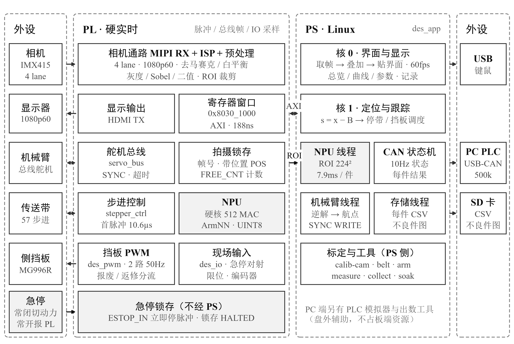
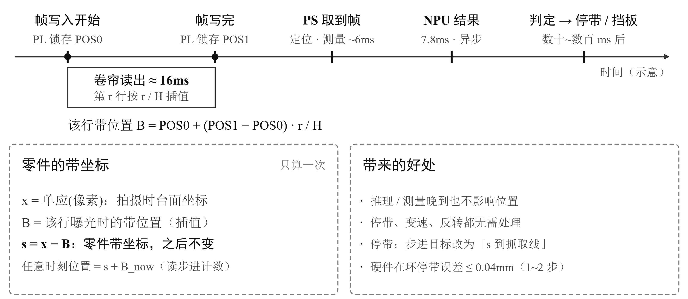
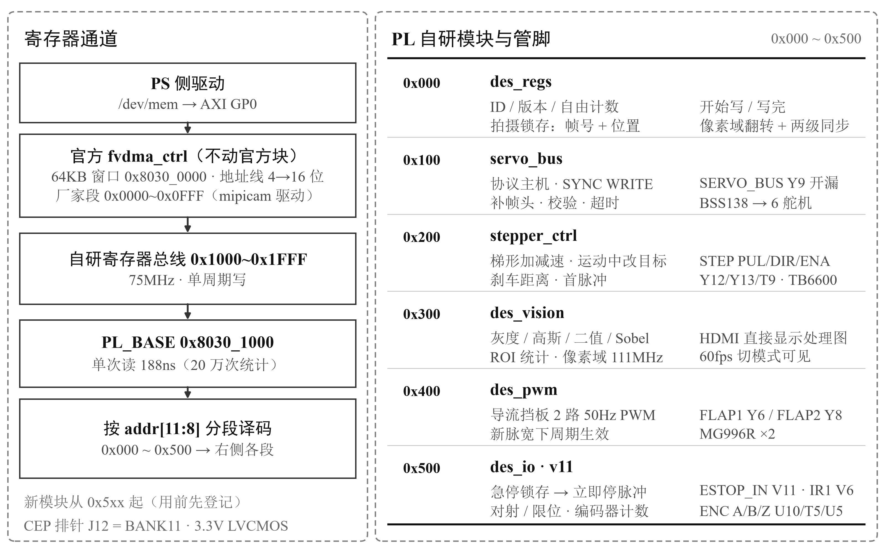
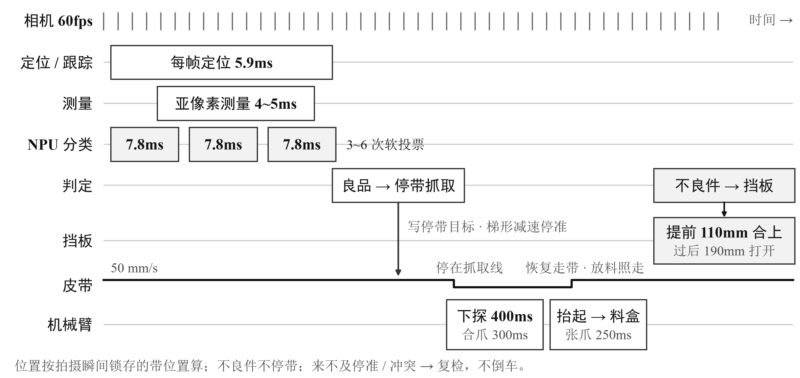
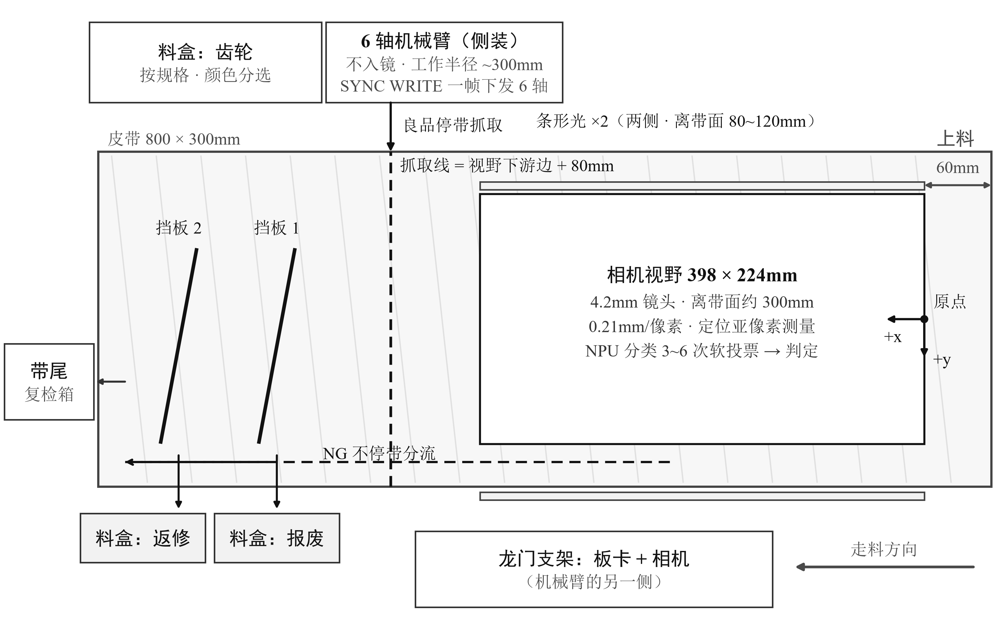

# 龙瞳分拣（DragonEyeSorter）—— 基于安路飞龙 SoC 的塑胶传动件在线质检分拣系统

## 1 作品概述

本作品在安路飞龙 F3P SoC 上用一个控制器完成塑胶齿轮「看 — 判 — 量 — 跟 — 分」全链路，赛题六项硬性要求均有对应实现。

### 1.1 应用场景

检测对象是注塑后多规格、多颜色的 POM 齿轮，需判缺料（齿不满）、飞边（毛刺填齿槽）、黑点（料中杂质）、尺寸超差与规格混料；人工目检慢且一致性差，只判不分拣的视觉检测站仍要人工搬运。

全链路由同一条传送带串起：PL 预处理并锁存拍摄瞬间的带位置，PS 定位与亚像素测量，NPU 分类缺陷，跟踪表按带坐标 s 追踪每一件。处置三类：良品到抓取线停带，6 轴总线舵机机械臂按姿态夹起、按规格 / 颜色入盒（够不着时夹爪倾斜下探）；不良品不停带，由抓取线下游的两个侧边导流挡板拦进报废 / 返修盒；存疑件走到带尾复检箱。PC 经 CAN 扮产线 PLC，下发启停、调速、对时并接收每件结果；HDMI 界面实时显示画面、曲线与参数。

### 1.2 赛题对应

六项硬性要求的落点不同：PL 承担工业级硬实时功能，PS 承担 Linux 应用与界面，NPU 承担轻量化模型推理。

| 硬性要求 | 本作品对应实现 |
|---|---|
| ① PL 工业级高实时硬件功能 | 德晟总线舵机协议主机（硬件补帧头 / 校验、SYNC WRITE 多轴同步、应答解析与超时）；步进梯形加减速与精确定位；帧起始锁存带位置 |
| ② PS Linux + 人机界面 + 本地存储 | 嵌入式 Linux；HDMI 1080p60 操作界面（总览 / 曲线 / 参数 / 记录 / 机械臂，共五页）；每件记录 + 不良品图像存 SD 卡 |
| ③ PL-PS AXI 双向 | AXI-Lite 寄存器窗口：控制命令下行；帧号、带位置、舵机应答、PL 视觉统计上行；帧 DMA |
| ④ NPU 轻量化模型 | YOLOv8n-cls（ReLU 改造）UINT8 量化，每件 ROI 缺陷分类，单次 7.8ms |
| ⑤ CAN 外设通信 | CAN 2.0A 500kbit/s 自定义产线协议，PC 端 PLC 模拟器；PS CAN0 经块设计引到板载收发器（官方比特流未引出）；同一套命令 / 状态另经网口 Modbus-TCP 对接 PLC（已实物启停；RS485 Modbus-RTU 为 P1，本期未实现） |
| ⑥ 测试报告 | 第 8 章：控制同步精度、采集延迟、AI 推理耗时、总线稳定性 + 连续运行 |

应用领域以流水线视觉检测（领域 3）为主，融合多轴运动与机电控制（领域 1：机械手 + 传送机构）。

### 1.3 主要指标

主要指标如下，未实测项保留「待测」；逐项测试条件与出处见第 8 章。

| 指标 | 数值 | 条件 | 出处 |
|---|---|---|---|
| 采集 / 显示 | 60.02fps、20s 0 丢帧；显示每帧 13.0~13.9ms | IMX415 1080p；`des_app run` | 第 3.3 / 4.1 节 |
| NPU 单次推理 | 7.8ms（p95 7.84ms） | 224×224，UINT8，100 次 | 第 5.2 节 |
| 分类准确率 | 待测（实物验证集） | 合成数据（齿轮 4 类）上 NPU 95.4% | 第 5.2 节 |
| 尺寸测量重复性 | 外径 σ 0.004mm（20 次） | 实物 30 齿，画面中心静止；合成图误差 ≤0.008mm | 第 4.3 节 |
| 舵机 6 轴 SYNC WRITE 帧 | 3298.9µs（理论 3298.6µs） | PL 硬件时间戳，未接舵机 | 第 3.1 节 |
| 停带定位误差 | ≤0.04mm（1~2 步） | 硬件在环，50~150mm/s | 第 4.4 节 |
| CAN 命令往返 | 平均 359µs（min 341 / max 825），1000/1000 | 板上 can0 回环，v12 回归 | 第 6 章 |
| 带速控制 | 启动 / 改速 / 暂停联锁全过，写入→板上执行确认 14~24ms | Modbus-TCP 实物启停（皮带真走），v12 | 第 6 章 |
| 外径 / 孔径对卡尺 | 3 个 30 齿齿轮，加标准件偏置（外径 +0.53 / 孔 +0.18）后外径差 −0.021~+0.003、孔差 −0.03~+0.05，单件重复 σ ≤0.009；翻面外径 +0.12 | 实物静止、画面中心 | 第 4.3 节 |
| 连续运行 | 软件 2h（60.02fps，跳帧 0.003%）；接实物复跑待测 | `soak.sh` | 第 8 章 |

---

## 2 系统架构

系统按「PL 硬实时 — PS 调度 — NPU 推理」三级划分：外设与图像链路接 PL，Linux 应用跑 PS，缺陷分类交 NPU，三者只通过 AXI-Lite 寄存器与帧 DMA 交换数据。

### 2.1 硬件组成

整套系统只用一块开发板和四个外设：相机、传送带、机械臂、导流挡板，外加一台 PC 扮产线 PLC。

| 部件 | 型号 / 说明 |
|---|---|
| 主控 | MLK-F3P-DR1M90G 开发板（DR1M90GEG400：双核 Cortex-A35 + FPGA + NPU 软核） |
| 视觉 | VID005 子卡 + IMX415（MIPI CSI-2，4.2mm 镜头），两侧条形光（手动开关 / 调光，不接 PL） |
| 传送带 | 800×300mm 皮带机，57 步进电机 + TB6600 类驱动器（16 细分，3200 步 / 圈，共阴直驱） |
| 机械臂 | 6 轴：德晟 15kg 总线舵机 ×5 + 6kg 夹爪舵机，115200 半双工单线总线，经 BSS138 由 PL 直驱 |
| 导流挡板 | MG996R ×2（皮带侧边摆杆：报废 / 返修） |
| 通信 | 板载 CAN 收发器 ↔ PC USB-CAN（智嵌 ZQWL-UCAN-101E）；网口 Modbus-TCP |
| 带速测量 | 计米轮编码器 E6B2-CWZ6C 1000 线，独立于步进实测皮带；输出带 5V 上拉，经 BSS138 接 3.3V IO |
| 电源 | 24V 主电源 + 可调降压（舵机 6.8V）；急停常闭切动力、常开报 PL |

### 2.2 软硬件分工

分工由数据路径决定：时序关键、逐像素、逐比特的工作在 PL，需要灵活性与算法迭代的在 PS，矩阵运算在 NPU（见图 2-1）。

*图 2-1 系统架构：外设 → PL → PS 的数据通路与三级分工*

### 2.3 数据流与时间基准

全系统只有一个时间 / 位置基准：PL 的 75MHz 自由计数器 `FREE_CNT` 与步进位置 `POS`（见图 2-2）。位置按拍摄瞬间的带位置换算，采集与推理延迟都不构成位置误差。

*图 2-2 时间基准：拍摄瞬间锁存带位置，零件坐标与处理延迟无关*

换算：帧写模块开始写帧时锁存 `FREE_CNT`、帧号和带位置 `POS`，写完再锁一次（`CAP_*`）；PS 取帧后按零件所在图像行定曝光时刻（卷帘快门逐行读出），在两次锁存值之间线性插值出拍摄时的带位置 B；零件带坐标 `s = x − B`（x 为台面坐标），零件不在带上滑动，停带、变速、反转都无需特殊处理；台面位置 = s + 当前 B，调度器据此算何时停带、挡板何时合上。

### 2.4 PL-PS 寄存器通道

PL 与 PS 只走一条寄存器总线：在 GP0 官方相机 DMA 控制器 `fvdma_ctrl` 的 64KB 地址窗口上加宽地址译码，把偏移 `0x1000~0x1FFF` 引出到 PL 顶层，形成 75MHz、单周期写脉冲、读数据多路选择的寄存器总线，PL 基址 `0x8030_1000`；官方驱动的 `0x0000~0x0FFF` 不受影响。各模块按 `addr[11:8]` 分段：

| 段 | 模块 | 主要内容 |
|---|---|---|
| 0x000 | des_regs | ID / 版本、`FREE_CNT`、帧号 / 帧周期、拍摄锁存（带位置、时间戳） |
| 0x100 | servo_bus | 舵机帧收发缓冲、状态、时间戳、错误计数 |
| 0x200 | stepper_ctrl | 模式、目标、速度 / 加速度（Q0.32）、位置、刹车距离 |
| 0x300 | des_vision | 处理模式、阈值、ROI；面积、外接框、质心、边缘数 |
| 0x400 | des_pwm | 导流挡板舵机脉宽（2 路 50Hz，下周期生效） |
| 0x500 | des_io | 急停锁存、对射 / 限位输入捕获、编码器计数 |

PS 经 `/dev/mem` 映射直接读写，单次读 PL 寄存器 **188ns**（20 万次统计）。

---

## 3 PL 设计

PL 承担全部硬实时工作：舵机总线主机、步进脉冲、拍摄锁存、视觉预处理、导流挡板 PWM 与现场输入，各模块按 `addr[11:8]` 分段挂在同一条寄存器总线上（见图 3-1）。

*图 3-1 PL 自研模块、寄存器窗口与管脚：分段译码按 `addr[11:8]`，管脚取自 `src/constraint/io.adc`*

### 3.1 舵机总线主机 servo_bus

机械臂 6 个舵机挂同一根 115200 波特半双工线（德晟协议 v4.01）。多轴同步靠一帧 SYNC WRITE：一帧广播同时下发 6 轴目标位置与运动时间，6 轴在帧结束时同时起跑，同步误差不随轴数累积。

硬件实现要点：

- 开漏发送：只主动拉低，高电平由 BSS138 电平转换模块上拉（舵机侧空闲 3.7V，不能直连 3.3V IO）。
- 硬件补帧头和校验：PS 只写帧主体 `[ID, LEN, 指令, 参数…]`，PL 自动加 `FF FF` 帧头、算校验 `~(ID+LEN+指令+参数) & 0xFF` 并发送。
- 应答解析：识别 `FF F5` 应答头，校验、长度检查，提取舵机状态字节（过载 / 过温 / 电压）；发送期间关闭接收，每帧后强制留 1 字节时间的总线换向间隔。
- 超时与计数：应答超时（默认 3ms）可配；超时 / 接收错误 / 已发帧数三个计数器。
- 硬件时间戳：首个起始位、最后停止位、应答收完三个时刻锁存 `FREE_CNT`，帧时长与延迟由此得出。

仿真以协议文档原例为标准答案（PING、READ、SYNC WRITE、无应答超时、错误校验），19 项全过；上板实测 6 轴 SYNC WRITE 一帧 **3298.9µs**（理论 3298.6µs）、PING **520.9µs**（理论 520.8µs）。

协议文档 SYNC WRITE 示例的校验值印作 `0x8B` 有误，按文档自身公式应为 `0xBA`；硬件按公式实现，实测正确。

### 3.2 步进控制 stepper_ctrl

步进控制用相位累加器产生脉冲：速度以 Q0.32 定点数表示，位置模式梯形加减速精确停在目标步数，传送带「停在某一步」就是运动中改写目标。

- 速度表示：每时钟步数用 Q0.32（`inc = v × 2³² / 75MHz`），相位累加器溢出即发一步，分辨率 0.017 步/s、无累积误差。
- 两种模式：速度模式（传送带连续走，改速自动平滑过渡）；位置模式（梯形加减速，精确停在目标步数）。升降速节拍 10kHz。
- 运动中改目标：「停在某一步」即运动中改写 `TARGET`，减速点硬件实时重算；目标已落在运动方向身后时，减速停在目标之后并清「到位」标志，不卡死。
- 刹车距离：`BRAKE` 寄存器实时给出减速到停所需步数，PS 据此判断能否停在抓取线；来不及转复检，不倒车。
- 安全：急停输入或 HALT 命令立即停止脉冲并锁存，需软件复位。
- 时序：脉冲宽 5µs、换向后等 10µs 再发脉冲，满足 TB6600 要求；共阴 / 共阳极性由顶层参数切换。

仿真用独立脉冲监视器核对正反向到位、换向、脉宽、最高速、减速停、急停、运动中改目标、目标在身后等；上板实测 `move 3200` 后 `POS` 与累计步数都精确为 **3200**。

### 3.3 拍摄锁存（des_regs）

拍摄锁存让零件位置只取决于被拍到的瞬间，与 PS 取帧和推理延迟无关。

官方帧写模块在开始写帧时、帧写完成中断时各翻转一次信号，两路经两级同步进 75MHz 域：开始时把帧号、`FREE_CNT`、`POS` 锁进暂存，完成时整组更新 `CAP_*` 寄存器。PS 取帧返回后有整整一帧时间读取，不与下一帧冲突。

实测锁存带位置差与「带速 × 读出时间」一致，帧号差全为 1（无跳帧）。

### 3.4 PL 视觉预处理 des_vision

PL 在 ISP 输出与帧写 DMA 之间做逐像素预处理，处理 128 位 AXI-Stream（每拍 4 个 BGRA 像素），不反压、不改变帧时序。

| 模式 | 输出 |
|---|---|
| 0 | 原图（1 拍直通） |
| 1 | 灰度 Y = (77R + 150G + 29B) >> 8（BT.601） |
| 2 | 3×3 高斯 [1 2 1; 2 4 2; 1 2 1] / 16 |
| 3 | 二值（高斯 ≥ 阈值） |
| 4 | Sobel \|Gx\| + \|Gy\| |
| 5 | 边缘（Sobel ≥ 边缘阈值） |

- 3×3 窗口由两行行缓冲（ERAM）+ 列寄存器构成，每拍并行处理 4 个像素；窗口运算拆成 3 级流水（列和 → 高斯 / 梯度 → 绝对值），共 6 拍延迟，以适应 MIPI 字节时钟 111.1MHz（时序约束 125MHz）。
- ROI 统计：PS 写入 ROI（跟随离光轴最近的零件），PL 对二值图统计面积、外接框、质心坐标和、边缘像素数，每帧发布一次；PS 换算成毫米即 PL 尺寸粗测，与 PS 亚像素测量并列记录。
- 无撕裂切换：设置写入后由 APPLY 生效于下一帧起始，输出源在帧起始那一拍按新模式切换，保证每个帧起始脉冲恰好到达帧写模块一次。
- 显示与仿真：HDMI 显示的就是 PL 处理后的图像，60fps 下切模式直接看到硬件灰度 / 滤波 / 边缘结果；仿真 32×12 帧、6 种模式逐像素对行为模型、统计量、ROI、帧中途写设置、帧起始计数，**790 项全过**。
- 资源后备：`LANES=2` 时每拍处理 2 个像素、滤波逻辑约减半（同样 790 项通过）。

### 3.5 导流挡板 PWM des_pwm

两路 50Hz 舵机 PWM 驱动两个侧边导流挡板，新脉宽在下一周期起始生效，不产生毛刺脉冲。

PS 调度器按带位置在零件到达拦截点前约 110mm 合上、滑出后约 190mm 打开（见第 4.4 节）。仿真 11 项通过；PWM 已上板验证读回与 50Hz。光源由人工手动开关 / 调光，不接 PL。

⚠ 挡板舵机尚未接上（`des_app.json` 的 `flaps.enabled=false`）：这两个距离是默认配置值，装上舵机后按实测微调。

### 3.6 现场输入 des_io

现场输入的共同要求是「先锁存再处理」：急停按下立即停步进并锁存，对射边沿锁存位置，编码器计数供跟踪误差与打滑判断。

急停按下保持 1ms 才算（去抖），随即**锁存**并直接停住步进；PS 在任何状态都能读到锁存位，复位报警时清除（按钮仍按着时清除无效）。

对射光电 / 限位去抖 20µs，对射每次挡光边沿锁存自由计数器、带位置与编码器计数，这是「跟踪误差」（预测前沿 vs 实测前沿）的实测依据；计米轮编码器四倍频计数（两级同步 + 约 107ns 滤波、Z 相锁存、A/B 同跳计错误、10ms 窗口测速）。

仿真 28 项通过；已上板：PL 级急停常开按下时步进命令被忽略、松开后恢复（[log/2026-10-17](log/2026-10-17-相机安装与标定试跑.md)）；`des_io` 锁存 + 界面「急停」显示 /「复位报警」流程未实测 ⚠；编码器实物两次 Z 脉冲之间正好 4000 计数（1000 线 ×4）、错误 0；对射实物待测 ⚠。

### 3.7 资源

资源是硬约束：官方 NPU 基线占 LUT 79%、ERAM 92.5%（NPU 软核单独占 2.24 万 LUT、156 块 ERAM）；自研模块全部加入后 slice **82.41%**（全量重编）、ERAM 261/280，只够放逐像素、低延迟的处理。大块图像算法（连通域、形态学）放 PS。待补：LUT / FF / ERAM / DSP 表与时序余量。

---

## 4 PS 软件

PS 跑嵌入式 Linux，产品运行时是 `des_app`（只有 `run` / `live` 两个模式）：核 0 负责取帧与显示，核 1 负责定位、测量、跟踪与调度，NPU、机械臂、存储各由独立线程承担。

### 4.1 进程与线程

线程按实时性分工：取帧 + 显示独占核 0 并跑实时优先级，其余在核 1 或独立线程，工作线程既不等 NPU 也不等 SD 卡。

标定、测量、采集、机械臂调试等运维模式在 `des_tool`，自动测试与底层调试件另列（划分见 `ps/README.md`「四类产物」）。

| 线程 | 核 | 职责 |
|---|---|---|
| 取帧 + 显示 | 0（实时优先级） | 等 DMA 帧完成、立即重新提交缓冲（平均 0.3µs）；BGRA→BGR 写显示缓冲、叠加跟踪框 / 判定线 / 状态、贴操作界面、翻页 |
| 工作 | 1 | 定位 → 测量 → 跟踪表 → 调度 → 存储 → 界面状态 |
| NPU | 1 | 零件分类（异步队列，工作线程不等 NPU） |
| 机械臂 | — | 执行抓取航点，完成后回报 |
| 存储 | — | 后台写 CSV / 图片，工作线程不等 SD 卡 |

实测：显示 60fps、每帧 13.0~13.9ms（`run`，现版布局）；工作线程处理 **99.9%** 的帧（2h 统计）；定位平均 **5.9ms** / 帧（2h 统计）。

### 4.2 零件定位

零件定位走「1/4 降采样灰度 → Otsu 阈值 → 开运算 → 外轮廓 → 最小外接矩形」的经典链路，经单应矩阵换算到台面毫米坐标 (x, y, θ, 长, 宽)。

触碰图像边缘的零件只记存在、不用几何；面积超限判粘连件。Otsu 阈值带最小阈值保护。

- 标定链：`calib-cam`（棋盘格平放皮带拍一次得皮带平面单应；台面坐标系 x 沿带前进方向、右手系、原点在视野上游边缘中点；合成图 5 姿态残差 rms 0.003~0.04mm）；`calib-belt`（白纸随带走过已知步数，得 mm / 步与方向、往返误差）；`calib-enc`（空带往返、每 10ms 采样，得 mm / 计数、轮周长、往返误差与速度波动；实测 0.04923mm / 计数、3 轮重复 0.02%、无非法跳变）。
- 实测（相机定版后）：残差 rms 0.240mm、0.1945mm / 像素、视野 373×214mm，总倾斜 0.7°；皮带 0.020921mm / 步（有效辊径 21.3mm）、横向漂移 0.29mm / 100mm、234mm 往返误差 0.08mm。

位置视差校正：零件顶面高出皮带 h，按皮带平面标定读出的位置会从相机正下方点向外放大 k 倍。把「绕正下方点按 1/k 缩放」并进单应矩阵得到 `px_to_part`（仍是单应），定位、跟踪、叠加与裁切都用它。

k 由实测定：三个 10mm 厚齿轮随皮带走 7 站，质心位移是皮带位移的 1.020 倍，属侧壁可见模型 k = (2H − h) / (2(H − h))（只看顶面需 H≈510mm，不可能）；H 取外径随位置最一致的 295mm（与尺量一致），离正下方 150mm 处约 3mm 偏差由此消除，残差约 0.25%。

### 4.3 亚像素几何测量

每件只在离光轴最近的那一帧测一次（视差最小），单核 **4~5ms**，测量结果既是尺寸判据，也是 NPU 之外的第二意见。

1. ROI 二值化找外轮廓与内孔。
2. 沿每个轮廓点的法线搜索灰度穿过 50% 电平（皮带与零件灰度中点）的亚像素位置。
3. 单应映射到毫米，做视差校正（零件顶面高于皮带平面）与卷帘快门逐行补偿（运动中每行曝光时刻不同）。
4. 齿轮：拟合齿顶圆（只用法线接近径向的点）、孔径、偏心；由齿距中位数推算规格齿数（30 齿缺 2 齿与 28 齿可区分）；判缺料齿、缺齿与三种形态的飞边（槽底填高、两齿连成一片、槽中凸起）。
5. 颜色：裁切图亮区的平均色调 / 饱和度按配置归类（白 / 黄 / 橙 / 蓝 / 红），用于按颜色分拣和颜色混料。

测量结果也是缺陷类别独立于 NPU 的第二意见：NPU 判 OK 但测到缺齿时转复检。

合成图（0.15mm/像素）精度：外径 ≤0.003mm、根径 0.004mm、孔径 0.008mm、齿距 ≤0.001mm。

实物（30 齿，曝光 800µs）：画面中心静止测 20 次外径 σ **0.006mm**。窄齿尖模糊后 50% 边缘落在真实齿尖以内，外径读小 0.53mm；亮顶面向孔内扩，孔径读小约 0.18mm → 用卡尺量过的齿轮定只加在报告值上的偏置，换曝光 / 灯光 / 相机后重做。三个齿轮交叉验证：外径差 −0.021~+0.003mm、孔差 −0.03~+0.05mm；同一齿轮翻面外径大 0.12mm（注塑件两面轮廓不同），故外径判废公差取 ±0.2mm 以上。

曝光 800µs：白零件顶面不过曝，50mm/s 拖影 0.04mm。离中心越远侧壁越多进入轮廓（75mm 外径 +0.6mm、150mm +5mm）→ 尺寸只取每件离中心最近的一帧；横向偏离中线 42mm 时外径即偏小 0.2~0.55mm，故在相机上游设 V 形导向条，使零件在中线 ±10mm 内通过。

### 4.4 跟踪与调度

跟踪表以带坐标 s 为核心：零件在带上的位置只随 s 变化，停带、变速、反转都不需要特殊处理；调度只做两件事——良品停带抓取、不良品挡板分流（见图 4-1）。

*图 4-1 良品停带抓取与不良品挡板分流时序：示意，时长取默认配置*

跟踪表：每件一个 ID，以带坐标 s 关联多帧观测（门限 12mm），状态 新建 → 跟踪 → 已判定 → 抓取中 → 完成。零件过判定线前融合多帧分类与测量结果定处置：良品按规格 / 颜色选料盒，不良品按类别选报废或返修，其余复检。

停带抓取：下一个要抓的良品接近抓取线时，调度器先查 `BRAKE` 刹车距离，再查夹爪两指占位区与邻件是否冲突（θ 与 θ+90° 都试），通过才把步进目标改写为「该件恰好停在抓取线」。

机械臂下探、夹取，抬起后立即恢复走带；来不及停或有冲突的件转复检，绝不倒车追件。

挡板分流：不良件不停带。抓取线下游、皮带一侧装两个舵机摆杆，合上时斜拦零件摆放带，皮带推着零件滑进侧边料盒（1 报废、2 返修）；不拦的件走到带尾进复检箱（失效安全：漏检、跟丢、挡板故障都只进复检）。

调度器按带位置在拦截点前合上、滑出后打开；合上期间会碰到其他零件时不拦、改走复检。

⚠ 挡板舵机尚未接上，拦截点与超前 / 滞后量取默认配置（图 4-1 亦为示意），实物分流待测。

硬件在环测试：模拟零件骑在真实 PL 步进计数上运动，经模拟相机 → 跟踪表 → 调度 → PL 步进，50 / 100 / 150mm/s 下 8 件良品全部停准抓取、4 件不良到带尾，停带定位误差 **≤0.04mm**，节拍 22.7 / 39.3 / 48.9 件/min。

### 4.5 机械臂

机械臂是 5 自由度定位（底座、大臂、小臂、腕俯仰、腕旋）+ 夹爪：逆运动学解台面目标点，腕旋按零件姿态 θ 对准，6 轴用一帧 SYNC WRITE 同时下发。

齿轮圆对称，夹取方向取与底座方向相切；竖直够不着时夹爪朝外倾斜下探，最多 40°，两指沿切向保持水平。关节角经各舵机零位与比例换算成位置码。

夹爪实测：#4 轴到指尖 106mm，指尖中心偏离腕旋（#5）轴 9mm——不补偿时抓取点随 #5 转角画半径 9mm 的圆。运动学把偏置作为工具坐标系固定向量，按 #5 转角解出让抓取点落在目标上的底座角（定点迭代）；倾斜下探时自动选让 #6 舵机位于外侧的 #5 转向，避免舵机碰带面。

调试工具 `des_tool arm` 支持扫描舵机、读位置、手掰示教、回零、走点、整套取放；运动命令默认只打印，加 `--go` 才执行。实物标定与重复定位精度待测。

### 4.6 操作界面

赛题要求 HDMI 曲线 / 参数配置界面，板上 Qt 只有独立镜像。为不影响 60fps 视频链路，界面用 OpenCV 自绘、FreeType 渲染中文，五页覆盖运行、曲线、参数、记录与机械臂调试。

画面布局 1440×780 + 右侧 480×780 状态栏 + 底部 1920×300 操作条；USB 鼠标 / 键盘热插拔。

| 页 | 内容 |
|---|---|
| 总览 | 运行状态、计数与良率、节拍、带速、NPU 耗时、最近零件 |
| 曲线 | 齿轮外径、孔径趋势 + 规格线 + Cpk；处理耗时、带速（命令值与编码器实测两条线） |
| 参数 | 配方（换型）、启停、正 / 反点动、带速、外径与孔径公差、置信度门限、存图策略、PL 显示模式 / 阈值；即时生效并保存 |
| 记录 | 最近零件的裁切图、类别、测量值、去向 |
| 机械臂 | 6 个舵机手动调试：位置 / 角度 / 电流 / 温度，按步长与动作时间微调，软限位内 SYNC WRITE；解锁、扭矩开关、记录 / 设为初始姿态与复位 |

另有脚本输入通道（命名管道），可远程点击 / 截图，用于自动化测试与界面截图。

### 4.7 本地存储

每件判定后写一行 43 列 CSV，不良与复检件另存 ROI 裁切图，按日期分目录；PC 端 `part_stats.py` 直接从中生成测试报告统计表。

CSV 列含时间、件号、帧号、类别 / 置信度、处置 / 去向 / 原因、全部测量值、带坐标与姿态、PL 粗测、NPU 投票次数 / 推理耗时 / 延迟、图片名、配方号。

板上无实时时钟，记录时间 = 本机时钟 + PLC 经 CAN 下发的时间偏移（不改系统时间）。

---

## 5 视觉与 AI

缺陷只有 1mm 量级，本作品走「PS 定位 + 按零件 ROI 分类」的路线，分辨率与计算量都优于整帧检测。

### 5.1 为什么分类每件 ROI 而不是整帧检测

4.2mm 镜头、相机高约 300mm 时整帧约 0.21mm / 像素，缩到 416 输入后约 0.95mm / 像素，1mm 的黑点或缺料只剩约 1 个像素。PS 已给出每件位置与方向，于是按零件方向转正、裁 56×56mm → 224×224（约 0.25mm / 像素），同样的缺陷约 4 个像素；分类网络计算量约为整帧检测的 1/7。

### 5.2 模型与部署

模型是面向板上 NPU 改造过的 YOLOv8n-cls：输入 224×224、UINT8 量化，单次推理 **7.8ms**。

- 模型：YOLOv8n-cls，输入 224×224，ImageNet 预训练迁移；温和增强（翻转、亮度），不做会抹掉缺陷的随机擦除。目标类别为齿轮 4 类——良品 / 缺料 / 飞边 / 黑点；良品覆盖全部规格与颜色，规格靠测量、颜色靠色调。
- 类别表现状：`models/label_list.json` 与板上模型均为齿轮 4 类；合成验证集板上 NPU 95.4%、OK/NG 96.0%（PC fp32 97.5% / uint8 95.6%），实物数据到位后同名替换模型即可。
- 激活函数改 ReLU：板上 NPU 对 SiLU 是近似计算；改 ReLU 后推理时间相同，精度见上一行。
- 量化：ONNX → 去 Softmax（PS 做）→ ONNX Runtime 静态量化，QDQ / UINT8 / per-tensor（与官方示例同格式）→ 形状推断；per-channel 在 PC 更准但板上推理中止，故用 per-tensor。
- 部署：ArmNN + 厂家 Alnpu 后端；输入在 PS 端预量化为 UINT8（查表），单次推理 7.8ms，输入准备 1.45ms，模型加载 0.11s。
- 软投票：每件经过视野时分类 3~6 次，概率累加后取最大类；置信度不足进复检。
- 训练与推理用同一裁切函数（`roi_crop`）、同一归一化，是精度不掉的前提。

已知问题：量化后的 ONNX 若缺中间张量形状，ArmNN 解析器直接段错误且无日志，导出脚本强制做形状推断。

### 5.3 数据

数据自行采集与合成，训练在 RTX 4060 上完成（WSL + CUDA）。

- 采集：`des_tool collect --cls <类别>` 一次只放一类零件，按零件分目录自动存裁切图；验证集用另外编号的零件单独采集，按零件（非按图片）划分，避免同一零件同时出现在训练和验证集。
- 缺陷样件：冷加工制作缺料 / 飞边 / 黑点样件，件数待补。
- 训练：合成 2400 张、12 轮、40 秒。
- 待补：实物数据规模、训练曲线、混淆矩阵、板上 NPU 准确率。

### 5.4 PL 与 PS 的视觉分工

分工按运算性质切：固定逐像素运算归 PL，复杂算法归 PS，卷积归 NPU。

| 环节 | PL | PS | NPU |
|---|---|---|---|
| 做什么 | 逐像素灰度 / 滤波 / 边缘 / 二值、ROI 面积与外接框（粗测） | 定位、亚像素测量、视差与卷帘补偿、跟踪 | 缺陷分类 |
| 为什么 | 固定运算、零延迟、不占 CPU | 算法复杂、需迭代 | 卷积网络 |

---

## 6 工业总线：CAN 产线协议

板载 CAN 收发器只支持经典 CAN，本作品用 CAN 2.0A（11 位 ID）500kbit/s 自定义产线协议与 PC「产线 PLC」通信，同一套命令 / 状态另经网口 Modbus-TCP 从站对接工厂 PLC。

协议定义在 `ps/src/hw/can_proto.h`，多字节小端：

| 方向 | ID | 内容 |
|---|---|---|
| PLC → 本机 | 0x100 CMD | 启动 / 停止 / 联锁暂停 / 恢复 / 复位报警 + 序号 |
| | 0x101 SPEED | 带速（0.1mm/s） |
| | 0x102 RECIPE | 配方号（换型：切换规格齿数 / 外径 / 孔径；运行中拒绝） |
| | 0x103 PLC_HB | PLC 心跳（≥2Hz；1s 收不到清除「PLC 在线」） |
| | 0x104 TIME | 对时（unix 秒 + 毫秒） |
| 本机 → PLC | 0x180 ACK | 命令 ID、序号、结果（成功 / 状态不允许 / 数值不对 / 未知） |
| | 0x181 STATUS | 状态、标志、带速、报警码、心跳、运行时间，10Hz |
| | 0x182 COUNTS | 总数 / 良品 / NG / 复检，1Hz |
| | 0x183 PART | 每件：件号、类别、去向、料盒 / 出口、置信度、主尺寸（0.01mm） |
| | 0x184 ALARM | 报警码、级别、细节 |

本机状态机：空闲 / 运行 / 暂停 / 急停 / 故障；PLC 命令与界面按钮同一套规则（未启动时「恢复」被拒、运行中不能换配方）。

配方（换型）：`recipes.json` 定义各产品规格（齿数、外径、孔径、偏心及公差：20 / 28 / 30 / 36 齿等），PLC 发 RECIPE 或界面选择，停机 / 暂停时生效，每件记录带配方号。例如切到「28 齿」配方后，同一批零件里 28 齿件由报废变为良品、30 齿件变为规格混料。

PC 端 PLC 模拟器（Python / tkinter）提供按钮、计数、逐件结果、报警与统计（收发帧数、命令往返）。

板上回环实测：命令往返平均 **359µs**（min 341 / max 825µs）、1000/1000；200~2000 帧/s 零丢失、零错序。

板载 CAN / RS485 收发器接在 PL 管脚（CAN F20 / F19），官方 demo 块设计没开 PS CAN0（接收脚接 0、发送脚悬空、无管脚约束），官方比特流下 CAN 实物不通。现版比特流把 PS CAN0 硬核收发信号经块设计引到顶层并约束到 F20 / F19（接收脚上拉）；单节点实测发帧后发送错误计数停在 128、进入被动错误而不离线（无应答的标准表现，发送与接收回路已通）。

PC 端 USB-CAN（ZQWL-UCAN-101E）是 USB 虚拟串口，按厂家二次开发协议直接收发，不依赖厂家 DLL；适配器已实测，双节点收发与长时间误码待 J11 插头到货后测 ⚠。

网口对接 PLC（Modbus-TCP 从站）：工厂 PLC（西门子 MB_CLIENT、三菱 / 欧姆龙）和组态软件普遍走以太网，同一套命令与状态开放在 PS 网口 502 端口。

保持寄存器 HR0 命令 / HR1 带速 / HR2 配方 / HR5~6 对时可写，HR3 结果 / HR4 执行序号只读；输入寄存器给状态、标志、四项计数（32 位）、最近一件的件号 / 类别 / 去向 / 尺寸 / 置信度、实际带速、心跳。

写入在服务线程里只排队，由控制循环按与 CAN、界面按钮相同的规则执行，三路命令源不打架；PLC 写入后等「执行序号」变化再读结果码。服务端自写（poll 单线程，MBAP 分帧、半帧 / 粘包、异常码 01 / 02 / 03），无第三方库。

实测：电脑经网线读全部 24 个输入寄存器平均往返 **1.04ms**，单元测试 29 项通过；实物启停（皮带真走）：启动 → 改带速 50 → 30 → 80mm/s → 联锁暂停 → 恢复 → 停止全部正确，4 种非法写被拒，写入到执行确认 14~24ms。

---

## 7 机械、电气与安全

机械与电气围绕三件事：把零件送到抓取线、让挡板在正确时机拦下不良品、任何异常都能安全停下（布局见图 7-1）。

*图 7-1 工位布局：俯视、按比例，零件从右往左走*

- 工位布局：上料 → 相机视野 → 抓取线（视野下游 80mm）→ 两个侧边导流挡板（报废 / 返修）→ 带尾复检箱；机械臂侧装不入镜。
- 供电树：24V 主电源 → 步进驱动器；可调降压 6.8V → 舵机总线（夹爪舵机上限 6.0V，厂家扩展板实测整链 6.87V）；5V 逻辑。
- 急停：常闭触点串在动力电源上，同时切断步进与全部舵机；常开触点报 PL 锁存，软件状态机进入急停、CAN 报警，需人工复位。
- 电平：舵机总线空闲 3.7V，经 BSS138 双向电平转换接 3.3V IO；编码器输出实测被拉到其 5V 电源（不是纯开集电极），同样经 BSS138 接入，编码器只接 5V、不接 24V。
- 待补：照片、接线图。

---

## 8 测试报告

赛题要求的四类指标都已有板上数据：帧率 60.02fps、NPU 单次推理 7.8ms、停带定位 ≤0.04mm、CAN 往返 359µs；分类准确率（实物）、换件对卡尺交叉验证、多舵机同步与实物连续运行待实测。未实测项标「待测 ⚠」，下表按「指标—数值—条件—出处」汇总。

| 指标 | 数值 | 条件 | 出处 |
|---|---|---|---|
| 控制同步 · 6 轴 SYNC WRITE / PING 帧时长 | 3298.9µs（理论 3298.6µs）；PING 520.9µs（理论 520.8µs） | PL 硬件时间戳，115200 8N1，未接舵机 | 第 3.1 节 |
| 控制同步 · 命令 → 总线第一位 | 空闲总线 1.1µs；连续发帧平均 25.5µs、最大 85.4µs | `desreg cmdlat`，含写发送缓冲 | 第 3.1 节 |
| 控制同步 · 步进命令 → 第一个脉冲 | 10.6µs（100 次 min 10.61 / max 10.77µs） | 共阴直驱 TB6600 + 57 步进 | 第 3.2 节 |
| 控制同步 · 停带定位误差 | ≤0.04mm（1~2 步） | 硬件在环，50 / 100 / 150mm/s，8 件良品 | 第 4.4 节 |
| 控制同步 · 多舵机动作起点差 / 机械臂重复定位 / 跟踪误差 | 待测 ⚠ | 逻辑分析仪；30 次重复定位；对射前沿 vs 预测前沿 | 第 4.4 / 4.5 节 |
| 采集延迟 · 采集帧率 | 60.02fps，20s 0 丢帧 | IMX415 1080p，PL 帧计数 | 第 3.3 节 |
| 采集延迟 · 取帧重新提交 | 平均 0.3µs | 取帧线程（实时优先级） | 第 4.1 节 |
| 采集延迟 · HDMI 显示 | 60fps，每帧 13.0~13.9ms | `run` 现版布局，含定位 / 跟踪 / 测量 / 界面 | 第 4.1 节 |
| 采集延迟 · 端到端（拍摄 → NPU 结果可用） | 待测 ⚠（逐件记录已含 `lat_ms`，可直接统计） | PL 时间戳 | 第 4.7 节 |
| AI 推理 · NPU 单次推理 | 7.8ms（p95 7.84ms），输入准备 1.45ms，加载 0.11s | 224×224，UINT8，Alnpu，100 次 | 第 5.2 节 |
| AI 推理 · 分类准确率 | 待测 ⚠（实物独立验证集）；合成数据 NPU 95.4%、OK/NG 96.0% | 齿轮 4 类合成裁切图 480 张，不代表实物 | 第 5.2 节 |
| AI 推理 · 尺寸测量 | 实物外径重复性 σ 0.004mm（20 次）；对卡尺换件交叉验证待测 ⚠；合成图外径 ≤0.003mm、根径 0.004mm、孔径 0.008mm、齿距 ≤0.001mm | 实物 30 齿画面中心静止；0.15mm / 像素合成图 | 第 4.3 节 |
| 总线稳定性 · CAN 往返 / 吞吐 | 往返平均 359µs（min 341 / max 825µs），1000/1000；200~2000 帧/s 零丢失、零错序 | 板上 can0 回环（FD 模式），两 socket，v12 回归 | 第 6 章 |
| 总线稳定性 · Modbus-TCP 读状态 | 平均 1.04ms；29 项测试通过 | 电脑经网线读 24 个输入寄存器，500 次 | 第 6 章 |
| 总线稳定性 · Modbus-TCP 实物启停 | 启停 / 调速 / 暂停 / 恢复全部正确，4 种非法写全被拒；写入 → 执行 14~24ms；带速 50 / 30 / 80 → 实测 50.5 / 30.0 / 79~81mm/s | 皮带真走，最新版比特流 | 第 6 章 |
| 总线稳定性 · CAN 实物收发 / 舵机总线长时 | 待测 ⚠ | USB-CAN + PC PLC；PL 超时 / 错误 / 已发帧计数 | 第 6 章 |
| 连续运行 · 软件 2h（无零件） | 60.02fps，跳帧 0.003%；工作线程处理 99.9% | `soak.sh`，`des_app run` + CAN 回环，每分钟采样 | 第 1.3 节 |
| 连续运行 · 接实物（含持续上料） | 待测 ⚠ | `soak.sh` | 第 1.3 节 |

数值来自板上输出与 PL 时间戳计数；43 列 CSV 含 NPU 耗时与端到端延迟字段，可直接统计；长时间稳定性由 `soak.sh` 每分钟采样。

---

## 9 创新点

本作品的创新落在五处，每处都能用实测数据或仿真结果回答「解决了什么问题」。

1. 帧起始锁存 + 带坐标跟踪。问题——传送带会停带、变速、反转，位置基准不能依赖处理延迟；做法——PL 在帧起始锁存带位置与帧号，PS 按图像行插值出拍摄瞬间的带位置 B，零件带坐标 s = x − B；结果——延迟不影响位置，三种工况都无需特殊处理，实测帧号差全为 1。
2. 不停带分流 + 只为良品停带。问题——逐件停带分拣节拍低，停了再倒车追件还容易丢件；做法——不良品由侧边导流挡板在线分流，皮带只为良品停一次，停前先查硬件刹车距离；结果——硬件在环 50 / 100 / 150mm/s 下 8 件良品全部停准（≤0.04mm）、4 件不良到带尾，节拍 22.7 / 39.3 / 48.9 件/min，绝不倒车。
3. 测量与 AI 双判定。问题——单一分类模型对尺寸超差、规格混料不敏感，误判会直接混进良品盒；做法——亚像素几何测量（含视差、卷帘补偿、规格齿数推算）与 NPU 分类相互校验；结果——一方判 OK 另一方判缺陷时进复检，良品盒只放双确认的件。
4. 面向 NPU 的模型改造。问题——板上 NPU 对 SiLU 是近似计算；做法——激活函数改 ReLU、按零件 ROI 分类替代整帧检测，并用齿轮 4 类数据重训；结果——4 类合成验证集板上 NPU 95.4%（OK/NG 96.0%）、PC uint8 95.6%，单次 7.80ms，1mm 缺陷像素数从约 1 个提高到约 4 个。
5. 全自研 PL 外设与寄存器通道。问题——官方块设计只有采集显示，没有运动控制与视觉预处理；做法——在相机 DMA 窗口加宽地址译码引出 `0x1000~0x1FFF` 总线，自研舵机、步进、视觉、挡板与现场输入；结果——全部上板，舵机 19 项、视觉 790 项、挡板 11 项、现场输入 28 项仿真全过。

---

## 10 总结与展望

本作品在安路飞龙 F3P SoC 上打通了塑胶齿轮「看 — 判 — 量 — 跟 — 分」全链路，PL 实时控制、PS Linux 应用、NPU 推理与 CAN 总线四条线都已有板上实测数据。

三条结论可以直接讲：位置按拍摄瞬间的带位置换算，处理延迟不影响精度；不良品不停带、只为良品停带，节拍由机械臂决定；测量与 NPU 双判定，判不准的件进复检。

下一步按优先级补实物验证：分类准确率、测量误差、机械臂重复定位与挡板分流，以及两路工业总线的长时间稳定性。

---

## 附录 A 第三方代码与来源

除下表外，PL 自研模块（`pl/soc_base/src/des/`）、PS 应用（`ps/src/` 除 `vision/` 4 个改造件）、训练与导出脚本（`train/`）、PC 端程序（`pc/`）均为自行编写。

| 部分 | 来源 | 许可 / 性质 | 我们的改动 |
|---|---|---|---|
| PL 底板工程 `soc_prj`（MIPI RX、ISP、帧写 / 显示 VDMA、HDMI、NPU 软核、块设计） | 安路 / 米联客 NPU 演示套件 | 厂家示例；其中 15 个加密 IP（NPU 软核、MIPI D-PHY、VDMA、HDMI 控制器等）闭源，随工程编译，清单见 `pl/soc_base/README.md` | 寄存器窗口引出（`fvdma_ctrl` 地址加宽）、ISP 白平衡除法器改逐位实现、帧写模块引出帧起始信号、像素时钟约束修正、PLL 改相机 INCK；明细见 `pl/soc_base/README.md` |
| 相机取帧 / NPU 推理封装（`ps/src/vision/` 4 个 `.cpp`） | 安路 face_detection demo（`npu_flow`） | MIT（文件头 SPDX） | 取帧工厂、去 USB 相机分支；推理改为每件 ROI 分类 + 异步线程（`src/app/npu_async`） |
| 相机驱动 `mipicam.ko`（`ps/kernel/`） | 厂家内核模块源码 | 厂家示例 | 未改（板上用厂家预编译模块） |
| JSON 库 `json.hpp` | nlohmann/json | MIT | 无 |
| 运行时库（板上系统自带） | ArmNN + Alnpu 后端、OpenCV 4.7、FreeType、文泉驿字体 | MIT / Apache-2.0 / FTL / GPL（含字体例外） | 无，动态链接 |
| 训练框架 | Ultralytics YOLOv8（分类） | AGPL-3.0 | 激活改 ReLU、导出去 Softmax、UINT8 QDQ 量化（`train/`） |
