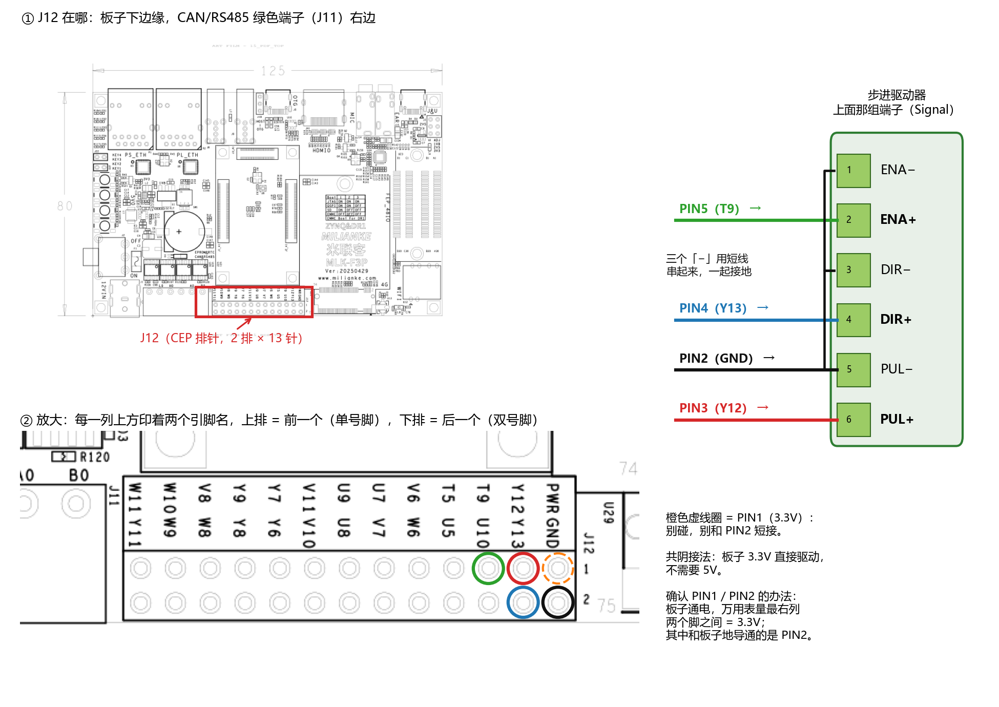

# 硬件与接线

> 引脚细节以板卡手册与原理图为准；实测见 `log/`。
>
> **全系统接线图**：[figures/fig_system_wiring.png](figures/fig_system_wiring.png)（2026-10-23 版：电源 / 急停 / 传送带 / XY6020L 6.8V 母排 / 5V / 编码器 / 电平转换 / 挡板 / J12 全部引脚 / J11 CAN，实线已接、虚线待接或未装；`figures/make_system_wiring.py` 生成）。舵机电平转换低压侧放大见 [figures/fig_servo_lv_wiring.png](figures/fig_servo_lv_wiring.png)。

## 平台

| 部件 | 型号 / 说明 |
|---|---|
| 核心板 + 底板 | MLK-F3P-DR1M90G（DR1M90GEG400：双核 Cortex-A35 + FPGA + 0.4T NPU） |
| 视觉 | VID005 子卡（占用 FEP 口）+ IMX415（MIPI CSI） |
| 机械臂 | 德晟 DS-SY15A 串口总线舵机 ×6，6.0~7.4V，堵转 ≤2.4A，300° 行程，回差 / 虚位各 ≤1°；接口 PH2.0-3Pin |
| 传送带 | 57BYG250B-D8 步进电机（1.8°，3.0A）+ TB6600 类驱动器（DC 9~42V） |
| 侧边导流挡板 | MG996R ×2（与舵机同 6.8V 母排） |
| 板载总线 | CAN（TX F20 / RX F19，SN65HVD232）与 RS485（TX L17 / RX N16 / DE N15，SP3485EN），均 BANK33（3.3V），共用端子 J11（针座 KF2EDG 3.81mm 6P，需配插头 KF2EDGK-3.81-6P 才能拧线；原理图 p14：**1 GND、2 CANL、3 CANH、4 GND、5 485_A、6 485_B**；板上 CAN R120 / RS485 R121 各有 120Ω 终端电阻；两个 GND 在第 1、4 位，可用万用表通断档对 CEP PIN2 找 1 脚）。**CAN 已在最新版比特流引到 F20 / F19，10-23 接 PC USB-CAN 双节点实测通过**（[PL设计](PL设计.md)、[测试与验证](测试与验证.md)）。 |

**舵机母排 6.8V**：夹爪 6kg 额定 4.8~6.0V，与 15kg 舵机共用菊花链；XY6020L 数控降压（24V → 6.8V、恒流限流）供电，链上两处进电（见「供电树」）。6 舵机峰值 >10A、4 轴同时堵转约 75W，不沿用厂家 12V/5A/60W 原配适配器。

## CEP 排针（J12，2.54mm 2×13）

- FEP 被 VID005 占用，运动控制 IO 只能走 CEP：26 针 = PIN1 电源 + PIN2 地 + **24 根信号**（12 对差分）。
- 信号 = 底板网名 `B13_` → DR1 **BANK11** → **固定 3.3V LVCMOS，不可调**。
- **PIN1 `VCC_CEP1` = 3.3V**（磁珠取自 3.3V 主轨；5V 路空焊位，**无跳线**），仅逻辑用，合计 <100mA；传感器 / 继电器 / 编码器一律外部供电。
- CEP 只有 PIN2 一根地 → 转接板上做一小段地线母排分出。

| PIN | 管脚 | 信号 | 方向 | 电平处理 / 接法 |
|---|---|---|---|---|
| 1 | — | `VCC_CEP1` 3.3V | — | 仅逻辑用，<100mA |
| 2 | — | GND | — | 地线母排（单点接到 24V GND 母排） |
| 3 | Y12 | `STEP_PUL` | 出 | **3.3V 直驱，高有效**（共阴）；驱动器 PUL+（PUL− 接地） |
| 4 | Y13 | `STEP_DIR` | 出 | 3.3V 直驱；驱动器 DIR+（DIR− 接地） |
| 5 | T9 | `STEP_ENA` | 出 | 3.3V 直驱，**高 = 脱机**；驱动器 ENA+（ENA− 接地） |
| 6 / 7 / 8 | U10 / T5 / U5 | `ENC_A/B/Z` | 入 | **经 BSS138 电平转换**：本批 E6B2-CWZ6C 输出被拉到它的电源（5V 供电时黑线对 0V 约 1.5V，不是纯开集电极）→ 不能直连。黑 A / 白 B / 橙 Z → BSS138 高压侧（HV = 5V 母排，可用舵机总线模块空着的三路），低压侧 → PIN6 / 7 / 8（LV = 3.3V）；**棕 = 5V 母排**（不接 24V）、蓝 = PL 地、屏蔽线 = PL 地（只接板子这头）。FPGA 内部上拉保留 |
| 9 | V6 | `IR1` | 入 | FPGA 内部上拉；对射光电接收端（NPN，经肖特基二极管，负极朝传感器） |
| 12 | V7 | `LIMIT1` | 入 | 内部上拉 + 去抖；挡板回位限位（可选） |
| 15 | V11 | `ESTOP_IN` | 入 | 内部上拉，**低 = 急停**；急停常开触点另一端接地 |
| 18 | Y6 | `FLAP1_PWM` | 出 | 直驱（舵机门限 2.0V）；导流挡板 1 = 报废（`des_pwm` 通道 0） |
| 19 | Y9 | `SERVO_BUS` | 双向 | **BSS138 双向电平转换**；机械臂舵机链 |
| 20 | Y8 | `FLAP2_PWM` | 出 | 直驱；导流挡板 2 = 返修（`des_pwm` 通道 1；信号名沿用原翻板） |
| 10、11、13、14、16、17、21~26 | W6 / U7 / U9 / U8 / V10 / Y7 / V8 / W8 / W10 / W9 / W11 / Y11 | — | — | 空闲 12 根 |



*J12 在板子下边缘、CAN/RS485 绿色端子 J11 右边；最右一列印「PWR GND」、旁边印「1」「2」= PIN1（3.3V）/ PIN2（GND）。底图为厂家位号图，`figures/make_step_wiring.py <位号图.pdf>` 生成。*

## 电平结论

- **舵机总线空闲 3.7V** > 3.3V IO 绝对最大值 → **经 BSS138 双向电平转换接入**，高压侧接 5V：DS-SY15A 规格书「信号高电平 2.0V ~ Vcc、低电平 ≤0.45V」，5V 在范围内。规格书引脚定义 1 信号 / 2 Vcc / 3 GND；线色因批次而异，接电前用原厂扩展板上电实测线序。TXS0108E 类自动方向芯片在强上拉总线上会误判锁死，纯电阻分压发送方向余量不足，均不可用。
- 六路舵机信号脚通断档**并联** → 确认是总线舵机。

## 步进驱动器（✅ 实测）

- **接法：共阴、FPGA 3.3V 直驱**（不用 74HCT245）：PUL+/DIR+/ENA+ 接 CEP，PUL−/DIR−/ENA− 接地，PL 侧高有效；顶层 `STEP_COMMON_CATHODE=1`。驱动器三个 `+` 端内部不导通，共阳需外部 +5V、PL 侧低有效；共阴由 CEP 3.3V 直驱 `+` 端，省去电平转换与 5V 供电。驱动电流约 6~8mA。
- 拨码：`1=OFF 2=OFF 3=ON 4=OFF 5=ON 6=ON` → 16 细分（3200 脉冲 / 圈），2.5A / 峰值 2.7A。
- 电机接线：`B−` 绿、`B+` 黑、`A−` 红、`A+` 蓝。
- 若丢步：先把 `DRIVESTRENGTH` 从 8 提到 12/16，仍丢步则加 74AHCT125 电平转换模块并改回共阳（顶层参数置 0）。

## 光源（手动）

两侧条形光**只人工手动开关 / 调光，不接 PL**：PL 无光源控制（`des_pwm` 无 lamp 位），PIN17 / Y7 为空闲 IO。

- **档位一次定好**：采集训练集、标定、演示、生产用同一档位，中途不动灯（[视觉与检测](视觉与检测.md) 要求"最终光学条件下采"）。
- **亮度靠灯、不靠曝光**：曝光定死 800µs（`des_app.json` 的 `camera.exposure_us`），画面暗就把控制器调亮。目标：零件顶面灰度 180~220、不到 255，皮带 ≤40。控制器若是 PWM 调光，低档位会被卷帘快门拍出横纹 → 灯开大、必要时加增益 `gain_db10`。
- **安装位置**（相机高约 280mm、视野横跨约 ±100mm）：两根灯条**沿皮带方向**、皮带两侧对称，长度盖住视野沿带方向（≥350mm），出光面朝皮带中线；**灯光打到中线时与带面约 40~45°**——灯离带面约 150~200mm、离皮带中线约 180~220mm（高度 ≈ 水平距离）。低角度（<30°）会照亮零件侧壁、影子长；太高则皮带与零件顶面的镜面反光容易进镜头——灯在皮带上的倒影离中线 y = L·H / (H + Z)（L 灯离中线、Z 灯高、H 相机高）要 > 110mm（在画面外）。
- 装好后看三点：灯不入画面；皮带上没有亮带；零件顶面亮、侧壁明显比顶面暗。

## 供电树

```
插排（220V 总闸）
├─ FPGA 板原配适配器 12V
├─ 光源 12V 适配器 ─→ 光源（手动开关 / 调光，不接 PL）
└─ 24V 主电源 LRS-350-24（FG 必须接地）
   ├─ +V1 ─ 急停【常闭】─→ 受控 24V 母排（急停一拍全断）
   │                        ├─ 步进驱动器 VCC
   │                        └─ 数控降压（XY6020L）→ 6.8V · 恒流限流 → 6.8V 母排 + 1000µF
   │                                                  ├─ 舵机链入口 A（底座 #1）
   │                                                  ├─ 舵机链入口 B（臂中段 #3/#4）
   │                                                  └─ 导流挡板舵机
   ├─ +V2 ──→ 常电 24V 母排（急停不断）
   │           ├─ 5V 降压 → 5V 母排（BSS138 高压侧、编码器 V+；步进输入由 CEP 3.3V 直驱，不占 5V）
   │           └─ 对射光电 V+
   └─ −V ──→ 24V GND 母排 → 所有 24V / 5V 负载的地；**单点**接 CEP PIN2
   XY6020L OUT− ──→ 6.8V GND 母排 → 舵机链、挡板舵机地（与 24V GND 母排不外接）
```

- **分段供电**：6 舵机峰值 >10A，单个连接器针约 3A → 链上两处进电（底座 #1、臂中段）。
- **单点共地**：PL 地只在 24V GND 母排一点相连。**XY6020L 的 OUT− 与 IN− 不可外部短接**（旁路低边采样电阻 → 限流失效）。
- 线规：主干（电源 → 急停 → 母排 → 降压）16AWG；母排 → 驱动器 / 舵机入口 20AWG；信号与小电流支路 22AWG / 杜邦线。
- 多股软线进螺钉端子必须压管型端子；一个端子只压一根线；电源线两端贴线标；电解电容注意极性。
- **导流挡板 MG996R**（棕 GND / 红 V+ / 橙信号）：橙 → 挡板 1（报废）J12 PIN18、挡板 2（返修）PIN20，3.3V 直驱（`des_pwm` 未使能时输出低、舵机无力）；信号线可串 1kΩ 防误碰 V+。**6.8V 母排未通之前临时供电**：备用 24V→5V 3A 降压调到 6.0V（MG996R 4.8~7.2V），输入取**受控 24V**（急停一起断），棕线接模块 OUT−（普通降压输入输出共地 → 与 PL 地同在 24V GND 母排；接好后通断档核对挡板地 ↔ CEP PIN2 导通）；不与 BSS138 / 编码器 / 机械臂那块模块共用（堵转约 2.5A 会把 5V 拉低）。6.8V 母排通了改挂 6.8V 母排 + 6.8V GND 母排。

## 急停逻辑（✅ 一起切）

| 部分 | 行为 |
|---|---|
| 常闭触点 | 串在主电源 +V1 → 受控 24V 母排：按下**同时断步进和全部舵机**（含挡板舵机） |
| 常电 24V | **不断**：5V 逻辑、编码器、光电保持 → PL 仍能读急停、电平转换器不断电、引脚不浮空 |
| 常开触点 | → `ESTOP_IN`（低有效）→ PL `des_io` 去抖 1ms 后**锁存**，锁存期间步进不发脉冲、拒绝启动 |
| 复位 | 拔起急停 → UI 点"复位报警"（或 CAN 命令）→ PS 清 PL 锁存，**不自动重启** |
| 降压模块 | 设为"上电不自动输出" → **急停复位、主电源重新上电后，舵机都要再按一次 XY6020L 的输出键才有电**（有意如此：舵机不会自己突然上力） |
| 机械臂失力 | 急停断的是 XY6020L 输入 → 6 个舵机同时失去扭矩，**机械臂会靠自重落下**（设计如此）；调试时臂下别放手、别放易碎物，抓取高度附近按急停会落在皮带上 |
| 按钮实物 | 22mm 蘑菇头自锁；触点块一面印 `11` `23`、对面印 `24` `12` → **11↔12 常闭**（串电源）、**23↔24 常开**（一头 CEP PIN15、一头 PL 地）。接前通断档核对：松开 11-12 通、23-24 断，按下反过来 |

PL 侧实现见 [PL设计](PL设计.md) `des_io`：任意状态（空闲 / 停带）按下都能锁存并由 PS 读到，状态字 `STATUS` b0/b1 分别给锁存与按钮现态。

## 操作规范

- ⚠ 新电源首次接入机械臂前，**逐个测舵机 V+~GND 电阻并检查旷量**，排除短路。
- 改接线先查本文件；电平不确定先量再接。
- 换比特流与关机规则见 [开发环境与构建](开发环境与构建.md)「操作禁忌」。
