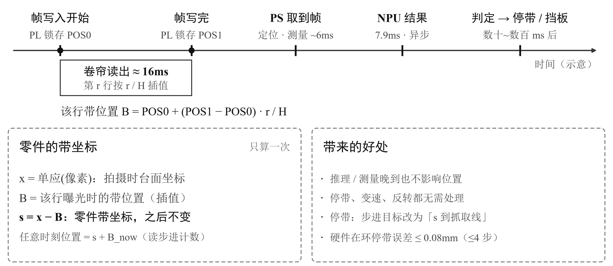
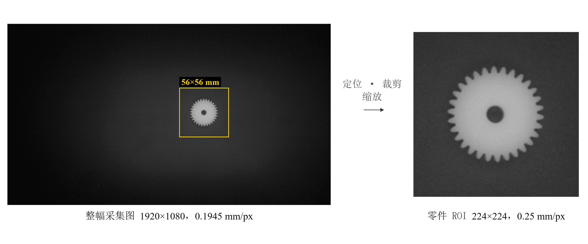
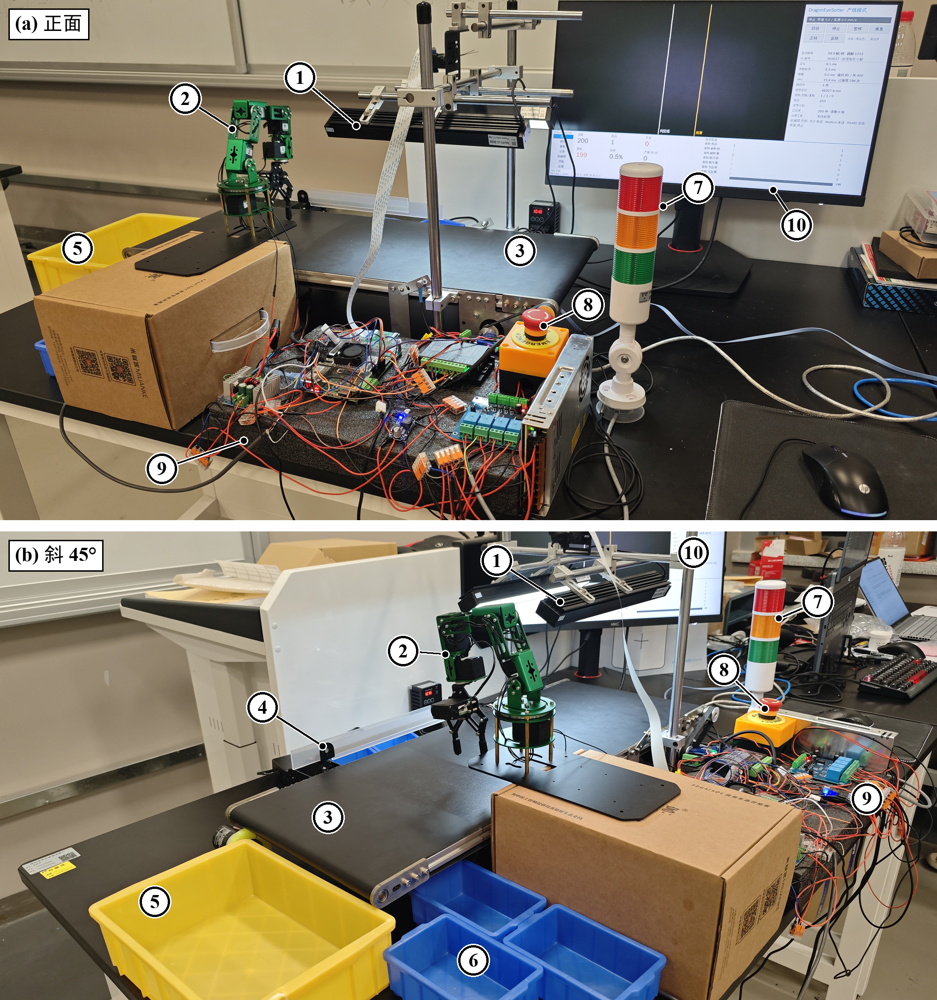
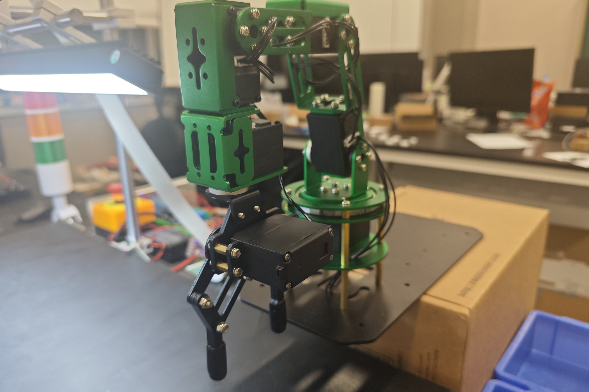
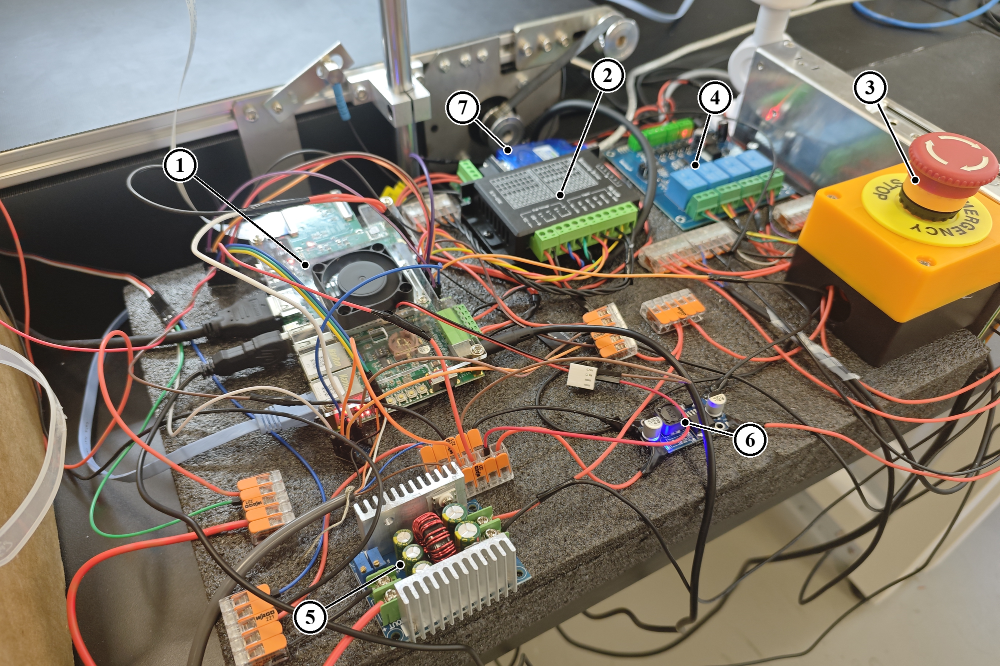

# 基于FPGA的工业智能检测系统

## 摘要

针对注塑塑胶齿轮人工目检效率低、一致性差、只检不分的问题，本作品基于安路飞龙 F3P 片上系统（system on chip, SoC）设计并实现了一套集在线质检与自动分拣于一体的嵌入式系统。系统按「硬实时—调度—推理」三级划分：可编程逻辑（programmable logic, PL）承担硬实时任务，包括德晟总线舵机协议主机（硬件补帧头与校验、SYNC WRITE 六轴同步、应答解析与超时）、步进梯形加减速与精确定位、拍摄瞬间的带位置锁存、逐像素图像预处理与 ROI 统计；处理系统（processing system, PS）上的 Linux 应用完成零件定位、亚像素几何测量、基于带坐标的跟踪与调度、六轴机械臂逆运动学解算与 HDMI 人机界面；神经网络处理单元（neural processing unit, NPU）以经 ReLU 改造与 8 位无符号整型（UINT8）量化的 YOLOv8n-cls 对每件零件的感兴趣区域（region of interest, ROI）做七类缺陷分类。测量结果与分类结果互为第二意见，判不准的零件进入复检，良品盒只放双重确认的零件。板端还对皮带卡滞、光源异常、总线断线等设备故障生成运维工单，经网口推送到 PC 端远程运维站。

实测结果表明：采集与显示帧率 60.02 fps（20 s 零丢帧）；NPU 单次推理约 8.0 ms，实物七类分类准确率 92.54%，良品/不良判别率 96.74%；硬件在环停带定位三档最坏误差 0.080 mm，节拍 22.7~48.8 件/min；CAN 命令往返平均 359 µs，Modbus-TCP 实物启停全部正确；软件连续运行 2 h 无错误。全部功能由 PL 硬件与 PS 软件协同实现并在板端运行，自研 PL 模块已完成综合、布局布线与板端 v16 上板验证，可为同类流水线视觉检测装备提供低成本、可复用的参考设计。

## 第一部分　作品概述

### 1.1 功能与特性

本作品面向注塑塑胶齿轮的在线质检，在单块安路飞龙 F3P 片上系统上实现「看—判—量—跟—分」完整闭环。传送带上的零件经过相机视野时，系统逐件完成缺陷分类与几何测量：分类按缺料、脏污、飞边各分轻、重两级，与良品构成七类；测量给出外径、孔径、齿数、偏心与颜色，独立于分类网络。处置分三条路：良品到达抓取线时皮带自动停稳，六轴总线舵机机械臂按姿态夹取并按规格与颜色入盒；不良品不停带，由侧边导流挡板按带位置拦入报废盒与返修盒；存疑件流到带尾复检箱。

特性集中在三点：零件位置以拍摄瞬间的带位置为基准，停带、变速与反转都无需特殊处理；不良品不停带、只为良品停带，节拍由机械臂动作决定；测量与分类互为第二意见，任一方判缺陷即转复检。HDMI 1080p60 界面实时显示画面、曲线与参数，每件记录与不良品图像存入 SD 卡，并经 CAN 与 Modbus-TCP 接入产线；设备故障自动生成运维工单，推送到远程运维站。

### 1.2 应用领域

注塑成型是塑胶传动件的主要成形工艺，多规格、多颜色的聚甲醛（polyoxymethylene, POM）齿轮在电器、电动工具与汽车零部件中批量使用，成形中易出现缺料（齿不满）、脏污（料中黑点）与飞边（毛刺填齿槽）等外观缺陷，并伴随尺寸超差与规格混料。这类零件产量大、单价低，人工目检速度慢且一致性差；只检不分的视觉检测站仍需人工搬运分类，难以闭环。本作品把检测、测量、跟踪与分拣放进同一套在线系统，可直接用于注塑件出厂检验、装配前分选与返修筛选。

系统的三级架构与工具链也面向一般流水线视觉检测：PL 侧的逐像素预处理、步进与总线舵机控制、拍摄锁存等模块可复用于传送带上的其他小件；PS 侧的定位、亚像素测量与跟踪调度由标定参数驱动，换型只需更换配方与训练数据；NPU 分类模型按缺陷样本重训即可迁移。系统同时提供 CAN、Modbus-TCP 与 RS485 三条工业总线接口，可并入既有产线由 PLC 统一调度，适合多工位扩展。

### 1.3 主要技术特点

系统按「PL 硬实时、PS 调度、NPU 推理」三级组织，与赛题六项硬性要求逐一对应：PL 以硬件完成工业级实时功能（总线舵机协议主机、步进梯形加减速、拍摄锁存、逐像素图像预处理）；PS 运行嵌入式 Linux，提供 HDMI 人机界面与本地存储；PL 与 PS 经 AXI 寄存器窗口与帧 DMA 双向交互；NPU 部署轻量化分类模型；CAN、Modbus-TCP 与 RS485 覆盖外设通信；测试条件与数据出处见第三部分。

实现上的特点有三。其一，全部自研 PL 外设挂在加宽译码引出的寄存器总线上，帧时序、脉冲与总线协议在固定时钟节拍下闭环，微秒级动作不依赖 Linux 调度，六类模块共 852 项仿真全部通过。其二，PS 按实时性划分线程：取帧与显示独占核 0 并运行实时优先级，定位、测量、跟踪与调度集中核 1，NPU 与存储各持异步队列，工作线程既不等待推理也不等待写卡。其三，失效安全：急停双路切断并硬件锁存，漏检、跟丢与挡板故障的零件一律落到带尾复检箱。

### 1.4 主要性能指标

主要实测指标见表 1，全部数值来自板端输出与测试脚本记录，条件随表给出；未实测项在第三部分以 ⚠ 标注，不做外推。

**表 1**　主要性能指标（板端实测）

| 指标 | 实测值 | 条件 |
|:--------|:----------------|:------------------|
| 采集与显示帧率 | 60.02 fps，20 s 零丢帧 | IMX415 1080p |
| NPU 单次推理 | 约 8.0 ms | 224×224，UINT8 |
| 七类分类准确率 | 92.54%（OK/NG 96.74%） | 737 张测试图，样品未参训 |
| 外径测量精度 | 约 ±0.1 mm | 卡尺比对标定件 |
| 停带定位误差 | 三档最坏 0.080 mm | 50/100/150 mm/s 硬件在环 |
| 节拍 | 22.7~48.8 件/min | 随带速三档 |
| CAN 命令往返 | 平均 359 µs | 板上回环，1000/1000 |
| Modbus-TCP 写入至执行 | 14~24 ms | 皮带真走启停 |
| 软件连续运行 | 2 h 零错误 | 60.02 fps，无零件 |

### 1.5 主要创新点

（1）位置基准取拍摄瞬间：帧起始由硬件锁存带位置，零件坐标与采集、推理延迟无关。

（2）只为良品停带：不良品由挡板不停带分流，节拍由机械臂动作决定。

（3）测量与分类双判定：亚像素几何测量与 NPU 分类互为第二意见，良品盒只放双确认零件。

（4）按零件 ROI 分类替代整帧检测：1 mm 缺陷由约 1 像素提高到约 4 像素，算力约为整帧的 1/7。

（5）面向 NPU 改造模型：SiLU 改 ReLU、量化加 logit 偏置校正，量化模型与浮点逐张一致。

### 1.6 设计流程

设计按图 1 的流程展开：由赛题六项硬性要求确定三级架构与资源预算；先做 PL 模块与寄存器分段，逐模块仿真通过后上板；再实现 PS 应用的定位、测量、跟踪与调度；相机、皮带与编码器三组标定建立毫米基准；随后采集实物缺陷样件、改造并量化模型、经 ArmNN 部署到 NPU；最后按硬件在环、总线联调与长时间运行三组实测验收，未测项如实标注。各阶段以实测数据为准迭代，设计文档与测试台账同步更新。

**图 1**　设计流程：自需求分析到联调实测的八个阶段。

## 第二部分　系统组成及功能说明

### 2.1 整体介绍

本系统由一块 MLK-F3P-DR1M90G 开发板、一套 VID005 相机子卡、一台 800×300 mm 皮带传送机、一台六轴总线舵机机械臂与一个侧边导流挡板组成；外围另有 M18 激光对射光电、RS485 继电器模块与 24 V 三色灯，以及一台扮演产线 PLC 的 PC。除 PC 外，全部部件围绕同一条传送带布置：相机架设于检测工位的带面上方，导流挡板与带尾复检箱沿带布置在检测工位下游。系统硬件组成见表 2。

**表 2**　系统硬件组成

| 部件 | 型号与说明 |
|:------|:--------------------------------|
| 主控 | MLK-F3P-DR1M90G 开发板（DR1M90GEG400：双核 Cortex-A35 + FPGA + NPU 软核） |
| 视觉 | VID005 子卡 + IMX415（MIPI CSI-2，4.2 mm 镜头），两侧条形光（手动开关与调光，不接 PL） |
| 传送带 | 800×300 mm 皮带机，57 步进电机 + TB6600 类驱动器（16 细分，3200 步/圈，共阴直驱） |
| 机械臂 | 六轴：德晟 15 kg 总线舵机 ×5 与 6 kg 夹爪舵机，115200 bit/s 半双工单线总线，经 BSS138 由 PL 直驱 |
| 导流挡板 | MG996R ×1（带尾侧平摆摆杆，报废与返修共用，按去向用两种放行曲线落入两只料盒） |
| 对射 | M18 激光对射光电，接收端 NPN 集电极开路，直接接 PIN9（FPGA 内部上拉）；10-29 标定光束 x 139.69 mm（sd 0.05），10-30 10 件过线全部 matched |
| 通信 | 板载 CAN 收发器 ↔ PC USB-CAN（智嵌 ZQWL-UCAN-101E）；网口 Modbus-TCP；RS485 ↔ 4 路继电器模块 + 24 V 三色灯 |
| 带速测量 | 计米轮编码器 E6B2-CWZ6C（1000 线），独立于步进实测皮带；输出经 BSS138 接 3.3 V IO |
| 电源 | 24 V 主电源（LRS-350-24）+ 300 W 恒压恒流降压（舵机 6.8 V，恒流限流 + 保险丝）；急停常闭断受控 24 V |

系统按「PL 硬实时、PS 调度、NPU 推理」三级划分，分工由数据路径决定：时序关键、逐像素与逐比特的工作在 PL，需要灵活性与算法迭代的在 PS，矩阵运算在 NPU。相机经移动产业处理器接口（mobile industry processor interface, MIPI）的 CSI-2 进入 PL，经图像信号处理器（image signal processor, ISP）与自研视觉预处理后，由帧写 DMA 送入 PS 内存；HDMI 显示的即为 PL 预处理后的图像，显示链路与 PS 取帧共用同一份数据。PL 自研的舵机总线、步进控制、拍摄锁存、视觉预处理、导流挡板 PWM、现场输入与 RS485 收发等模块，经寄存器窗口与 PS 交换控制命令与状态。系统架构与三级分工如图 2 所示。

**图 2**　系统架构：外设、PL 与 PS 的数据通路及三级分工。

图像数据不经过寄存器通道，只由帧 DMA 批量搬运；帧号、带位置与视觉统计等少量状态走寄存器，PL 与 PS 由帧号与帧起始信号保持一一对应。PS 侧运行嵌入式 Linux，零件定位、亚像素测量、跟踪调度、机械臂控制、界面与本地存储均由应用层承担；NPU 只做逐件 ROI 分类，由 PS 侧加载与调用模型。通信外设同样分属两侧：CAN 与 Modbus-TCP 由 PS 侧驱动，RS485 的帧收发由 PL 的 `des_485` 模块承担。这样外设时序在 PL 内闭环，协议栈与业务逻辑在 PS 内迭代，两侧通过寄存器与 DMA 的窄接口解耦。

视觉链路的算力分布见表 3：固定逐像素运算归 PL，零延迟且不占用 CPU；复杂算法归 PS，需要迭代与全局信息；卷积归 NPU，由专用加速器承担。可编程逻辑的资源只够容纳逐像素、低延迟的处理，连通域、形态学等大块图像算法因此放在 PS 实现。分类所需的 ROI 由定位结果裁出，PL 的粗测结果在分类置信度不足时作为复检的补充判据。

**表 3**　PL / PS / NPU 视觉分工

| 承担者 | 主要内容 | 分工依据 |
|:---|:-----------|:------|
| PL | 逐像素灰度、滤波、边缘与二值运算，ROI 面积与外接框粗测 | 固定运算，零延迟，不占用 CPU |
| PS | 零件定位、亚像素几何测量、视差与卷帘补偿、跟踪 | 算法复杂，需要迭代与全局信息 |
| NPU | 缺陷分类 | 卷积计算由专用加速器承担 |

全系统只有一个时间与位置基准：PL 内的 75 MHz 自由计数器 `FREE_CNT` 与步进位置 `POS`。零件位置按拍摄瞬间的带位置换算，采集延迟与推理延迟都不构成位置误差，时间基准与锁存路径如图 3 所示。

**图 3**　时间基准：拍摄瞬间锁存带位置，零件坐标与处理延迟无关。

帧写模块开始写帧时锁存 `FREE_CNT`、帧号与带位置 `POS`，写完后第二次锁存并把整组值更新到 `CAP_*` 寄存器；PS 取帧后按零件所在图像行确定曝光时刻（卷帘快门逐行读出），在两次锁存值之间线性插值出拍摄时的带位置 B。零件带坐标定义为 `s = x − B`（x 为台面坐标），零件不在带上滑动，因此停带、变速与反转都无需特殊处理。台面位置由 `s + 当前 B` 实时得到，调度器据此计算停带时刻与挡板合上时刻。该基准已由实测检验：锁存带位置差与「带速 × 读出时间」一致，帧号差全为 1，20 s 内保持 60.02 fps 且 0 丢帧。

PL 与 PS 之间只走一条寄存器总线：官方相机 DMA 控制器 `fvdma_ctrl` 在 GP0 上占有 64 KB 地址窗口，本作品在该窗口上加宽地址译码，把偏移 `0x1000~0x1FFF` 引出到 PL 顶层，形成 75 MHz、单周期写脉冲、读数据多路选择的寄存器总线，PL 基址为 `0x8030_1000`，官方驱动使用的 `0x0000~0x0FFF` 不受影响。各模块按 `addr[11:8]` 分段，PS 经 `/dev/mem` 映射后直接读写，单次读 PL 寄存器耗时 188 ns（20 万次统计）。控制命令与阈值由 PS 下行写入，帧号、带位置、舵机应答与视觉统计由 PL 上行提供；帧 DMA 与寄存器通道彼此独立，以帧号与帧起始信号对齐，分段见表 4。

**表 4**　PL-PS 寄存器窗口分段

| 段 | 模块 | 主要内容 |
|:---|:-------|:------------------|
| `0x000` | `des_regs` | ID 与版本、`FREE_CNT`、帧号与帧周期、拍摄锁存（带位置、时间戳） |
| `0x100` | `servo_bus` | 舵机帧收发缓冲、状态、时间戳、错误计数 |
| `0x200` | `stepper_ctrl` | 模式、目标、速度与加速度（Q0.32）、位置、刹车距离 |
| `0x300` | `des_vision` | 处理模式、阈值、ROI；面积、外接框、质心、边缘数 |
| `0x400` | `des_pwm` | 导流挡板舵机脉宽（2 路 50 Hz，下周期生效） |
| `0x500` | `des_io` | 急停锁存、对射与限位输入捕获、编码器计数 |
| `0x600` | `des_485` | RS485 Modbus-RTU：配置、收发缓冲、状态与时间戳、计数（v16） |

### 2.2 硬件系统介绍

#### 2.2.1 硬件整体介绍

主控为 MLK-F3P-DR1M90G 开发板，片内 DR1M90GEG400 集成双核 Cortex-A35、FPGA 与 NPU 软核，三级划分因而可以落在同一颗芯片上。视觉链路由 VID005 子卡与 IMX415 传感器组成，镜头焦距 4.2 mm；带速另由计米轮编码器独立测量，用于标定与步进指令的交叉校验。执行机构由 PL 一侧统一组织：步进脉冲、舵机总线帧与挡板 PWM 均在 PL 内产生，PS 只下发目标值与时序参数。

供电由 24 V 主电源与 300 W 恒压恒流降压组成。主电源输出分两路：一路经急停常闭触点后形成受控 24 V 母排，只供步进驱动器与降压模块，后者把 24 V 降至 6.8 V，经恒流限流与保险丝送入舵机链的两处进电点与导流挡板舵机；另一路为常电 24 V，急停不切断，供给 5 V 逻辑、计米轮编码器与对射光电。开发板与光源各由一只 12 V 适配器供电，不在这两路之内。

6 个舵机的峰值电流较大，舵机链在底座与臂中段两处进电、分段供电。接地为单点共地：PL 地只在 24 V GND 母排一点相连，6.8 V 母排的地与 24 V 母排的地不外接，避免步进驱动器的大电流回流经过信号地；6.8 V 降压模块的输出负端与输入负端不得在外部短接，否则低边采样电阻被旁路、恒流限流失效。

急停按钮的常闭触点串在受控 24 V 母排上，按下时同时切断步进驱动器与全部舵机的电源；常开触点接 `ESTOP_IN`（低有效），经 PL 去抖 1 ms 后锁存，锁存期间步进不发脉冲并拒绝启动，复位需人工拔起按钮后在界面点击「复位报警」。急停切断的是 6.8 V 降压模块的输入，6 个舵机同时失去扭矩、机械臂因自重落下，调试时不得在机械臂下方放手或放置易碎物；现用降压模块上电即输出，复位前必须先确认机械臂姿态。常电 24 V 不在切断之列，端子附近使用金属工具前先关 24 V 总电源，不能把急停当作总电源开关。

#### 2.2.2 机械设计介绍

整机以一条 800×300 mm 的皮带机为干线，零件从右往左依次经过上料、相机视野、抓取线与带尾复检箱四个工位，布局如图 4 所示。相机安装在皮带中段上方，两侧沿带方向布置条形光源；抓取线位于相机视野下游 65 mm 处，正对机械臂底座；机械臂侧装于皮带一侧，其底座与运动范围均在相机视野之外，不会在图像中形成遮挡或反光。

**图 4**　工位布局：俯视、按比例，零件从右往左走。

侧边导流挡板装在带尾一侧、机械臂对侧的带边，摆杆长 321 mm，合上时与带边成 42.3°，斜拦零件经过的带面；零件中心偏向机械臂一侧超过约 27 mm 时摆杆够不着，改走复检。报废件与返修件共用这一块挡板：零件被皮带推着碰到摆杆后，摆杆按两种曲线摆开，把零件推出对侧带边——报废件在碰件后再走 50 mm 才开始摆、用 2.75 s 摆完，返修件碰件即摆、0.6 s 摆完，两类零件因此落在带边外的不同位置，各进一只料盒；未被拦下的零件走到带尾进入复检箱。该布局把良品抓取与不良品分流分开：良品需要停带，由机械臂在抓取线竖直夹取；不良品不停带，由挡板在运动中分流，不占用机械臂时间；带尾复检箱作为失效安全出口。挡板的转轴位置、摆杆长度与夹角均按相机实测标定（合位截图换算的夹角 42.3°，尺量 42.6°）。

传送带由 57 步进电机经 TB6600 类驱动器驱动，取 16 细分、3200 步/圈，控制侧共阴直驱，PL 的 3.3 V 输出直接接驱动器的 PUL+、DIR+ 与 ENA+。步进由 PL 直接发脉冲并计数，是停带定位的执行基准；计米轮编码器独立测量皮带运动，用于带速显示与步进位置的交叉核对。

机械臂由 5 个德晟 15 kg 总线舵机（底座、大臂、小臂、腕俯仰、腕旋）与 1 个 6 kg 夹爪舵机组成，共 6 轴，挂在同一根 115200 bit/s 半双工单线总线上，经 BSS138 双向电平转换由 PL 直接驱动。夹爪为两指结构，夹取方向取与底座方向相切，闭合后读取 #6 轴位置判断是否夹住。导流挡板为一片侧边平摆摆杆，由一只 MG996R 舵机驱动，PWM 取自 PL `des_pwm` 两路 50 Hz 通道中的第 1 路（开位 1500 µs、合位 1100 µs），电源取自与机械臂共用的 6.8 V 母排；摆杆合上或摆开期间若还会碰到别的零件，调度器放弃拦截、改走复检。

#### 2.2.3 电路各模块介绍

PL 承担本系统全部硬实时工作：舵机总线帧的收发、步进脉冲的产生、拍摄瞬间的位置锁存、逐像素的图像预处理、导流挡板的脉宽调制与现场输入的去抖锁存。这些操作的共同特征是对时序敏感且时间粒度在微秒量级，交给运行 Linux 的 PS 会受调度抖动影响，因此由 PL 在固定时钟节拍下完成。六类自研功能模块按 `addr[11:8]` 分段挂在 2.1 节所述的寄存器总线上，模块、寄存器窗口与引脚的对应关系如图 5 所示；全部自研模块只经这条总线与 PS 交换命令和状态，图像数据仍沿 ISP 到帧写 DMA 的 128 位数据通路流动，视觉预处理模块串接在这条通路上。

**图 5**　PL 自研模块、寄存器窗口与引脚。分段译码按地址位 addr[11:8] 划分，引脚取自工程约束文件 io.adc。

**舵机总线主机。**机械臂的六个总线舵机挂在同一根半双工单线上，采用德晟总线舵机协议 v4.01[2]。多轴协同动作依赖一帧 SYNC WRITE：一帧广播同时下发六个轴的目标位置与运动时间，各轴在帧结束时同时起跑，同步误差不会随轴数累积。发送通路采用开漏方式，PL 只主动拉低总线，高电平由 BSS138 一侧的上拉给出；帧头与校验由硬件自动生成，PS 只把帧主体写入发送缓冲。接收方向识别 `FF F5` 应答头，完成校验与长度检查后提取舵机的过载、过温与电压状态字节；发送期间关闭接收，每帧之后强制留出 1 字节时间的总线换向间隔。模块还提供超时、计数与硬件时间戳：应答超时可配置（默认 3 ms），首个起始位、最后一个停止位与应答接收完成三个时刻分别锁存 `FREE_CNT`，帧时长与命令延迟由硬件时间戳相减得到。仿真覆盖 PING、READ、SYNC WRITE、无应答超时、错误校验与非法 LEN 等 23 项；上板实测六轴 SYNC WRITE 一帧 3298.9 µs（理论 3298.6 µs），PING 一帧 520.9 µs（理论 520.8 µs）。

**步进控制。**脉冲由相位累加器产生，速度以 Q0.32 定点数表示每时钟的步进增量，速度分辨率 0.017 步/s，长时间运行不产生累积误差。速度模式下修改速度指令自动平滑过渡；位置模式按梯形加减速运行（升降速节拍 10 kHz），运动中改写 `TARGET` 即可「停在某一步」，减速点由硬件按当前速度与加速度实时重算。抓取判定所依赖的刹车距离由 `BRAKE` 寄存器实时给出，来不及停下的零件转为复检，不采用倒车追件。急停输入或 `HALT` 命令立即停止脉冲并锁存；脉冲宽度 5 µs、换向等待 10 µs，满足驱动器对脉宽与方向建立时间的要求。上板实测执行 `move 3200` 后 `POS` 与累计步数精确等于 3200。

**拍摄锁存。**官方帧写模块在开始写帧时与帧写完成中断时各翻转一次信号，两路信号经两级同步进入 75 MHz 时钟域：开始写帧时把帧号、`FREE_CNT` 与步进位置 `POS` 锁进暂存寄存器，写帧完成时整组更新到 `CAP_*` 寄存器。PS 的取帧调用返回之后还有整整一帧的时间读取 `CAP_*`，不会与下一帧的锁存冲突。v16 比特流在锁存组中加入计米轮编码器计数，同一帧的带位置、时间戳与编码器读数可一并取出。实测锁存带位置差与「带速 × 读出时间」一致，帧号差全为 1。

**图像预处理。**PL 在 ISP 输出与帧写 DMA 之间做逐像素预处理，处理 128 位 AXI-Stream 数据，每拍 4 个 BGRA 像素，不反压上游、不改变帧时序。预处理提供六种模式：原图直通、BT.601 灰度、3×3 高斯平滑、阈值二值化、Sobel 梯度与边缘二值化；3×3 窗口由两块行缓冲（ERAM）与列寄存器构成，窗口运算拆成三级流水共 6 拍延迟，以满足 125 MHz 的时序约束。除整帧图像外，模块还统计 ROI 内的面积、外接框、质心与边缘像素数，PS 把这些量换算成毫米即得到 PL 尺寸粗测。模式切换采用无撕裂策略：新设置由 `APPLY` 在下一帧起始生效。仿真覆盖 6 种模式共 790 项，逐像素比对行为模型；另保留 `LANES=2` 降级配置（每拍 2 像素、滤波逻辑约减半），同样 790 项通过。

**导流挡板 PWM。**PWM 模块提供两路 50 Hz 舵机脉宽输出，新脉宽在下一周期起始处生效，占空比切换不产生毛刺脉冲；两路输出错开动作并做平滑起停，避免两个摆杆同时启动造成电源冲击（现装一块挡板，用第 1 路）。挡板的开合时机与放行曲线由 PS 调度器按挡板几何与带位置计算，摆开时由 PS 每个控制周期按曲线改写脉宽（见 2.3.2 节）。仿真 11 项通过；PWM 已上板验证读回值与 50 Hz 输出，挡板已按实测几何启用分流。

**现场输入。**现场输入的共同要求是先锁存再处理。急停按下并保持 1 ms 才被确认，确认后立即锁存并直接停住步进脉冲，只有在复位报警时才能清除；对射光电与限位输入去抖 20 µs，对射每次挡光边沿锁存自由计数器、带位置与编码器计数，作为跟踪误差的原始依据。计米轮编码器按四倍频计数，输入经两级同步与约 107 ns 滤波，Z 相单独锁存，A/B 两相同跳记为错误。仿真 28 项通过；上板已验证 PL 级急停，编码器实测两次 Z 脉冲之间正好 4000 计数、错误计数为 0；对射已接 PIN9 并完成光束标定与整线过件实测（见 3.3 节）。

关键输入输出信号线及其电平处理汇总于表 5。任何 5 V 侧信号必须经电平隔离后才能进入 3.3 V IO；CEP 排针的 3.3 V 电源仅供逻辑使用，传感器、继电器与编码器一律外部供电；24 V 不得进入任何 IO 引脚；舵机母排与逻辑母排共地但不同源，单点接地并在端子处绝缘。

**表 5**　关键信号线与电平转换

| 信号 | 方向 | 接口 / 引脚 | 电平与转换 |
|:-------|:-------|:-------------|:-----------------------|
| 舵机总线 | 双向半双工单线 | PL IO ↔ BSS138 | 3.3 V 开漏，高压侧 5 V 上拉（舵机侧空闲 3.7 V） |
| 步进 PUL/DIR/ENA | PL → 驱动器 | 3.3 V 直驱 | 共阴接 TB6600 类驱动器，16 细分 |
| 挡板 PWM | PL → 舵机 | `des_pwm` 第 1 路（共 2 路），50 Hz | MG996R，6.8 V 母排 |
| 急停 | 按钮 → PL | `ESTOP_IN`（低有效） | 常开触点报 PL（去抖 1 ms 锁存）；常闭串受控 24 V |
| 对射光电 | 接收端 → PL | PIN9 | NPN 集电极开路，FPGA 内部上拉；V+ 取常电 24 V |
| 编码器 A/B/Z | 编码器 → PL | 经 BSS138 | 5 V 输出隔离后接 3.3 V IO，四倍频计数 |
| RS485 A/B | 双向 | `des_485` ↔ J11 第 5 / 6 位 | 4 路继电器模块（地址 1，9600 bit/s、8N1） |
| CAN H/L | 双向 | 板载收发器 ↔ F20 / F19 | PS CAN0 硬核经块设计引到顶层，500 kbit/s |

自动方向的电平转换芯片在带强上拉的总线上会误判方向并锁死，纯电阻分压的发送方向余量不足，因此均未采用；实测该批编码器输出被上拉到其自身 5 V 电源、并非纯开集电极，直接接 3.3 V IO 会向 IO 灌入电流，故经 BSS138 接入。

资源是 PL 设计的硬约束。官方 NPU 基线已占用查找表（look-up table, LUT）的 79% 与嵌入式块 RAM（embedded block RAM, ERAM）的 92.5%，剩余空间只够容纳逐像素、低延迟的处理逻辑，单个自研模块控制在数百 LUT 量级，逐模块综合资源见表 6（口径为 TD 6.2.1 的 Optimize-Gate 综合，非布局布线结果）。板端当前比特流为 v16，新增 `des_485` 与帧起始锁存的编码器计数，`pl_check.sh` 0 失败；综合资源为 slice 84.22%、LUT 80.15%、ERAM 261/280（93.21%）、DSP 65%（156/240）。时序上，自研的 75 MHz、像素时钟、150 MHz 与 PS AXI 四个时钟域均无违例，剩余违例全部落在厂家加密 IP 内部，其中 TMDS 输出域尚待肉眼复核波形 ⚠。

**表 6**　自研模块综合资源（TD 6.2.1 Optimize-Gate 综合口径，非 P&R）

| 模块 | LUT | FF | ERAM | DSP |
|:-------|:---:|:---:|:---:|:---:|
| `des_regs` | 9 | 457 | 0 | 0 |
| `des_io` | 77 | 478 | 0 | 0 |
| `des_pwm` | 58 | 123 | 0 | 0 |
| `servo_bus` | 246 | 351 | 0 | 0 |
| `stepper_ctrl` | 270 | 331 | 0 | 0 |
| `des_vision` | 977 | 1556 | 2 | 13 |
| `awb_seq_div`（2 实例） | 146 | 232 | 0 | 0 |
| **自研小计** | **1783** | **3528** | **2** | **13** |

表中 `awb_seq_div` 是 ISP 自动白平衡的逐位除法器，用于替换厂家的流水线实现。开发过程中对自研模块与厂家明文 RTL 做过多轮零行为重构，每轮都以整顶层的逐拍等价回归与综合资源对比作为验收条件；重构不改变端口、参数与寄存器接口，因此 PS 侧软件不随重构改动。最新源码构建尚未上板：默认 `opt_timing=high` 的单进程全流程 59 min 16 s 收敛，布线后 Setup WNS 为 +0.007 ns、Hold WNS 为 +0.022 ns，setup 与 hold 违例端点均为 0；VTC 与 NPU、150 MHz 之间的跨时钟域路径按异步组排除，整体余量很薄，最差路径位于 TMDS 742.94 MHz 域 ⚠。该构建的候选 `BOOT.bin` 已打包但未上板，板端仍运行 v16。

### 2.3 软件系统介绍

#### 2.3.1 软件整体介绍

PS 上运行嵌入式 Linux，产品运行时的可执行程序为 `des_app`，只保留 `run` 与 `live` 两个模式。为使 60 fps 视频链路与视觉处理互不干扰，系统按实时性划分线程：取帧与显示独占核 0 并运行于实时优先级，定位、测量、跟踪与调度集中于核 1，NPU 推理、机械臂执行与本地存储各由独立线程承担，见表 7。设计目标是让工作线程既不等待 NPU 推理、也不等待 SD 卡写入：NPU 与存储各自持有一个异步队列，工作线程只投递任务并读取最近一次结果，因此定位与调度的节拍由相机帧率决定。

**表 7**　PS 进程与线程模型

| 线程 | 核 | 职责 |
|:------|:----|:-------------------------|
| 取帧与显示 | 0（实时优先级） | 等待 DMA 帧完成并立即重新提交缓冲（平均 0.3 µs）；BGRA→BGR 写显示缓冲，叠加跟踪框、判定线与状态，贴操作界面并翻页 |
| 工作 | 1 | 定位、测量、跟踪表、调度、存储与界面状态更新 |
| NPU | 1 | 零件分类，经异步队列解耦，工作线程不等待 NPU |
| 机械臂 | 独立 | 执行抓取航点，完成后回报 |
| 存储 | 独立 | 后台写 CSV 与图片，工作线程不等待 SD 卡 |

实测结果符合上述设计目标：`run` 模式下显示保持 60 fps、每帧 13.0~13.9 ms（现版布局），工作线程处理了 99.9% 的帧（2 h 统计），单帧定位平均耗时 5.9 ms。像素搬运全程由 DMA 承担：相机帧由帧写模块（米联客开源 `uiFDMA` 与 `uidbuf_write`，150 MHz，经 HP0 口）写入 DDR，写完后以中断通知 PS；HDMI 一侧由 VDMA 从显示缓冲读出扫描。CPU 每帧只做一次画面合成（NEON 按 3/4 缩放、转 BGR、贴叠加信息与界面、VDMA 停驻指针在帧边界切换），该合成固定在核 0 上执行。

单件零件在软件中的处理流程与关键输入输出变量如图 6 所示：定位、测量与调度集中在核 1，按带坐标 s 串联；NPU 分类与本地存储经异步队列解耦，不阻塞工作线程。

**图 6**　PS 软件单件处理流程与关键输入输出变量（异步环节以队列传接）。

PC 端程序承担三件事：产线 PLC 模拟器（Python / tkinter）提供按钮、计数、逐件结果、报警与收发统计，用于在接入真实 PLC 前复现产线交互；测试统计脚本 `part_stats.py` 直读板上逐件 CSV 记录生成统计表，使现场记录与报告数据同源；远程运维站接收板端推送的运维工单、逐件记录与不良品图片，提供网页看板、远程确认与运维报表（见 2.3.2 节（9））。板端另有运维调试件 `des_tool`，提供标定、采集、测量与机械臂调试等模式，与产品运行时共同构成 PS 侧软件。

#### 2.3.2 软件各模块介绍

**（1）零件定位与相机标定。**零件定位在 1/4 降采样灰度图上完成，依次经过白电平相对阈值分割、开运算、外轮廓提取与最小外接矩形拟合，最后由单应矩阵换算为台面毫米坐标 (x, y, θ, 长, 宽)。触碰图像边缘的零件只记录其存在而不使用几何量，面积超过上限者判为粘连件。

台面坐标系的建立依赖三组标定。`calib-cam` 用平放在皮带上的棋盘格拍摄一次，得到皮带平面的单应矩阵，合成图上五种姿态残差 rms 为 0.003~0.04 mm；`calib-belt` 让白纸随皮带走过已知步数，得到毫米每步与方向；`calib-enc` 在空带往返过程中每 10 ms 采样编码器，实测 0.049227 mm/计数（3 轮标准差 0.019%）。相机定版后的实测结果为：定位残差 rms 0.240 mm，比例尺 0.1945 mm/像素，视野 373×214 mm；皮带为 0.020921 mm/步，横向漂移 +0.29 mm/100 mm，234 mm 往返误差 −0.08 mm。

位置视差是定位误差的主要来源。零件顶面高出皮带 h，按皮带平面标定读出的位置会以相机正下方点为中心向外放大 k 倍，将「绕正下方点按 1/k 缩放」并入单应矩阵得到面向零件顶面的 `px_to_part`。k 由实测确定：三个 10 mm 厚的齿轮随皮带走过 7 个站点，其质心位移是皮带位移的 1.020 倍，符合侧壁可见模型；现行灯位（光源高位朝下、侧壁变暗）下模型切换为侧壁暗模型，k = H/(H − h) ≈ 1.035，定位直接按顶面计算，视差在视野内不再表现为系统性放大。

**（2）亚像素几何测量。**每件零件只在离光轴最近的一帧上测量一次，此时视差最小，单核耗时 4~5 ms。测量结果既作为尺寸判据直接决定处置，也作为独立于 NPU 的第二意见参与复检判定。流程分五步：ROI 内二值化并找出外轮廓与内孔；沿每个轮廓点法线搜索灰度穿过 50% 电平的亚像素位置；经单应变换映射到毫米并做视差校正与卷帘快门逐行补偿；拟合齿顶圆、孔径与偏心，由齿距推算规格齿数（齿距取中位数 ±25% 范围内的平均值，使 30 齿缺 2 齿与 28 齿可以区分），同时判定缺料齿、缺齿与三种形态的飞边；对裁切图亮区按色调与饱和度归类白、黄、橙、蓝、红五种颜色。

平场校正是裁切图预处理的关键：广角渐晕与条形光不均匀使视野四角只有中心亮度的 32~51%，系统让白纸走过视野 13 个站点得到 48×27 白电平网格，裁切图逐点乘以 ref / white 完成校正（校正后纸面亮度 p5~p95 为 98.0~101.8%），该校正对 NPU 输入、存图与训练集共用。实物测量取 30 齿零件、曝光 800 µs、画面中心静止，外径重复性 σ 0.004~0.011 mm；边缘定位与光照带来系统性偏差，用卡尺量过的标准件确定修正量，现行修正为「增益 × 拟合值 + 偏置」形式（增益 1.0285、外径 +0.02 mm、孔 +0.15 mm），修正后 20 与 28 齿外径误差 ±0.01 mm、30 齿两件 −0.08 与 +0.07 mm，外径实际精度约 ±0.1 mm，判废公差取 ±0.2 mm。测量可信范围受曝光与视场限制：曝光 800 µs 下 50 mm/s 拖影 0.04 mm，尺寸只取每件离中心最近的一帧；现行灯位下可信范围扩大到离光轴 40 mm，并在相机上游设 V 形导向条使零件中心落在判齿、训练数据与机械臂可达范围的交集内；超出该范围的零件不判齿形，分类为良品且置信度不低于 0.8 时照常夹取，否则进入复检。

**（3）跟踪与调度。**跟踪表以带坐标 s 为核心，为每件零件分配 ID 并以 s 关联多帧观测，关联门限 12 mm，状态依次为新建、跟踪、已判定、抓取中与完成。调度只承担良品停带抓取与不良品导流两件事，时间关系如图 7 所示。

**图 7**　良品停带抓取与不良品导流时序：示意，时长取默认配置。

停带抓取发生在待抓良品接近抓取线时：调度器先查询 `BRAKE` 刹车距离，再检查夹爪两指开合区域与邻件是否冲突（θ 与 θ + 90° 两种候选姿态都需通过），全部通过后才把步进目标改写为「该件恰好停在抓取线」；来不及停或有冲突的零件转复检，不倒车追件。挡板分流针对不停带的不良件：调度器按挡板几何算出每件零件碰到摆杆的位置与摆杆扫过的区段，按带位置在碰件前合上；碰件后按该件去向的放行曲线摆开（报废件碰件后 50 mm 开始、2.75 s 摆完且后半程放慢，返修件碰件即摆、0.6 s 摆完），把零件推出对侧带边，两类零件落点不同、各进一只料盒。摆杆合上或摆开期间若还会碰到别的零件，后一件不拦而改走复检；是否碰到按零件横向位置与摆杆末端伸出量逐时刻判断，中线附近的后一件相距约 18 cm 以上即不受影响。漏检、跟丢与挡板故障都只导致零件进入复检，具有失效安全性。单挡板于 11-01 按实测几何启用，台前放件验证两类不良分别落入对应料盒，逐件成功率待整线统计 ⚠。硬件在环测试让模拟零件以真实 PL 步进计数为位移基准运动，50、100、150 mm/s 三档 6/6 全部通过：8 件良品全部停准抓取、最坏偏差 0.080 mm，4 件不良品全部到达带尾，节拍 22.7、39.1 与 48.8 件/min。

**（4）机械臂控制。**控制系统对台面目标点求解逆运动学，腕旋角按零件姿态 θ 对准，6 轴指令在一帧 SYNC WRITE 中同时下发。齿轮圆对称，夹取方向取与底座方向相切；竖直方向够不着时软件可令夹爪朝外倾斜下探（最大倾角 40°），但本台机械臂的倾斜能力受 #5 轴行程限制。夹爪装配偏差需要补偿：#4 轴到指尖距离 190 mm、指尖中心偏离腕旋轴 9 mm，运动学把该偏置作为工具坐标系中的固定向量，按 #5 转角反解底座角、定点迭代求解；倾斜下探时自动选择让 #6 舵机位于外侧的 #5 转向。当前实装机械臂的 #5 软限位为 −158°~+145°，倾斜下探需要 #5 转到 ±180°，因此实际只用竖直夹取，竖直够不着的零件进入复检。夹取确认依据 #6 轴位置：闭合后与闭合指令相差大于 0.8 mm 判为夹住，完全闭合判为空抓（挤压量 4 mm 时，夹住齿轮约 2.6 mm、空抓约 0.21 mm）。手眼标定已完成（底座位于台面 (437.8, 142.4)、`belt_z` 为 −54.1）。整线真抓已跑通：单件慢速 4/4 成功，正常速度一次抓取 4.26 s；50 mm/s、件距 27~28 cm 时 3/3 抓取并放入料盒；件距小于一次抓取所占的 186 mm 带长时只能抓到部分良品，这是单臂串行的上限。重复定位精度待测 ⚠。

**（5）人机界面。**赛题要求提供 HDMI 曲线与参数配置界面，而板上 Qt 仅有独立镜像，为不影响 60 fps 视频链路，系统用 OpenCV 自绘界面、以 FreeType 渲染中文，共七页：总览页显示运行状态、计数与良率、节拍、带速与最近零件；曲线页给出外径与孔径趋势线、规格线与工序能力指数（process capability index, Cpk），带速同时显示命令值与编码器实测；参数页集中管理配方、带速、公差、置信度门限、存图策略与 PL 显示模式；记录页列出最近零件的裁切图、类别、测量值与去向；机械臂页提供 6 个舵机的手动调试并在软限位内 SYNC WRITE；挡板页手动调试挡板舵机、查找开合脉宽；运维页列出设备运维工单（见（9））。画面左侧 1440×780 为主画面、右侧为状态栏、底部为操作条，USB 鼠标键盘热插拔；界面元素在显示线程内贴入显示缓冲，另保留脚本输入通道用于自动化测试与截图。

**（6）本地存储与运行记录。**每件零件判定完成后写入一行 44 列的 CSV 记录，不良品与复检件另外保存 ROI 裁切图，按日期分目录存放。CSV 覆盖时间、件号、帧号、类别与置信度、处置与去向及原因、全部测量值、带坐标与姿态、PL 粗测、NPU 投票次数与推理耗时及延迟、图片名与配方号。板上没有实时时钟，记录时间取本机时钟加 PLC 经 CAN 下发的时间偏移，该偏移只用于记录换算。

**（7）视觉与缺陷分类。**分类模型选用面向板上 NPU 改造过的 YOLOv8n-cls[3]，输入 224×224，以 ImageNet 预训练权重迁移，训练只做翻转与亮度两类温和增强。类别按缺陷类型与轻重两级展开共 7 类：良品，缺料轻与缺料重，脏污轻与脏污重，飞边轻与飞边重；规格由几何测量判定、颜色由色调判据判定，分类网络只负责缺陷类型与轻重。分类结果直接决定去向：良品送机械臂抓取，缺料两级与重脏污报废，轻脏污与飞边两级返修。

按零件 ROI 分类的动机是缺陷尺度：缺料、脏污与飞边多在 1 mm 量级，整幅图像分辨率约 0.19 mm/像素，缩到 416 输入后 1 mm 缺陷只剩约 1 个像素；先定位后分类、按零件方向转正并裁 56×56 mm 的 ROI 缩放到 224×224，单像素约 0.25 mm，1 mm 缺陷约占 4 个像素，计算量约为整帧检测的 1/7，如图 8 所示。整帧检测还要求网络同时完成定位与分类，检测框回归误差会叠加到缺陷判别上；拆开之后，定位与亚像素测量由几何流程独立完成，分类器只需回答缺陷类别。

**图 8**　整幅采集图与单件 ROI 裁切图对比（同一零件同一帧；右侧为送入分类网络的 224×224 视图）。

模型改造围绕板端 NPU 的算子特性展开：NPU 对 SiLU 只做近似计算，训练与导出改用 ReLU（同一批合成数据上 ReLU 版板上 96.25%、SiLU 版 94.0%，推理时间相同）；per-tensor 量化会压缩良品与缺料轻之间的分界，导出时用训练图统计 fp32 与 UINT8 输出之差的均值写入模型 JSON 的 `logit_offset` 字段、由 PS 在 softmax 前加上，并配合全部实物数据重训，最终量化模型与 fp32 逐张一致。部署链为 ArmNN[4] 与厂家 Alnpu 后端，输入在 PS 端预先查表量化为 UINT8，单次推理约 8.0 ms，输入准备 1.45 ms；每件零件经过视野时分类 3~6 次、概率累加后取最大类，置信度不足的件进入复检。训练与推理使用同一裁切函数与同一归一化，是精度不掉的必要前提。

数据按缺陷类型与轻重两级组织，样件形貌如图 9 所示。缺陷样件由冷加工制作，每个等级 8 件，其中 6 件用于采集训练图、2 件只用于测试，按零件而非按图片划分，使测得的准确率反映对未见样件的泛化能力。飞边分级以缺陷处数为准：轻飞边 1 处（一个齿槽或孔里填充不到一半），重飞边 2 处及以上或孔里填充超过一半。训练在 RTX 4060 上完成，采集在皮带 30 mm/s 自走条件下每件存 10 张；剔除带激光红点的图像 205 张后，各类别样本数见表 8。

**图 9**　零件与七类缺陷样件。良品齿轮与缺料、脏污、飞边三类缺陷的轻、重两级样件对照。

**表 8**　数据集规模与划分

| 类别 | 训练集（张） | 测试集（张） |
|:-------|:---------:|:---------:|
| 良品 | 1469 | 250 |
| 缺料轻 | 660 | 80 |
| 缺料重 | 290 | 80 |
| 脏污轻 | 300 | 80 |
| 脏污重 | 320 | 92 |
| 飞边轻 | 274 | 80 |
| 飞边重 | 259 | 75 |

良品训练集由 30 齿 833 张、20 齿 287 张、28 齿 219 张与 30 齿孔 8 的 130 张组成。训练集最初漏掉 30 齿孔 8 规格，该规格 130 张良品中有 49 张被浮点模型判成重飞边——未参与训练的规格必须补进良品类；仅用合成数据训练的模型对 833 张实物良品只判对 38.8%，实物重训不可省。737 张测试图（样品均未参与训练）的板上逐图准确率为 92.54%，OK/NG 96.74%，按零件投票 73/78；缺料两级与重脏污全部判对，轻脏污 17/80 张被判成重脏污（仍为不良），最弱的轻飞边 80 张中判对 45 张，整线由几何测量补第二道拦截。分类对颜色不敏感：转灰度后板上准确率 88.87%，训练不做灰度增强（随机转灰度会使 UINT8 量化掉 10~20 个点）。正式运行时开启激光后的影响、轻飞边的整线检出率待实测 ⚠。

**（8）工业总线通信。**总线通信由三条链路组成：与产线 PLC 交互的 CAN、面向工厂 PLC 的 Modbus-TCP 从站，以及驱动塔灯与继电器的 RS485 主站；前两条共用同一套命令与状态语义。

板载 CAN 收发器只支持经典 CAN，系统采用 CAN 2.0A（11 位标识符）[5]、500 kbit/s 的自定义产线协议，报文见表 9。命令侧覆盖产线生命周期（启动、停止、联锁暂停、恢复、复位报警，附命令序号），带速、配方、心跳、对时与塔灯接管各有独立标识符；状态侧以 10 Hz 上报状态，1 Hz 上报计数，每件零件单独上报件号、类别、去向、置信度与主尺寸（0.01 mm）。本机状态机分为空闲、运行、暂停、急停与故障五态，PLC 命令与界面按钮走同一套规则；配方切换会同时改变良品判据与混料判据。

**表 9**　CAN 产线协议报文

| 方向 | 标识符 | 内容 |
|:-----|:------|:-----------------------|
| PLC → 本机 | 0x100 CMD | 启动 / 停止 / 联锁暂停 / 恢复 / 复位报警，附命令序号 |
| PLC → 本机 | 0x101 SPEED | 带速（0.1 mm/s） |
| PLC → 本机 | 0x102 RECIPE | 配方号（换型：切换规格齿数 / 外径 / 孔径；运行中拒绝） |
| PLC → 本机 | 0x103 PLC_HB | PLC 心跳（≥2 Hz；1 s 收不到清除「PLC 在线」） |
| PLC → 本机 | 0x104 TIME | 对时（unix 秒 + 毫秒） |
| PLC → 本机 | 0x105 LAMP | 塔灯接管（v1.2）：经 RS485 写继电器模块；RS485 不在跑时拒绝 |
| 本机 → PLC | 0x180 ACK | 命令 ID、序号、结果（成功 / 状态不允许 / 数值不对 / 未知） |
| 本机 → PLC | 0x181 STATUS | 状态、标志（b5 = RS485 在线，b6 = 有运维工单）、带速、报警码、心跳、运行时间，10 Hz |
| 本机 → PLC | 0x182 COUNTS | 总数 / 良品 / NG / 复检，1 Hz |
| 本机 → PLC | 0x183 PART | 每件：件号、类别、去向、料盒 / 出口、置信度、主尺寸（0.01 mm） |
| 本机 → PLC | 0x184 ALARM | 报警码、级别、细节；运维工单为故障代码、级别（提示 / 警告 / 故障）与工单号 |

CAN 的物理通路在硬件上另行实现：官方演示工程的块设计没有启用 PS CAN0，现版比特流把 PS CAN0 硬核的收发信号经块设计引到顶层并约束到 F20 / F19。协议先在板上回环验收（命令往返平均 359 µs，1000/1000，200~2000 帧/s 零丢失零错序），再以 PC 端 USB-CAN 充当 PLC 做双节点实测：2 min 内 240 条命令全部应答，板端状态帧 1063 帧 0 丢。测试中发现「应答立即发」与「同周期排队帧」背靠背会丢帧（3%），改为应答单独排队、每周期仍只发 1 帧后消除；2 h 回环中 PLC 侧 STATUS 丢 82 帧（0.13%），同样落在有 PART 突发的秒内，复测进行中 ⚠，实物上料的长时间误码待测 ⚠。

Modbus-TCP 从站在 PS 网口的 502 端口上自行实现（单线程 poll 完成 MBAP 分帧，处理半帧与粘包，不依赖第三方库）[6]，命令与状态沿用 CAN 的同一套语义：保持寄存器 HR0 命令、HR1 带速、HR2 配方、HR5~6 对时、HR7 塔灯、HR8 运维工单确认可写，HR3 结果与 HR4 执行序号只读，输入寄存器提供状态、计数、最近一件的明细与运维工单摘要。三路命令源（CAN、Modbus-TCP 与界面按钮）并发时在服务线程里只排队，由控制循环按同一套规则执行；PLC 写入后等待「执行序号」变化再读结果码。实物启停测试中启动、调速、暂停、恢复与停止全部正确，4 种非法写均被拒绝（见 3.3 节）。

RS485 由 PL 的 `des_485` 模块作 Modbus-RTU 主机，从站为 4 路继电器模块，继电器再驱动 24 V 三色警示灯；灯态与产线状态绑定（空闲不亮、运行绿、暂停黄、急停红），CAN 的 0x105 LAMP 与 Modbus-TCP 的 HR7 可以接管灯态，使警示灯既能跟随本机状态机，也能服从外部 PLC 统一编排。

**（9）设备运维与远程运维。**设备运维由板端健康监测、运维工单与 PC 端远程运维站三部分组成。健康监测不增加传感器，只复用产线已有的测量：步进指令带速与计米轮实测带速对比，判断皮带卡滞或打滑；画面平均亮度与开机时学到的基准对比，判断光源熄灭或镜头被遮挡；此外还监测视觉处理帧率、对射光电与视觉跟踪是否一致（漏检风险）、机械臂连续抓取失败与舵机指令未确认、RS485 继电器模块与 PLC 的链路、NPU 运行状态、SD 卡空间与写入错误，以及最近 20 件的不良率、复检率与最近 10 件良品的外径均值漂移，共 15 种故障代码。每条判据都设有持续时间门限与恢复条件，单个慢窗口、切换显示模式或白纸路过都不会误报。

同一种故障在工单关闭前只对应一张工单，重复发生只累加次数；工单按「待处理、已恢复待确认、已关闭」流转，故障消失且有人确认后才关闭，每次变化都追加写入 SD 卡上的工单日志。皮带卡滞属于停机故障：线体转入故障态，皮带停住，塔灯红灯加蜂鸣，须复位报警后才能重新启动；其余故障为警告，线体继续运行，未确认期间塔灯亮黄灯。同一张工单同时推向五个出口：HDMI 运维页列出工单、详情与处理建议，可在现场确认；网口上传通道新增工单帧，新连接的客户端先收到当前工单列表；Modbus-TCP 输入寄存器给出工单摘要，保持寄存器 HR8 用于远程确认；CAN 以 0x184 ALARM 帧上报故障代码、级别与工单号；RS485 塔灯提供现场声光提示。

远程运维站运行在 PC 上，只用 Python 标准库实现：经网口接收工单、逐件记录与不良品图片并存入本地 SQLite 数据库，网页看板展示设备状态、工单与处理建议，支持远程确认工单、启停与调速，可导出运维报表；连接建立时即为板端对时（板端没有实时时钟），板端 5 s 无响应时自动生成「设备离线」工单。板上验证中，运维页发出的测试工单经网口推送到远程运维站，在看板上确认后板端工单同步关闭；判据单元测试 72 项、运维站自检 23 项全部通过。

## 第三部分　完成情况及性能参数

### 3.1 整体介绍

整机实物全景如图 10 所示：相机龙门与条形光、抓取线与机械臂、带尾复检箱沿同一条 800×300 mm 传送带布置，全部功能在一块安路飞龙 F3P 开发板上运行。系统已完成单机联调、相机 / 传送带 / 机械臂标定、7 类实物训练上板，以及 10 月下旬的对射光电整线过件、机械臂整线真抓与 11 月初的单挡板分流；板端比特流为 v16，`pl_check.sh` 0 失败，软件连续运行 2 h 无错误。

**图 10**　整机实物全景：相机龙门与条形光、抓取线与机械臂、带尾复检箱沿同一条 800×300 mm 传送带布置。

### 3.2 工程成果

#### 3.2.1 机械成果

机械部分已完成皮带机安装与张紧、相机龙门与两侧条形光安装、机械臂底座固定与手眼标定、对射光电支架与光束标定（10-29 标定光束 x 139.69 mm、sd 0.05）。六轴总线舵机机械臂与夹爪如图 11 所示，抓取航点与取放流程先在 `des_tool arm` 上验证（运动命令默认只打印、加 `--go` 才执行），整线已能把良品停带夹起放入料盒（50 mm/s 3/3）；带尾侧导流挡板已装上并按相机实测几何标定，报废与返修两类不良经两种放行曲线分别落入两只料盒（11-01 台前验证）。

**图 11**　六轴总线舵机机械臂与夹爪。

#### 3.2.2 电路成果

电路以 MLK-F3P-DR1M90G 开发板为核心，如图 12 所示。板外电路全部为接线级实现：24 V 主电源与 300 W 恒压恒流降压（舵机 6.8 V）、急停双触点（常闭串受控 24 V、常开报 PL）、TB6600 类驱动器共阴直驱、BSS138 电平转换（舵机总线与编码器）、4 路 RS485 继电器模块与三色灯、USB-CAN 适配器。自研 PL 模块（舵机总线主机、步进控制、拍摄锁存、图像预处理、挡板 PWM、现场输入、RS485）已随 v16 比特流上板，`pl_check.sh` 0 失败；对射光电整线过件实测 10 件全部 matched、跟踪误差 −0.57±0.29 mm（最大 0.96）、视觉漏检 0/10。

**图 12**　开发板与主要接口特写。

#### 3.2.3 软件成果

软件成果以 HDMI 操作界面为直接证据，如图 13 所示。`des_app` 产品模式含总览、曲线、参数、记录、机械臂、挡板与运维七个页面，支持配方换型、PL 显示模式点选、参数即时生效并保存，设备故障生成运维工单；`des_tool` 提供相机 / 皮带 / 编码器 / 手眼标定、数据采集与机械臂调试；PC 端 PLC 模拟器、`part_stats.py` 统计脚本与远程运维站构成产线对接、测试与运维工具链。训练与导出脚本（`train/`）覆盖数据采集、ReLU 改造、去 Softmax 导出与 UINT8 QDQ 量化全流程。

**图 13**　HDMI 操作界面七页（总览 / 曲线 / 参数 / 记录 / 机械臂 / 挡板 / 运维）。

### 3.3 特性成果

本节按实时控制与同步、视觉测量与分类、总线通信与连续运行三组给出板上实测结果。全部数值来自板端输出、PL 时间戳与测试脚本记录，测试条件随数值一同给出；尚未实测的项目保留「待测 ⚠」标记，不做外推。

测试在安路飞龙 F3P 开发板上完成，板端比特流版本为 v16，PS 侧运行 `des_app` 产品模式。时延与同步类指标一律取 PL 硬件时间戳与寄存器计数：`FREE_CNT` 提供 75 MHz 时间基准，命令到总线、命令到步进脉冲的间隔由 PL 直接记录，不经过 Linux 用户态。硬件在环测试由 `test_belt_hil` 完成，把模拟零件骑在真实 PL 步进计数上，经模拟相机、跟踪表、调度回到 PL 步进，覆盖 50、100、150 mm/s 三档带速。NPU 推理由 `test_npu` 分阶段计时；分类测试集共 737 张、样品均未参与训练；尺寸测量以卡尺读数为真值；CAN 先做板上回环、再由 PC 经 USB-CAN 充当 PLC 做双节点收发；Modbus-TCP 由 PC 经网线读取输入寄存器 500 次；RS485 接 4 路继电器模块读 8 路线圈 1000 次；长时间稳定性由 `soak.sh 7200` 每分钟采样。

实时控制与同步精度的实测结果汇总于表 10。6 轴 SYNC WRITE 与 PING 帧的线上时长与理论值之差均在 1 µs 以内；步进命令至第一个脉冲的延迟在 100 次统计中波动小于 0.2 µs；停带定位用硬件在环在三档带速下 6/6 全部停准，误差已包含停稳 300 ms 后释放步进驱动器、起步前使能 50 ms 的抗噪开销。多舵机动作起点差、机械臂重复定位与端到端延迟尚未实测 ⚠；跟踪误差已于 10-30 实测：10 件连续过线全部 matched，−0.57±0.29 mm（最大 0.96）。

**表 10**　实时控制与同步精度实测

| 指标 | 数值 | 条件 | 测法 / 依据 |
|:--------|:--------------|:-----------|:--------|
| 6 轴 SYNC WRITE / PING 帧时长 | 3298.9 µs（理论 3298.6 µs）；PING 520.9 µs（理论 520.8 µs） | 115200 bit/s、8N1，未接舵机 | PL 硬件时间戳 |
| 命令至总线第一位 | 空闲总线 1.1 µs；连续发帧平均 25.5 µs、最大 85.4 µs | 含写发送缓冲 | `desreg cmdlat` 计时 |
| 步进命令至第一个脉冲 | 10.6 µs（100 次最小 10.61 µs、最大 10.77 µs） | 共阴直驱 TB6600 与 57 步进 | 脉冲观测计时 |
| 停带定位误差 | 最坏 0.080 mm（三档 0.040 / 0.050 / 0.080 mm）；节拍 22.7 / 39.1 / 48.8 件/min | 50 / 100 / 150 mm/s，每档 6/6；含停稳 300 ms 与起步使能 50 ms | 硬件在环 `test_belt_hil` |
| 多舵机动作起点差、机械臂重复定位 | 待测 ⚠ | 逻辑分析仪；30 次重复定位 | — |
| 跟踪误差（对射前沿 vs 预测前沿） | 10 件全部 matched，−0.57±0.29 mm（最大 0.96） | 30 齿件连续过线；PL 同时钟锁存 IR1 | `part_stats.py`，[log/2026-10-30](../docs/log/2026-10-30-对射光电整线过件实测.md) |
| 整线良品抓取 | 50 mm/s、件距 27~28 cm：3/3 抓取并放入料盒；一次抓取 4.26 s；夹取判据（挤压 4 mm）：夹住约 2.6 mm、空抓 0.21 mm（门限 0.8 mm） | 30 齿 POM 齿轮，机械臂随整线运行 | 服务日志与逐件记录，[log/2026-10-30](../docs/log/2026-10-30-机械臂整线联调.md) |
| 挡板分流 | 报废、返修两类分别落入两只料盒；逐件成功率待统计 ⚠ | 单挡板，合位 1100 µs、夹角 42.3°；报废件碰件后 50 mm 起 2.75 s 摆开，返修件碰件即 0.6 s 摆开 | 11-01 台前放件 |
| 采集帧率 | 60.02 fps，20 s 0 丢帧 | IMX415 1080p | PL 帧计数 |
| 取帧重新提交 | 平均 0.3 µs | 取帧线程（实时优先级） | 线程内计时 |
| HDMI 显示 | 60 fps，每帧 13.0~13.9 ms | `run` 现版布局 | 帧耗时统计 |
| 端到端（拍摄至 NPU 结果可用） | 待测 ⚠（逐件记录已含 `lat_ms`，可直接统计） | PL 时间戳 | 逐件 `lat_ms` 字段 |

综合来看，控制链路的时延主要由协议本身决定，指令到执行的环节处于 10 µs 量级，相对毫米级的停带精度与机械臂动作时间可以忽略；抓取可靠性留待整线验证。

视觉测量与分类精度的实测结果汇总于表 11。7 类模型在 v16 板上 50 次推理的中位耗时 8.01 ms、p95 8.05 ms；七类逐类准确率如图 14 所示：缺料两级与重脏污全部判对，良品与重飞边各错 1 张，短板集中在轻脏污与轻飞边（轻脏污误判为重脏污 17 张、仍为不良；轻飞边误判为良品 23 张，由几何测量补第二道拦截）。尺寸测量方面，外径重复性 σ 0.004~0.011 mm，现行标定下 20 与 28 齿外径误差 ±0.01 mm、30 齿两件 −0.08 与 +0.07 mm，实际精度约 ±0.1 mm；孔 30 齿两件 +0.01 与 +0.02 mm，20 与 28 齿 +0.13 与 −0.22 mm（受小孔卡尺本身限制）。合成图（非实测）按 0.15 mm/像素生成，外径与齿距拟合精度分别 ≤0.003 mm 与 ≤0.001 mm。

**表 11**　视觉测量与分类精度实测

| 指标 | 数值 | 条件 | 测法 / 依据 |
|:--------|:----------------|:--------|:--------|
| NPU 单次推理 | 约 8.0 ms（v16 板 50 次中位 8.01 ms、p95 8.05 ms；5 类 7.85 ms；旧 4 类 7.8 ms），输入准备 1.45 ms，加载 0.11 s | 224×224，UINT8，Alnpu | 板上 NPU 计时 |
| 分类准确率 | 92.54%（682/737）；OK/NG 96.74%；按零件投票 73/78（OK/NG 76/78）；轻飞边 45/80 | 实物 7 类，测试集样品均未参与训练；灰度复测 88.87% | 实物测试集逐图评测 |
| 尺寸测量（外径） | 重复性 σ 0.004~0.011 mm；对卡尺 20 / 28 齿 ±0.01 mm、30 齿 −0.08 / +0.07 mm，实际精度约 ±0.1 mm；合成图 ≤0.003 mm（非实测） | 实物 20 / 28 / 30 齿四件画面正中，曝光 800 µs、0.1945 mm/像素；合成图 0.15 mm/像素 | 实物测量与卡尺比对 |
| 尺寸测量（孔径） | 30 齿 +0.01 / +0.02 mm；20 / 28 齿 +0.13 / −0.22 mm（小孔卡尺本身不准）；合成图齿距 ≤0.001 mm（非实测） | 实物四件，孔 6 / 8 两种 | 实物测量与卡尺比对 |

**图 14**　七类逐类准确率（板端 NPU，737 张测试图均未参训；柱内标注判对数 / 总数）。

总线通信与连续运行的实测结果汇总于表 12。板上 CAN 回环 1000/1000、200~2000 帧/s 零丢失零错序；双节点实测 240 条命令全部应答、状态帧 0 丢；Modbus-TCP 实物启停各步状态全部正确、4 种非法写被拒；RS485 读线圈 1000/1000、三色灯 5 min 1773 次 0 失败；软件连续运行 2 h 无崩溃、内存 88.5→99.9 MB 后持平；运维工单从板端推送到远程运维站、再远程确认关闭的链路已在板上打通。表中 CAN 回环与 Modbus-TCP 启停两项在 v12 板端测得，v16 仅新增 `des_485` 与拍摄锁存编码器计数，寄存器接口与 v12 一致，结论不受影响。CAN 2 h 复测、舵机总线长时间与接实物连续运行尚未完成 ⚠，是后续整线验证的主要项目。

**表 12**　总线通信与连续运行实测

| 指标 | 数值 | 条件 | 测法 / 依据 |
|:--------|:-------------|:---------|:--------|
| CAN 往返与吞吐 | 往返平均 359 µs（最小 341 µs、最大 825 µs），1000/1000；200~2000 帧/s 零丢失、零错序 | 板上 can0 回环（FD 模式），v12 回归 | 板上回环实测 |
| Modbus-TCP 读状态 | 平均 1.04 ms；39 项测试通过 | 读 24 个输入寄存器 500 次 | 网线读寄存器计时 |
| Modbus-TCP 实物启停 | 启停 / 调速 / 暂停 / 恢复全部正确，4 种非法写被拒；写入至执行 14~24 ms；带速 50 / 30 / 80 mm/s 实测 50.5 / 30.0 / 79~81 mm/s | 皮带真走，v12 板端 | 实物启停联调 |
| RS485 读线圈与灯态 | 读 8 路线圈 1000/1000；应答 9.99 / 10.30 / 11.07 ms（最小 / 平均 / 最大）；超时、CRC、帧错误均为 0；三色灯 5 min 1773 次 0 失败 | J11 接 4 路继电器模块（地址 1，9600 bit/s、8N1） | 板上 `desreg 485 soak 1000` |
| RS485 帧时序 | 8 字节请求线上 8.334 ms（9600 bit/s、8N1）/ 0.764 ms（115200 bit/s、8E1） | 同一总线两种速率 | 总线时间戳计时 |
| CAN 实物收发 | 命令 240 / 应答 240；应答往返中位 44.5 ms（含 USB）；状态帧 1063 帧 0 丢 | PC USB-CAN 作 PLC，2 min，500 kbit/s | 双节点实测 |
| CAN 与舵机总线长时间 | CAN 2 h 回环：TX 108,691 / RX 107,691（差 1000）；PLC 侧 STATUS 63,928 帧丢 82（0.13%）；复测中 ⚠；舵机总线长时待测 ⚠ | 回环 + canplc 当 PLC | `soak.sh 7200` 长时采样 |
| 软件连续运行 2 h（无零件） | 60.02 fps；432,122 帧跳 13 帧（0.003%）；工作线程 99.9%；显示 9.29 / 14.67 ms（平均 / 最大）；内存 88.5→99.9 MB 后持平；无崩溃 | `des_app run` 与 CAN 回环 | `soak.sh 7200` 每分钟采样 |
| 运维工单推送与远程确认 | 运维页测试工单经网口推到远程运维站；看板确认经 Modbus HR8 回写，板端工单同步关闭；判据单元测试 72 项、运维站自检 23 项通过 | v16 板端 + PC 远程运维站（网线） | 板上核对，[log/2026-11-01](../docs/log/2026-11-01-设备运维与远程运维站.md) |
| 接实物连续运行（含持续上料） | 待测 ⚠ | `soak.sh` | — |

本阶段尚未实测的项目统一汇总如下：控制侧包括多舵机动作起点差、机械臂重复定位与端到端延迟三项；执行与可靠性侧包括挡板与机械臂的逐件成功率统计、接实物连续运行、CAN 2 h 复测、舵机总线长时间稳定性与 RS485 总线长时间稳定性五项；界面「复位报警」与 PL 锁存联动的流程、运维判据的实物故障触发（挡光、断线、皮带卡滞）也待验证。已完成项目亦有口径限制：停带定位误差来自硬件在环、未覆盖真实零件的滑动与打滑，整线真抓与挡板分流目前只是小样本验证，轻飞边仅 45/80、其整线检出率需在整线运行中统计，尺寸测量只覆盖少数标定件。后续按「先补实测、再谈优化」推进：先在整线连续运行中统计挡板分流与机械臂抓取的逐件成功率以及漏检率与误判率，再扩大尺寸测量与轻飞边检出的样本量。

## 第四部分　总结

### 4.1 可扩展之处

系统在四个方面具备扩展空间。检测能力上，按零件 ROI 的分类框架与 PL 预处理管线可扩展到更多规格与更多缺陷类型，配方机制已支持 20 / 28 / 30 齿与孔 6 / 8 等规格切换。通信上，CAN 与 Modbus-TCP 共用同一套命令语义，可直接并入多工位产线由 PLC 统一编排，RS485 亦可用于更多现场从站。运维上，工单已能经网口推送到 PC，增加 4G 或云端中转即可实现异地监控。部署上，定位、测量与跟踪由标定参数驱动，更换相机、带速或零件只需重做标定与训练。当前待完成项按「先补实测、再谈优化」推进：整线连续运行与挡板、机械臂的逐件成功率统计，并把缺陷检出率与误判率的统计口径固化为随件记录，供产线追溯。

### 4.2 心得体会

作品的难度不在单个模块，而在把三级器件捏成一个时间基准。立项时最容易走的路是把视觉流程整体跑在 PS 上、外设交给现成例程，但赛题明确「全部功能仅 PS 实现扣分」，更根本的是停带定位、舵机总线帧与挡板脉宽的时间粒度在微秒量级，受调度的 Linux 应用扛不住。最终把位置基准、脉冲与协议帧全部下沉到 PL，是本作品最重要的一个决定；「拍摄瞬间锁存带位置」也源于此——只要零件位置只取决于被拍到的瞬间，取帧、推理再慢都不产生误差，大量补偿代码因此不必存在。

调试中收获最多的是对「口径」的警惕。停带定位 0.080 mm 的误差里含着停稳 300 ms 后释放步进驱动器的开销，若不看条件直接引用，精度会被高估；CAN 2 h 回环丢的 82 帧最后定位到应答帧与周期帧背靠背连发，改掉排队策略后现象消除。数字脱离条件不具可比性——这一条后来成了组内汇报的固定格式：数值、条件、测法三件套，缺一不收。

模型一役教训最深。第一版 per-tensor 量化把 PC 端良品准确率压到 53%，根因是量化压缩了良品与缺料轻之间的分界，靠统计浮点与整型输出之差写入 logit 偏置、再用全部实物数据重训才挽回；训练集最初漏掉 30 齿孔 8 规格，该规格 130 张良品有 49 张被判成重飞边——未参与训练的规格必须进良品类，「覆盖不全」的代价远高于多采一类样本。SiLU 改 ReLU 则是先查 NPU 算子的近似实现再动手：同一批数据上 ReLU 版反超 SiLU 版 2 个点，推理时间相同。

工程现场永远有意外。六角扳手曾同时触碰 6.8 V 模块两个端子打出电弧，所幸恒流限流与保险丝兜住、6 个舵机状态位全为 0，事后把「先关电、再动端子」写成铁律；急停切断舵机电源后机械臂会因自重落下，调试时手臂下方不清场就不通电。这些条款最终固化在供电、急停与电平转换的接线原则里：先量电平、再接线，先关电、再动端子。

回头看，团队最大的纪律是「结论以实测为准」：每个数字标条件与出处，未测的写 ⚠ 不外推，重构前先写能失败的测试。这份纪律让 852 项仿真、三组标定与七类实物训练的每一环都可追溯，也是本作品敢把每一个数字写进报告的全部底气。

## 第五部分　参考文献

1. 安路科技. 2026 全国大学生嵌入式芯片与系统设计竞赛 · FPGA 创新设计赛道选题指南[Z]. 2026.
2. 德晟. 串口总线舵机通信协议：v4.01[Z]. 舵机厂家资料.
3. JOCHER G, CHAURASIA A, QIU J. Ultralytics YOLO: version 8.0[CP/OL]. (2023)[2026-10-29]. https://github.com/ultralytics/ultralytics.
4. ARM LIMITED. Arm NN: a framework for enabling machine learning on Arm platforms[CP/OL]. [2026-10-29]. https://github.com/arm/armnn.
5. ROBERT BOSCH GMBH. CAN specification: version 2.0[S]. Stuttgart: Robert Bosch GmbH, 1991.
6. MODBUS ORGANIZATION. MODBUS application protocol specification: V1.1b3[S]. 2012.
7. 德晟. DS-SY15A 数字舵机规格书[Z]. 2017.
