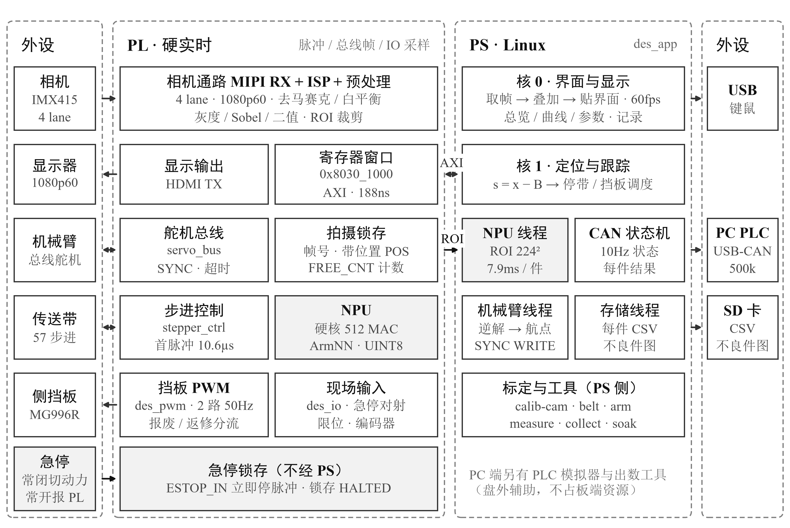
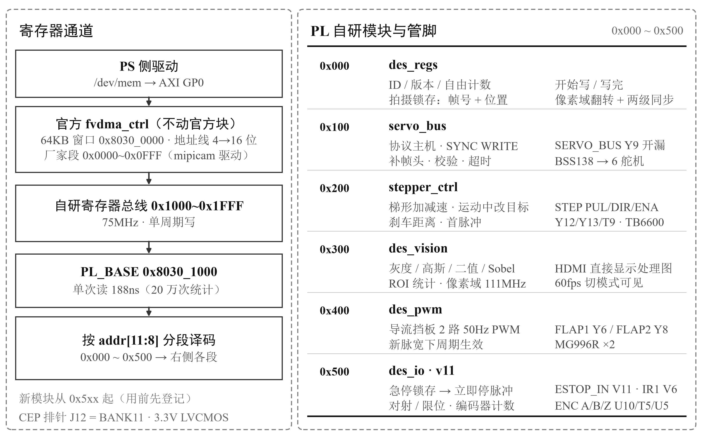
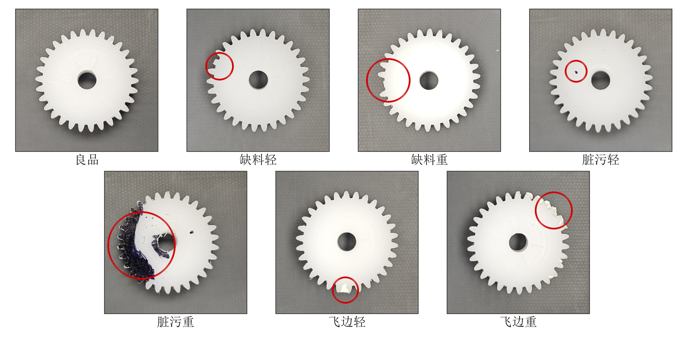
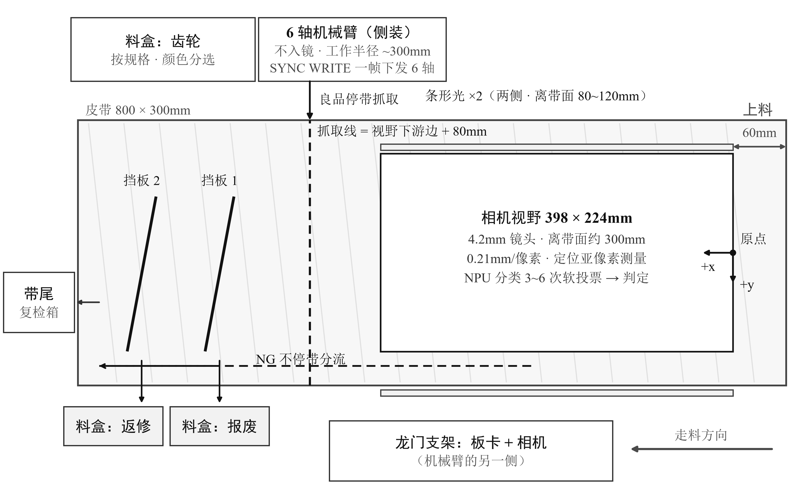

# 基于安路飞龙 SoC 的塑胶传动件在线质检分拣系统

**竞赛与选题**：2026 全国大学生嵌入式芯片与系统设计竞赛 · FPGA 创新设计赛道 · 安路赛题选题四
**硬件平台**：安路飞龙 F3P（MLK-F3P-DR1M90G，DR1M90GEG400）
## 摘要

针对注塑塑胶齿轮人工目检效率低、一致性差、只检不分的问题，本文基于安路飞龙 F3P 片上系统（system on chip, SoC）设计并实现了一套集在线质检与自动分拣于一体的嵌入式系统。系统按「硬实时—调度—推理」三级划分：可编程逻辑（programmable logic, PL）承担硬实时任务，包括德晟总线舵机协议主机（硬件补帧头与校验、SYNC WRITE 六轴同步、应答解析与超时）、步进梯形加减速与精确定位、拍摄瞬间的带位置锁存、逐像素图像预处理与 ROI 统计；处理系统（processing system, PS）上的 Linux 应用完成零件定位、亚像素几何测量、基于带坐标的跟踪与调度、六轴机械臂逆运动学解算与 HDMI 人机界面；神经网络处理单元（neural processing unit, NPU）以经 ReLU 改造与 8 位无符号整型（UINT8）量化的 YOLOv8n-cls 对每件零件的感兴趣区域（region of interest, ROI）做七类缺陷分类。测量结果与分类结果互为第二意见，判不准的零件进入复检，良品盒只放双重确认的零件。

实测结果表明：采集与显示帧率 60.02 fps（20 s 零丢帧）；NPU 单次推理约 8.0 ms，实物七类分类准确率 92.54%，良品/不良判别率 96.74%；硬件在环停带定位三档最坏误差 0.080 mm，节拍 22.7~48.8 件/min；CAN 命令往返平均 359 µs，Modbus-TCP 实物启停全部正确；软件连续运行 2 h 无错误。全部功能由 PL 硬件与 PS 软件协同实现并在板端运行，自研 PL 模块已完成综合、布局布线与板端 v16 上板验证，可为同类流水线视觉检测装备提供低成本、可复用的参考设计。

## 关键词

嵌入式视觉检测（embedded visual inspection）；可编程逻辑（programmable logic）；神经网络处理单元（neural processing unit）；亚像素测量（sub-pixel measurement）；传送带跟踪（conveyor tracking）；工业现场总线（industrial fieldbus）

## I. 引言

### A. 应用背景与检测对象

注塑成型是塑胶传动件的主要成形工艺，多规格、多颜色的聚甲醛（polyoxymethylene, POM）齿轮在批量生产中广泛使用。成形过程中可能出现缺料（齿不满）、脏污（料中黑点）与飞边（毛刺填齿槽）等外观缺陷，也会出现尺寸超差与规格混料等问题。人工目检速度慢且一致性差；只检不分的视觉检测站虽能替代目检，检测后仍需人工搬运与分类，难以形成闭环。因此，把检测、测量与分拣放进同一套在线系统，成为这类零件批量质检的现实需求。

本文的检测对象是注塑后多规格、多颜色的 POM 齿轮，缺陷按缺料、脏污与飞边各分轻、重两级，与良品一起构成七类。全链路由同一条传送带串联：可编程逻辑（programmable logic, PL）完成图像预处理并锁存拍摄瞬间的带位置，处理系统（processing system, PS）完成零件定位与亚像素几何测量，神经网络处理单元（neural processing unit, NPU）完成每件感兴趣区域（region of interest, ROI）的缺陷分类，跟踪表按带坐标 s 追踪每一件零件。处置分为三类：良品到达抓取线时停带，由六轴总线舵机机械臂按姿态夹起并依规格与颜色入盒；不良品不停带，由侧边导流挡板按带位置拦入报废盒与返修盒；存疑件送至带尾复检箱。

现场集成方面，一台 PC 经 CAN（controller area network）扮演产线可编程逻辑控制器（programmable logic controller, PLC），下发启停、调速与对时命令并接收每件结果；高清多媒体接口（high-definition multimedia interface, HDMI）1080p60 操作界面实时显示画面、曲线与参数，每件记录与不良品图像存入 SD 卡。上述链路全部运行在一块安路飞龙 F3P 片上系统（system on chip, SoC）上。硬件平台为 MLK-F3P-DR1M90G（DR1M90GEG400），片内集成双核 Cortex-A35、现场可编程门阵列（field programmable gate array, FPGA）与 NPU 软核。

### B. 赛题要求与设计目标

赛题对作品提出六项硬性要求[1]：（1）由 PL 实现工业级高实时硬件功能；（2）运行嵌入式 Linux 并提供人机界面与本地存储；（3）建立 PL 与 PS 之间的高级可扩展接口（advanced extensible interface, AXI）双向交互；（4）在 NPU 上部署轻量化模型；（5）具备 CAN 等外设通信能力；（6）给出完整的测试报告。就赛题的应用领域而言，本作品以流水线视觉检测（领域 3）为主，融合多轴运动与机电控制（领域 1，即机械手与传送机构）。本系统的落点与之对应：PL 承担工业级硬实时功能，PS 承担 Linux 应用、界面与存储，NPU 承担轻量化模型推理，三者只通过 AXI-Lite 寄存器与帧直接内存访问（direct memory access, DMA）交换数据。六项要求覆盖实时性、操作系统应用、片内互连、智能推理、现场总线与测试验证，构成作品的设计边界。

对照赛题对「流水线工业视觉检测」的中级与高级细则，本作品已实现 PL 硬件边缘检测与尺寸粗测、NG 分流机构联动（挡板 PWM 已上板验证，实物分流待测 ⚠）、亚像素测量、缺陷分级与网口对接 PLC：缺陷分级准确率 92.54%，达到高级细则「缺陷分级准确率 ≥92%」的要求；外径实际精度约 ±0.1 mm，相对中级细则「尺寸测量误差 <0.3 mm」留有余量（见第 VIII-C 节）。就发挥拓展项而言，本作品覆盖多轴联动与多通道同步（6 轴 SYNC WRITE 同步下发，同步误差待测 ⚠）、多协议网关（CAN、RS485 与 Modbus-TCP 之间的状态与命令转换）、AI 多任务（缺陷分类与几何测量双判定）、本地数据存储（每件记录与不良品图像）、网络运维（Modbus-TCP 从站）与工程可靠性（急停双路切断与锁存、舵机过载与过温状态位监测、2 h 连续运行）。

设计目标由此确定：在单块 SoC 上完成检测、测量、跟踪与分拣的完整闭环，使位置与时间量由同一基准推导，处理延迟不进入位置误差；同时把停带次数压到最低，只为需要抓取的良品停带，使节拍由机械臂动作决定。围绕该目标，系统按「PL 硬实时、PS 调度、NPU 推理」三级组织，外设与图像链路接 PL，需要灵活性与算法迭代的应用留在 PS，矩阵运算交 NPU。该三级划分贯穿第 II 节至第 V 节的设计。

实现上述目标需要同时应对三类约束。其一是位置基准：传送带会停带、变速甚至反转，若以取帧或处理完成的时刻推算位置，延迟波动会直接变成定位误差。其二是实时性：步进脉冲、舵机总线帧与挡板动作的时间粒度在微秒量级，不能交给受调度的 Linux 应用承担。其三是资源：官方 NPU 软核已占去大部分逻辑资源与片上存储，视觉预处理与全部自研外设只能在剩余预算内实现。本文的设计正围绕这三类约束展开。

主要实测指标为：采集与显示 60.02 fps（20 s 内 0 丢帧），NPU 单次推理约 8.0 ms，实物七类分类准确率 92.54%，良品/不良判别率 96.74%。实时控制方面，硬件在环停带定位三档最坏 0.080 mm，节拍 22.7~48.8 件/min，CAN 命令往返平均 359 µs，Modbus-TCP 实物启停全部通过，软件连续运行 2 h 零错误。完整的测试条件与数据出处统一见第 VIII 节，未实测项在该节以 ⚠ 标注。

### C. 主要工作与贡献

本文的第一项工作是把位置基准放在拍摄瞬间：PL 在帧起始锁存帧号、75 MHz 自由计数器与步进位置，PS 按零件所在图像行插值出拍摄时的带位置 B，并以带坐标 `s = x − B` 表示零件位置。这样停带、变速与反转都无需特殊处理，实测帧号差全为 1。第二项工作是不停带分流与只为良品停带：不良品由侧边导流挡板在线分流，皮带只为良品停一次，停带前先由硬件给出的刹车距离判断能否停在抓取线。硬件在环 50、100 与 150 mm/s 三档均停准，最坏 0.080 mm（含停稳后释放步进驱动器以保舵机总线的开销），节拍为 22.7、39.1 与 48.8 件/min。

第三项工作是测量与分类的双判定：亚像素几何测量（含视差、卷帘补偿与规格齿数推算）与 NPU 分类相互校验，一方判良品而另一方判缺陷时该件进入复检，良品盒只放双确认的零件。第四项工作是面向 NPU 的模型改造：激活函数由 SiLU 改为 ReLU，以按零件 ROI 分类替代整帧检测，对量化输出加 logit 偏置校正，并用实物缺陷样件按轻重两级训练。改造后实物七类在板上 NPU 上的准确率为 92.54%（良品/不良判别率 96.74%，无飞边的五类为 99.31%），单次推理约 8.0 ms，1 mm 缺陷的像素数由约 1 个提高到约 4 个。

第五项工作是全自研 PL 外设与寄存器通道：在官方相机 DMA 控制器的地址窗口上加宽译码，引出 `0x1000~0x1FFF` 的寄存器总线，并以 `addr[11:8]` 分段实现舵机总线、步进控制、视觉预处理、导流挡板与现场输入等模块，全部模块已上板。舵机 23 项、视觉 790 项、挡板 11 项与现场输入 28 项仿真全部通过。上述工作构成本文第 II 节至第 VI 节的设计内容，第 VII 节讨论机械、电气与安全，第 VIII 节给出实验与结果，第 IX 节总结全文。

## II. 系统总体设计

系统设计分为组成、分工、数据流与寄存器通道四个层面。本章先给出整机组成与硬件配置（表 1），再说明软硬件分工与数据通路（图 1），随后给出全系统统一的时间与位置基准（图 2），最后说明 PL 与 PS 之间的寄存器通道（表 2）。

### A. 系统组成与硬件配置

本系统由一块 MLK-F3P-DR1M90G 开发板、一套 VID005 相机子卡、一台 800×300 mm 皮带传送机、一台六轴总线舵机机械臂与两个侧边导流挡板组成；外围另有 M18 激光对射光电、RS485 继电器模块与 24 V 三色灯，以及一台扮演产线 PLC 的 PC。除 PC 外，全部部件围绕同一条传送带布置：相机架设于检测工位的带面上方，导流挡板与带尾复检箱沿带布置在检测工位下游。

主控为 MLK-F3P-DR1M90G 开发板，片内 DR1M90GEG400 集成双核 Cortex-A35、FPGA 与 NPU 软核，三级划分因而可以落在同一颗芯片上。视觉链路由 VID005 子卡与 IMX415 传感器组成，经移动产业处理器接口（mobile industry processor interface, MIPI）的 CSI-2 接口接入 PL，镜头焦距 4.2 mm。带速另由计米轮编码器独立测量，用于标定与步进指令的交叉校验。系统硬件配置汇总于表 1。

**表 1**　系统硬件组成

| 部件 | 型号与说明 |
|:------|:--------------------------------|
| 主控 | MLK-F3P-DR1M90G 开发板（DR1M90GEG400：双核 Cortex-A35 + FPGA + NPU 软核） |
| 视觉 | VID005 子卡 + IMX415（MIPI CSI-2，4.2 mm 镜头），两侧条形光（手动开关与调光，不接 PL） |
| 传送带 | 800×300 mm 皮带机，57 步进电机 + TB6600 类驱动器（16 细分，3200 步/圈，共阴直驱） |
| 机械臂 | 六轴：德晟 15 kg 总线舵机 ×5 与 6 kg 夹爪舵机，115200 bit/s 半双工单线总线，经 BSS138 由 PL 直驱 |
| 导流挡板 | MG996R ×2（皮带侧边摆杆：报废与返修）；舵机尚未装上 ⚠ |
| 对射 | M18 激光对射光电，V+ 取常电 24 V；接收端为 NPN 集电极，经 1N5819 肖特基二极管接 PIN9（FPGA 内部上拉）；已装，信号进 PL 待接 ⚠ |
| 通信 | 板载 CAN 收发器 ↔ PC USB-CAN（智嵌 ZQWL-UCAN-101E）；网口 Modbus-TCP；RS485 ↔ 4 路继电器模块 + 24 V 三色灯（空闲不亮、运行绿、暂停黄、急停红） |
| 带速测量 | 计米轮编码器 E6B2-CWZ6C（1000 线），独立于步进实测皮带；输出带 5 V 上拉，经 BSS138 接 3.3 V IO |
| 电源 | 24 V 主电源（LRS-350-24）+ 300 W 恒压恒流降压（舵机 6.8 V，恒流限流 + 保险丝）；急停常闭断受控 24 V（步进与舵机），常开报 PL |

执行机构由 PL 一侧统一组织：步进脉冲、舵机总线帧与挡板 PWM 均在 PL 内产生，PS 只下发目标值与时序参数。供电由 24 V 主电源与 300 W 恒压恒流降压组成，后者供舵机 6.8 V；急停常闭触点切断受控 24 V（步进与舵机），常开触点报入 PL 锁存。对射光电已安装，信号进 PL 待接。

### B. 软硬件分工与数据通路

系统按「PL 硬实时、PS 调度、NPU 推理」三级划分，分工由数据路径决定：时序关键、逐像素与逐比特的工作在 PL，需要灵活性与算法迭代的在 PS，矩阵运算在 NPU。相机经 MIPI CSI-2 进入 PL，经图像信号处理器（image signal processor, ISP）与自研视觉预处理后，由帧写 DMA 送入 PS 内存；HDMI 显示的即为 PL 预处理后的图像，显示链路与 PS 取帧共用同一份数据。PL 自研的舵机总线、步进控制、拍摄锁存、视觉预处理、导流挡板 PWM、现场输入与 RS485 收发等模块，经寄存器窗口与 PS 交换控制命令与状态。系统架构与三级分工如图 1 所示。

**图 1**　系统架构：外设、PL 与 PS 的数据通路及三级分工。

图像数据不经过寄存器通道，只由帧 DMA 批量搬运；帧号、带位置与视觉统计等少量状态走寄存器，PL 与 PS 由帧号与帧起始信号保持一一对应。PS 侧运行嵌入式 Linux，零件定位、亚像素测量、跟踪调度、机械臂控制、界面与本地存储均由应用层承担；NPU 只做逐件 ROI 分类，由 PS 侧加载与调用模型。通信外设同样分属两侧：CAN 与 Modbus-TCP 由 PS 侧驱动，RS485 的帧收发由 PL 的 `des_485` 模块承担。这样外设时序在 PL 内闭环，协议栈与业务逻辑在 PS 内迭代，两侧通过寄存器与 DMA 的窄接口解耦。

### C. 数据流与时间基准

全系统只有一个时间与位置基准：PL 内的 75 MHz 自由计数器 `FREE_CNT` 与步进位置 `POS`。零件位置按拍摄瞬间的带位置换算，采集延迟与推理延迟都不构成位置误差。时间基准与锁存路径如图 2 所示。

**图 2**　时间基准：拍摄瞬间锁存带位置，零件坐标与处理延迟无关。

帧写模块开始写帧时锁存 `FREE_CNT`、帧号与带位置 `POS`，写完后第二次锁存并把整组值更新到 `CAP_*` 寄存器；PS 取帧后按零件所在图像行确定曝光时刻（卷帘快门逐行读出），在两次锁存值之间线性插值出拍摄时的带位置 B。零件带坐标定义为 `s = x − B`（x 为台面坐标），零件不在带上滑动，因此停带、变速与反转都无需特殊处理。台面位置由 `s + 当前 B` 实时得到，调度器据此计算停带时刻与挡板合上时刻。PS 取帧返回后有整整一帧的时间读取锁存值，与下一帧不冲突。

该基准已由实测检验：锁存带位置差与「带速 × 读出时间」一致，帧号差全为 1，说明未发生跳帧；采集与显示在 20 s 内保持 60.02 fps 且 0 丢帧。由于零件位置只取决于被拍到的瞬间，PS 取帧与 NPU 推理的耗时不会传递到跟踪与停带判决。这一性质也是后续跟踪、停带与挡板调度都以带坐标 s 为唯一自变量的原因。

### D. PL-PS 寄存器通道

PL 与 PS 之间只走一条寄存器总线：官方相机 DMA 控制器 `fvdma_ctrl` 在 GP0 上占有 64 KB 地址窗口，本文在该窗口上加宽地址译码，把偏移 `0x1000~0x1FFF` 引出到 PL 顶层。由此形成 75 MHz、单周期写脉冲、读数据多路选择的寄存器总线，PL 基址为 `0x8030_1000`，官方驱动使用的 `0x0000~0x0FFF` 不受影响。各模块按 `addr[11:8]` 分段，PS 经 `/dev/mem` 映射后直接读写，单次读 PL 寄存器耗时 188 ns（20 万次统计）。

寄存器窗口的分段见表 2，表中列出各段的模块与主要内容。控制命令与阈值由 PS 下行写入，帧号、带位置、舵机应答与视觉统计由 PL 上行提供；图像本身不经过该通道。帧 DMA 与寄存器通道彼此独立，二者以帧号与帧起始信号对齐。

**表 2**　PL-PS 寄存器窗口分段

| 段 | 模块 | 主要内容 |
|:---|:-------|:------------------|
| `0x000` | `des_regs` | ID 与版本、`FREE_CNT`、帧号与帧周期、拍摄锁存（带位置、时间戳） |
| `0x100` | `servo_bus` | 舵机帧收发缓冲、状态、时间戳、错误计数 |
| `0x200` | `stepper_ctrl` | 模式、目标、速度与加速度（Q0.32）、位置、刹车距离 |
| `0x300` | `des_vision` | 处理模式、阈值、ROI；面积、外接框、质心、边缘数 |
| `0x400` | `des_pwm` | 导流挡板舵机脉宽（2 路 50 Hz，下周期生效） |
| `0x500` | `des_io` | 急停锁存、对射与限位输入捕获、编码器计数 |
| `0x600` | `des_485` | RS485 Modbus-RTU：配置、收发缓冲、状态与时间戳、计数（v16） |

## III. PL 硬件设计

PL 承担本系统全部硬实时工作：舵机总线帧的收发、步进脉冲的产生、拍摄瞬间的位置锁存、逐像素的图像预处理、导流挡板的脉宽调制与现场输入的去抖锁存。这些操作的共同特征是对时序敏感且时间粒度在微秒量级，交给运行 Linux 的 PS 会受调度抖动影响，因此由 PL 在固定时钟节拍下完成。六类自研功能模块按 `addr[11:8]` 分段挂在同一条寄存器总线上，各分段的内容见表 2，模块、寄存器窗口与引脚的对应关系如图 3 所示。

该总线沿用第 II-D 节的加宽译码方案：在官方相机 DMA 控制器 `fvdma_ctrl` 的 64 KB 地址窗口上把偏移 `0x1000~0x1FFF` 引出到 PL 顶层，形成 75 MHz、单周期写脉冲、读数据多路选择的寄存器总线，PL 基址为 `0x8030_1000`，官方驱动使用的 `0x0000~0x0FFF` 不受影响。全部自研模块只经这条总线与 PS 交换命令和状态；图像数据仍沿 ISP 到帧写 DMA 的 128 位数据通路流动，视觉预处理模块串接在这条通路上。RS485 收发模块 `des_485` 占用 `0x600` 分段，其功能与寄存器在第 VI 节说明。

**图 3**　PL 自研模块、寄存器窗口与引脚。分段译码按地址位 addr[11:8] 划分，引脚取自工程约束文件 io.adc。

### A. 舵机总线主机

机械臂的六个总线舵机挂在同一根 115200 bit/s 半双工单线上，采用德晟总线舵机协议 v4.01[2]。多轴协同动作依赖一帧 SYNC WRITE：一帧广播同时下发六个轴的目标位置与运动时间，各轴在帧结束时同时起跑，同步误差不会随轴数累积。协议层要求在单线上逐位完成收发换向、帧头与校验的拼装以及应答解析，这些动作的时间粒度同样在微秒级，因此总线主机由 PL 实现。

发送通路采用开漏方式，PL 只主动拉低总线，高电平由 BSS138 电平转换模块一侧的上拉给出，原因是舵机侧空闲电平为 3.7 V，3.3 V 的 IO 不能直接相连。帧头与校验由硬件自动生成：PS 只把帧主体 `[ID, LEN, 指令, 参数…]` 写入发送缓冲，PL 依次补上 `FF FF` 帧头、按 `~(ID+LEN+指令+参数) & 0xFF` 计算校验并串行发出。接收方向识别 `FF F5` 应答头，完成校验与长度检查后提取舵机的过载、过温与电压状态字节；发送期间关闭接收，每帧之后强制留出 1 字节时间的总线换向间隔，避免收发方向冲突。

为便于 PS 判断总线行为，模块内实现了超时、计数与硬件时间戳三类辅助功能。应答超时时间可配置，默认为 3 ms；超时、接收错误与已发帧数各有一个独立计数器。首个起始位、最后一个停止位与应答接收完成三个时刻分别锁存 `FREE_CNT`，帧时长与命令延迟由这些硬件时间戳相减得到，不依赖 PS 侧的软件计时，也不受 Linux 调度影响。

仿真以协议文档中的原例作为标准答案，覆盖 PING、READ、SYNC WRITE、无应答超时、错误校验与非法 LEN 等场景，23 项全部通过。上板实测六轴 SYNC WRITE 一帧耗时 3298.9 µs，理论值为 3298.6 µs；PING 一帧耗时 520.9 µs，理论值为 520.8 µs，两者与按波特率和帧长推算的结果相符。协议文档 SYNC WRITE 示例中印出的校验值 `0x8B` 与文档自身给出的公式不符，按公式计算应为 `0xBA`，硬件以公式为准实现，实测正确。

### B. 步进控制

传送带的 57 步进电机由 TB6600 类驱动器直驱，驱动器的输入是脉冲与方向信号，步进控制模块负责把速度指令转换为精确的脉冲序列。脉冲由相位累加器产生，速度以 Q0.32 定点数表示每时钟的步进增量（`inc = v × 2³² / 75 MHz`），相位累加器每次溢出即输出一个脉冲，速度分辨率为 0.017 步/s，长时间运行不产生累积误差。

模块提供速度与位置两种工作模式。速度模式下传送带连续运行，修改速度指令时自动平滑过渡；位置模式按梯形加减速运行，精确停在目标步数上，升降速节拍为 10 kHz。传送带「停在某一步」不需要停机重开，在运动中改写 `TARGET` 即可，减速点由硬件按当前速度与加速度实时重算；若新的目标已落在运动方向的身后，模块会减速停在目标之后并清除「到位」标志，也不会陷入往复判断。

抓取判定所依赖的刹车距离由 `BRAKE` 寄存器实时给出，PS 读取减速到停所需的步数后判断本件能否停在抓取线上，来不及停下的零件转为复检，不采用倒车追件的方式。安全方面，急停输入或 `HALT` 命令会立即停止脉冲并锁存该状态，必须由软件复位才能恢复。输出时序上，脉冲宽度为 5 µs，换向之后等待 10 µs 再发下一个脉冲，满足 TB6600 对脉宽与方向建立时间的要求；驱动器采用共阴还是共阳接法由顶层参数切换。

仿真使用独立的脉冲监视器核对正反向到位、换向、脉宽、最高速、减速停、急停、运动中改目标以及目标落在身后等情形。上板实测执行 `move 3200` 后 `POS` 与累计步数都精确等于 3200，说明脉冲计数与位置换算一致。

### C. 拍摄锁存

拍摄锁存的作用是让零件位置只取决于被拍到的瞬间，与 PS 取帧和后续推理的耗时无关。官方帧写模块在开始写帧时与帧写完成中断时各翻转一次信号，两路信号经两级同步进入 75 MHz 时钟域：开始写帧时把帧号、`FREE_CNT` 与步进位置 `POS` 锁进暂存寄存器，写帧完成时整组更新到 `CAP_*` 寄存器，于是一次锁存给出同一帧的完整时间与位置样本。

两组信号的先后关系保证了读取安全。PS 的取帧调用返回之后还有整整一帧的时间读取 `CAP_*`，不会与下一帧的锁存冲突；帧完成之前读到的始终是上一帧已经确定的样本，不会出现半更新的中间值。v16 比特流在锁存组中加入计米轮编码器计数，同一帧的带位置、时间戳与编码器读数可一并取出，供跟踪误差与打滑判断使用。

实测中，锁存得到的带位置差与「带速 × 读出时间」一致，帧号差全为 1，说明既没有跳帧也没有漏锁。这一结果使 PS 在计算零件坐标时只需按拍摄瞬间的带位置换算，无需为取帧与推理延迟做补偿。

### D. 图像预处理

PL 在 ISP 输出与帧写 DMA 之间做逐像素预处理，处理的是 128 位 AXI-Stream 数据，每拍 4 个 BGRA 像素。模块不反压上游，也不改变帧时序，处理与否只影响写入帧存的内容，因此 HDMI 显示的画面与 PS 取到的图像始终是同一份数据。

预处理提供六种模式，由模式寄存器选择。（1）模式 0 为原图直通，一拍输出。（2）模式 1 输出按 BT.601 加权的灰度值 Y = (77R + 150G + 29B) >> 8。（3）模式 2 为 3×3 高斯平滑，核按行列可分的 1、2、1 权重取 1/16 归一化。（4）模式 3 在高斯结果上按阈值二值化。（5）模式 4 输出 Sobel 梯度的绝对值之和 |Gx| + |Gy|。（6）模式 5 对 Sobel 结果按边缘阈值二值化。

3×3 窗口由两块行缓冲（ERAM）与列寄存器构成，每拍并行处理 4 个像素。窗口运算拆成列和、高斯或梯度、绝对值三级流水，共 6 拍延迟，目的是为参考时钟留出余量：像素通路的时钟来自 MIPI 字节时钟 111.1 MHz，时序约束按 125 MHz 施加，流水级数正是为满足该约束而设。除直通模式外，各模式共用同一套行缓冲与运算单元，切换只改变末端输出选择。

除整帧图像外，模块还提供 ROI 统计。PS 写入跟随离光轴最近零件的 ROI，PL 在二值图上统计面积、外接框、质心坐标和与边缘像素数，每帧发布一次；PS 把这些量换算成毫米即得到 PL 尺寸粗测，与 PS 的亚像素几何测量并列记录，两路结果可以相互印证。

模式切换采用无撕裂策略：新设置写入后并不立即生效，而由 `APPLY` 在下一帧起始生效，输出源在帧起始那一拍按新模式切换，保证每个帧起始脉冲恰好到达帧写模块一次。HDMI 显示的就是预处理后的图像，在 60 fps 下切换模式可以直接看到硬件灰度、滤波与边缘结果，便于联调核对。仿真覆盖 32×12 帧与 6 种模式，逐像素比对行为模型，并检查统计量、ROI、帧中途写设置与帧起始计数，790 项全部通过。为应对资源紧张，设计保留 `LANES=2` 的降级配置：每拍处理 2 个像素、滤波逻辑约减半，该配置下同样 790 项通过。

### E. 导流挡板 PWM

导流挡板由两个侧边摆杆组成，分别对应报废与返修两个分流方向，由 MG996R 舵机驱动。PWM 模块提供两路 50 Hz 舵机脉宽输出，新脉宽在下一周期起始处生效，因此占空比切换不产生毛刺脉冲，摆杆不会因半个周期的异常脉宽而抖动。

挡板的开合时机由 PS 调度器计算：调度器按挡板几何（转轴位置、摆杆长度、开合角度）算出每件零件碰到摆杆的位置以及摆杆扫过的区段，再按带位置控制摆杆在零件碰到之前合上、滑出之后打开（见第 IV-D 节）。两路输出错开动作并做 300 ms 平滑起停，避免两个摆杆同时启动造成的电源冲击。仿真 11 项通过；PWM 已上板验证读回值与 50 Hz 输出。光源由人工手动开关与调光，不接 PL，因此不占用逻辑资源。需要说明的是，挡板舵机尚未装上，`des_app.json` 中 `flaps.enabled=false`，上述几何参数是安装前的估计值，装好后需按实物回填 ⚠；挡板的机械结构与摆杆布置见第 VII-B 节。

### F. 现场输入

现场输入的共同要求是先锁存再处理，因为急停、对射与编码器事件的持续时间都可能短于软件响应周期。急停按钮按下并保持 1 ms 才被确认，确认后立即锁存并直接停住步进脉冲；PS 在任何状态都能读到该锁存位，只有在复位报警时才能清除，若按钮仍被按着则清除无效。这一处理保证即使软件处于异常状态，硬件也已把系统带到安全一侧。

对射光电与限位输入的去抖时间为 20 µs。对射每次挡光边沿都会锁存自由计数器、带位置与编码器计数，这三者是跟踪误差的原始依据：PS 比较预测前沿与实测前沿，判断零件是否与带面发生相对滑动。计米轮编码器按四倍频计数，输入经两级同步与约 107 ns 的滤波，Z 相单独锁存，A/B 两相同跳记为错误，测速在 10 ms 窗口内完成。

仿真 28 项通过。上板已验证 PL 级急停：常开触点按下时步进命令被忽略，松开后恢复，相关记录详见仓库 log。`des_io` 的锁存、界面「急停」显示与「复位报警」流程尚未实测 ⚠。编码器实测两次 Z 脉冲之间正好 4000 计数（1000 线 ×4），错误计数为 0。对射（M18 激光）已装但只接了电源，信号进 PL 与跟踪误差实测待做 ⚠。

### G. 资源占用与静态时序

资源是 PL 设计的硬约束。官方 NPU 基线已占用查找表（look-up table, LUT）的 79% 与嵌入式块 RAM（embedded block RAM, ERAM）的 92.5%，其中 NPU 软核单独占用 2.24 万 LUT 与 156 块 ERAM，剩余空间只够容纳逐像素、低延迟的处理逻辑，连通域、形态学等大块图像算法因此放在 PS 实现。自研模块的设计目标是在这一预算内完成实时控制，单个模块控制在数百 LUT 量级。

板端当前比特流为 v16，新增 `des_485` 与帧起始锁存的编码器计数，`pl_check.sh` 0 失败；综合资源为 slice 84.22%、LUT 80.15%、ERAM 261/280（93.21%）、数字信号处理器（digital signal processor, DSP）65%（156/240）。时序上，自研的 75 MHz、像素时钟、150 MHz 与 PS AXI 四个时钟域均无违例，剩余违例全部落在厂家加密 IP 内部，其中 TMDS 输出域尚待肉眼复核波形 ⚠。

最新源码构建尚未上板。默认 `opt_timing=high` 的单进程全流程 59 min 16 s 收敛；TD 6.2.1 综合（Optimize-Gate 选项，非布局布线）给出 LUT 46,360、FF 39,584、slice 估计 44,305（84.42%）、ERAM 245/280（87.50%）、DSP 157/240；布局后 slice 83.80%（43,980），Setup S-EP 为 0；布线后 Setup WNS 为 +0.007 ns、Hold WNS 为 +0.022 ns，setup 与 hold 违例端点均为 0。这一结果需要按口径理解：VTC 与 NPU、150 MHz 之间的跨时钟域路径按异步组排除，这些端点并未被真正修复；整体余量很薄，最差路径位于 TMDS 742.94 MHz 域，周期 1346 ps 中只剩约 0.5% 的余量 ⚠。该构建的候选 `BOOT.bin` 已打包但未上板，板端仍运行 v16。

自研模块的逐模块综合资源见表 3。表中数字取自重构后的一次综合，口径为 TD 6.2.1 的 Optimize-Gate 综合，并非布局布线结果；`des_485` 未单列，第五轮与第六轮的零行为精简也未逐模块拆分，整体数字以上一段为准。`des_vision` 是其中的资源大户，占用全部 2 块 ERAM 与 13 个 DSP；控制类模块都在数百 LUT 以内，与设计目标相符。

**表 3**　自研模块综合资源（TD 6.2.1 Optimize-Gate 综合口径，非 P&R）

| 模块 | LUT | FF | ERAM | DSP |
|:-------|:---:|:---:|:---:|:---:|
| `des_regs` | 9 | 457 | 0 | 0 |
| `des_io` | 77 | 478 | 0 | 0 |
| `des_pwm` | 58 | 123 | 0 | 0 |
| `servo_bus` | 246 | 351 | 0 | 0 |
| `stepper_ctrl` | 270 | 331 | 0 | 0 |
| `des_vision` | 977 | 1556 | 2 | 13 |
| `awb_seq_div`（2 实例） | 146 | 232 | 0 | 0 |
| **自研小计** | **1783** | **3528** | **2** | **13** |

表中 `awb_seq_div` 是 ISP 自动白平衡的逐位除法器，用于替换厂家的流水线实现。开发过程中对自研模块与厂家明文 RTL 做过多轮零行为重构，每轮都以整顶层的逐拍等价回归与综合资源对比作为验收条件，重构后源码规模明显下降，逐轮明细详见仓库 log。重构不改变端口、参数与寄存器接口，因此 PS 侧软件不随重构改动。

## IV. PS 软件设计

PS 上运行嵌入式 Linux，产品运行时的可执行程序为 `des_app`，只保留 `run` 与 `live` 两个模式。为使 60 fps 视频链路与视觉处理互不干扰，本系统按实时性划分线程：取帧与显示独占核 0 并运行于实时优先级，定位、测量、跟踪与调度集中于核 1，NPU 推理、机械臂执行与本地存储则各由独立线程承担。标定、测量、采集与机械臂调试等运维模式由 `des_tool` 提供，自动测试与底层调试件单独划分，它们与产品运行时共同构成 PS 侧的四类软件。

### A. 进程与线程模型

线程模型的划分依据是各任务对时延的敏感程度，表 4 给出产品运行时各线程的核绑定与职责。设计目标是让工作线程既不等待 NPU 推理，也不等待 SD 卡写入：NPU 与存储各自持有一个异步队列，工作线程只投递任务并读取最近一次结果，因此定位与调度的节拍由相机帧率决定，而不受推理耗时与存储抖动的影响。

**表 4**　PS 进程与线程模型

| 线程 | 核 | 职责 |
|:------|:----|:-------------------------|
| 取帧与显示 | 0（实时优先级） | 等待 DMA 帧完成并立即重新提交缓冲（平均 0.3 µs）；BGRA→BGR 写显示缓冲，叠加跟踪框、判定线与状态，贴操作界面并翻页 |
| 工作 | 1 | 定位、测量、跟踪表、调度、存储与界面状态更新 |
| NPU | 1 | 零件分类，经异步队列解耦，工作线程不等待 NPU |
| 机械臂 | 独立 | 执行抓取航点，完成后回报 |
| 存储 | 独立 | 后台写 CSV 与图片，工作线程不等待 SD 卡 |

实测结果符合上述设计目标。`run` 模式下显示保持 60 fps，每帧 13.0~13.9 ms（现版布局）；工作线程处理了 99.9% 的帧（2 h 统计），单帧定位平均耗时 5.9 ms（2 h 统计）。显示线程的负载主要来自画面合成，而不来自像素搬运；显示与视觉分处两核，画面合成的抖动因此不会传导到定位与调度。

像素搬运全程由 DMA 承担，CPU 不逐像素拷贝采集数据或扫描数据。相机帧由帧写模块（米联客开源 `uiFDMA` 与 `uidbuf_write`，150 MHz，经 HP0 口）写入 DDR，写完后以中断通知 PS；HDMI 一侧由 VDMA 从 DDR 中的显示缓冲读出扫描。CPU 每帧只做一次画面合成：把相机画面用 NEON 按 3/4 缩放并转为 BGR 写入两块显示缓冲之一，再贴上叠加信息与操作界面，最后用 VDMA 的停驻指针在帧边界切换。该合成固定在核 0 上执行，核 1 的视觉处理因此不受显示影响。

### B. 零件定位与相机标定

零件定位在 1/4 降采样灰度图上完成，依次经过白电平相对阈值分割、开运算、外轮廓提取与最小外接矩形拟合，最后由单应矩阵换算为台面毫米坐标（x, y, θ, 长, 宽）。分割阈值取 `locate.rel_thresh` 与平场场地基准的乘积，无标定文件时回退到 Otsu 阈值，并保留最小阈值保护。触碰图像边缘的零件只记录其存在而不使用几何量，面积超过上限者判为粘连件。

台面坐标系的建立依赖三组标定。`calib-cam` 用平放在皮带上的棋盘格拍摄一次，得到皮带平面的单应矩阵，并约定台面坐标系 x 轴沿皮带前进方向、服从右手系、原点位于视野上游边缘中点；合成图上该标定的五种姿态残差 rms 为 0.003~0.04 mm。`calib-belt` 让白纸随皮带走过已知步数，得到毫米每步与方向，并给出往返误差；`calib-enc` 在空带往返过程中每 10 ms 采样编码器，得到毫米每计数、轮周长、往返误差与速度波动，实测 0.049227 mm/计数（3 轮标准差 0.019%），未出现非法跳变。三组标定分别对应像素到台面平面的几何映射、带位移的等效比例与编码器计数三个层面，互相校验之后，跟踪表即可直接以步进计数推算零件在带上的位置。

相机定版后的实测结果为：定位残差 rms 0.240 mm，比例尺 0.1945 mm/像素，视野 373×214 mm，总倾斜 0.7°；皮带为 0.020921 mm/步（有效辊径 21.31 mm），横向漂移 +0.29 mm/100 mm，234 mm 往返误差 −0.08 mm。上述误差构成后续调度与测量的精度基准。

位置视差是定位误差的主要来源。零件顶面高出皮带 h，按皮带平面标定读出的位置会以相机正下方点为中心向外放大 k 倍。将「绕正下方点按 1/k 缩放」并入单应矩阵，得到面向零件顶面的 `px_to_part`，它仍是单应，定位、跟踪、叠加与裁切共用这一变换。k 由实测确定：三个 10 mm 厚的齿轮随皮带走过 7 个站点，其质心位移是皮带位移的 1.020 倍，符合侧壁可见模型 k = (2H − h) / (2(H − h))；该模型要求只看顶面时物距 H 约为 510 mm，在本工位无法实现，故取外径随位置最一致的 H = 295 mm（与尺量一致），此时离正下方 150 mm 处约 3 mm 的位置偏差得以消除，残差约 0.25%。

现行灯位为光源高位朝下、侧壁变暗，模型相应切换为侧壁暗模型（`walls_visible` 置为 false），k = H/(H − h) ≈ 1.035，定位直接按顶面计算。该组参数使视差在视野内不再表现为系统性放大。

### C. 亚像素几何测量

每件零件只在离光轴最近的一帧上测量一次，此时视差最小，单核耗时 4~5 ms。测量结果既作为尺寸判据直接决定处置，也作为独立于 NPU 的第二意见参与复检判定，例如 NPU 判为良品而测量发现缺齿时，该件转复检。

测量流程分为五步。（1）在感兴趣区域内二值化，找出外轮廓与内孔。（2）沿每个轮廓点的法线方向搜索灰度穿过 50% 电平的亚像素位置，该电平取皮带与零件灰度的中点。（3）用单应变换映射到毫米坐标，并做视差校正与卷帘快门逐行补偿，后者针对运动中各行曝光时刻不同所引入的偏差。（4）对齿轮拟合齿顶圆（只使用法线接近径向的点）、孔径与偏心，再由齿距推算规格齿数，齿距取中位数 ±25% 范围内的平均值，使 30 齿缺 2 齿与 28 齿可以区分；同时判定缺料齿、缺齿与三种形态的飞边，即槽底填高、两齿连成一片与槽中凸起。（5）对裁切图亮区的平均色调与饱和度按配置归类为白、黄、橙、蓝、红五种颜色，用于按颜色分拣与颜色混料判别。

平场校正是裁切图预处理的关键一步。广角镜头的渐晕与条形光的不均匀使视野四角只有中心亮度的 32~51%（最暗 31%）。本系统让白纸随皮带走过视野的 13 个站点，得到 48×27 的白电平网格，裁切图逐点乘以 ref / white 完成校正，校正后纸面亮度的 p5~p95 为 98.0~101.8%。该校正对 NPU 输入、存图与训练集共用同一套变换，避免训练与推理之间的分布差异。

误差水平可从合成图与实物两个层面衡量。合成图按 0.15 mm/像素生成（非实测），拟合精度为外径 ≤0.003 mm、齿距 ≤0.001 mm。实物测量取 30 齿零件、曝光 800 µs、画面中心静止，3 件各测 20 次，外径 σ 0.004~0.009 mm；综合多规格标定结果，实物外径重复性为 σ 0.004~0.011 mm。

系统偏差主要来自边缘定位与光照。窄齿尖经模糊后其 50% 边缘落在真实齿尖以内，外径读数偏小约 0.5~1.0 mm，且随灯光角度变化；亮顶面向孔内扩展使孔径读数偏小。为此用卡尺量过的标准件确定修正量，修正只加在报告值上，更换曝光、灯光或相机后需重新标定。单一偏置无法适应尺寸变化：按 30 齿确定的偏置 +0.96 mm 会使 20 齿外径偏大 0.33 mm，现行修正改为由 20、28、30 齿四件拟合的「增益 × 拟合值 + 偏置」形式，增益 1.0285、外径偏置 +0.02 mm、孔偏置 +0.15 mm。修正后 20 与 28 齿外径误差为 ±0.01 mm，30 齿两件为 −0.08 mm 与 +0.07 mm；孔 30 齿两件为 +0.01 mm 与 +0.02 mm，20 与 28 齿为 +0.13 mm 与 −0.22 mm，后者主要受小孔卡尺本身不准的限制。

旧灯位（侧壁亮模型）下三个齿轮的交叉验证结果为外径差 −0.021~+0.003 mm、孔差 −0.03~+0.05 mm；现行灯位逐站扫描时，离光轴 10、11、48 mm 处外径差分别为 −0.03、+0.02、+0.08 mm。同一齿轮翻面后外径差 0.11~0.12 mm，原因是注塑件两面轮廓不同，故外径实际精度约 ±0.1 mm，判废公差取 ±0.2 mm。

测量可信范围同时受曝光与视场限制。曝光时间取 800 µs，白零件顶面不过曝，50 mm/s 下拖影 0.04 mm。离画面中心越远，进入轮廓的侧壁越多，外径读数偏大：75 mm 处 +0.6 mm，150 mm 处 +5 mm，故尺寸只取每件离中心最近的一帧。横向偏离中线 42 mm 时外径即偏小 0.2~0.55 mm。现行灯位高位朝下、侧壁变暗，可信范围扩大到离光轴 40 mm；此外在相机上游设 V 形导向条（出口宽 50~60 mm，中线向机械臂侧偏约 15 mm），使零件中心落在判齿范围、NPU 训练数据覆盖范围与机械臂竖直可达范围的交集内。

### D. 跟踪与调度

跟踪表以带坐标 s 为核心：零件在带上的位置只随 s 变化，停带、变速与反转都无需特殊处理。调度只承担两件事，即良品停带抓取与不良品导流，其时间关系如图 4 所示。

**图 4**　良品停带抓取与不良品导流时序：示意，时长取默认配置。

跟踪表为每件零件分配一个 ID，以带坐标 s 关联多帧观测，关联门限 12 mm，状态依次为新建、跟踪、已判定、抓取中与完成。零件经过判定线之前，系统融合多帧分类与测量结果确定处置：良品按规格与颜色选料盒，不良品按类别选报废或返修，其余转复检。

停带抓取的判定发生在下一个待抓良品接近抓取线时：调度器先查询 `BRAKE` 刹车距离，再检查夹爪两指的开合区域与邻件是否冲突，θ 与 θ + 90° 两种候选姿态都需通过检查，全部通过后才把步进目标改写为「该件恰好停在抓取线」。机械臂随后下探、夹取，抬起后立即恢复走带；来不及停或有冲突的零件转复检，系统不倒车追件。

挡板分流针对不停带的不良件。机械臂对侧的带边安装两个平摆舵机摆杆：挡板 1 的转轴与抓取线同位（正对机械臂底座），其摆杆在抓取线上游拦下报废件；挡板 2 位于下游，拦下返修件。挡板合上时斜拦零件摆放带，皮带推着零件滑入侧边料盒，1 号盒收报废件、2 号盒收返修件；未被拦下的零件走到带尾进入复检箱。该设计具有失效安全性，漏检、跟丢与挡板故障都只导致零件进入复检。调度器按带位置在碰件前合上挡板、在零件滑出后打开；若摆杆开合扫过的区段内还有别的零件（包括路过的良品），则不拦而改走复检。⚠ 挡板舵机尚未装上，几何参数取安装前的估计值，图 4 亦为示意，实物分流效果待测。

硬件在环测试让模拟零件以真实 PL 步进计数为位移基准运动，数据经模拟相机、跟踪表、调度回到 PL 步进，在 50、100、150 mm/s 三档速度下 6/6 全部通过：8 件良品全部停准抓取，最坏偏差 0.080 mm，其中含停稳后释放步进驱动器以保舵机总线通信的开销；4 件不良品全部到达带尾，节拍分别为 22.7、39.1 与 48.8 件/min。

### E. 机械臂控制

机械臂由 5 个定位关节与末端夹爪构成，关节依次为底座、大臂、小臂、腕俯仰与腕旋。控制系统对台面目标点求解逆运动学，腕旋角按零件姿态 θ 对准，6 轴指令在一帧 SYNC WRITE 中同时下发，使各关节在同一控制周期内动作。

齿轮圆对称，夹取方向取与底座方向相切。竖直方向够不着时，软件可令夹爪朝外倾斜下探，最大倾角 40°，下探过程中两指沿切向保持水平；但本台机械臂的倾斜能力受 #5 轴行程限制。各关节角经零位与比例换算为位置码后下发。

夹爪的装配偏差需要补偿：#4 轴到指尖距离 190 mm（其中工具段 111 mm），指尖中心偏离腕旋轴（#5）9 mm，若不补偿，抓取点将随 #5 转角画出半径 9 mm 的圆。运动学把该偏置作为工具坐标系中的固定向量，按 #5 转角反解使抓取点落在目标上的底座角，采用定点迭代求解；倾斜下探时自动选择让 #6 舵机位于外侧的 #5 转向，避免舵机碰撞带面。⚠ 当前实装机械臂的 #5 行程为 ±145°，倾斜需要 #5 转到 ±180°，`des_tool ik` 扫描时全部卡在 #5 行程上，实际只有竖直夹取可用。

夹取确认依据 #6 轴位置：闭合后读取其位置，与闭合指令相差大于 0.8 mm 即判为夹住，此时舵机停在零件宽度附近；完全闭合则判为空抓。调试工具 `des_tool arm` 支持扫描舵机、读取位置、手掰示教、回零、走点与整套取放，运动命令默认只打印，加 `--go` 才执行。手眼标定已完成，底座位于台面 (437.8, 142.4)、`belt_z` 为 −54.1，参数存于 `calib.json`；重复定位精度与真抓验证待测 ⚠。

### F. 人机界面

赛题要求提供 HDMI 曲线与参数配置界面，而板上 Qt 仅有独立镜像，为不影响 60 fps 视频链路，本文用 OpenCV 自绘界面、以 FreeType 渲染中文，共五页覆盖运行、曲线、参数、记录与机械臂调试，如图 5 所示。

**图 5**　HDMI 操作界面五页（总览、曲线、参数、记录与机械臂调试）。

画面布局分三块：左侧 1440×780 为主画面，右侧 480×780 为状态栏，底部 1920×300 为操作条，USB 鼠标与键盘支持热插拔。

五页的功能分工如下：（1）总览页显示运行状态、计数与良率、节拍、带速、NPU 耗时与最近零件；（2）曲线页给出齿轮外径与孔径的趋势线、规格线与工序能力指数（process capability index, Cpk），并绘制处理耗时与带速曲线，带速同时显示命令值与编码器实测两条线；（3）参数页集中管理配方（换型）、启停、正反点动、带速、外径与孔径公差、置信度门限、存图策略以及 PL 显示模式与阈值，参数即时生效并保存；（4）记录页列出最近零件的裁切图、类别、测量值与去向；（5）机械臂页提供 6 个舵机的手动调试，显示位置、角度、目标、初始姿态与状态位（过载、过热、电压），可按步长与动作时间微调，并在软限位内 SYNC WRITE，另提供解锁、扭矩开关、记录或设为初始姿态以及复位操作。界面元素在显示线程内贴入显示缓冲，翻页与参数操作因此与视频显示共用同一刷新节拍。

此外系统保留脚本输入通道，通过命名管道接收远程点击与截图请求，用于自动化测试与界面截图，使界面验证不依赖人工操作。

### G. 本地存储与运行记录

每件零件判定完成后写入一行 44 列的逗号分隔值（comma-separated values, CSV）记录，不良品与复检件另外保存 ROI 裁切图，记录按日期分目录存放。PC 端脚本 `part_stats.py` 直接读取这些记录生成测试报告的统计表，因此现场记录与报告数据同源。

CSV 列覆盖时间、件号、帧号、类别与置信度、处置与去向及原因、全部测量值、带坐标与姿态、PL 粗测、NPU 投票次数与推理耗时及延迟、图片名与配方号。板上没有实时时钟，记录时间取本机时钟加 PLC 经 CAN 下发的时间偏移，该偏移只用于记录换算，不改动系统时间。

## V. 视觉与缺陷分类

视觉与缺陷分类承担分拣链路中的判断环节，其输出与亚像素几何测量的结果共同决定每件零件的去向。与常见的整帧检测方案不同，本系统先由 PS 完成零件定位，再把分类任务收敛到单个零件的幅面上，由此在有限算力下获得足够的缺陷分辨率。

### A. 按零件 ROI 分类的动机

本系统需要甄别的缺陷，即缺料、脏污与飞边，尺度多在 1 mm 量级。在 4.2 mm 镜头、相机高度约 300 mm 的配置下，整幅图像的空间分辨率约为 0.19 mm/像素；若把整帧缩到 416 的输入尺寸，单个像素将代表约 0.90 mm，1 mm 的缺陷在网络上只剩约 1 个像素。此时轻重两级无法稳定区分，卷积网络的算力也大部分消耗在背景上。

PS 在每帧中给出每个零件的位置与方向（见第 IV-B 节），分类因此可以退化为对单个零件的判别。本系统按零件方向把零件转正，从原图裁出 56×56 mm 的 ROI，再缩放到 224×224 送入分类网络；此时单个像素约 0.25 mm，同样的 1 mm 缺陷约占 4 个像素，分类网络的计算量约为整帧检测的 1/7。分辨率与计算量的双重收益，是按零件 ROI 分类取代整帧检测的直接原因。

整帧检测还要求网络在同一幅图上同时完成定位与分类，检测框的回归误差会直接叠加到缺陷判别上；本系统的定位与亚像素测量由 PS 的几何流程独立完成，其精度不受分类网络输入分辨率的限制（见第 IV-C 节）。把定位与分类拆开之后，分类器只需回答零件属于哪一类缺陷，输入尺寸可以压到 224×224，为板端 NPU 留出算力余量。

### B. 轻量化模型与板端部署

分类模型选用面向板上 NPU 改造过的 YOLOv8n-cls[3]，输入 224×224，以 ImageNet 预训练权重迁移，训练时只做翻转与亮度两类温和增强，不做会抹掉缺陷的随机擦除。类别按缺陷类型与轻重两级展开，共 7 类：良品，缺料轻与缺料重，脏污轻与脏污重，飞边轻与飞边重；分级标准见第 V-C 节。良品类覆盖 20 / 28 / 30 齿孔 6 与 30 齿孔 8 的全部规格，规格由几何测量判定，颜色由色调判据判定，分类网络只负责缺陷类型与轻重。分类结果直接决定去向：良品送机械臂抓取，缺料两级与重脏污报废，轻脏污与飞边两级返修。

在板端 NPU 上，737 张测试集图像（样品均未参与训练）的 7 类准确率为 92.54%，OK/NG 二分类为 96.74%，按零件投票为 73/78（OK/NG 76/78）。良品 249/250，缺料两级、重脏污与重飞边几乎全部正确；轻脏污有 17/80 张被判成重脏污，轻重判错但仍为不良；表现最弱的是轻飞边，80 张中仅判对 45 张。按零件投票把同一零件的多次分类概率累加，可抑制单帧的偶发误判，轻飞边这类难例的判定因此比单帧结果更稳定。

两件难例说明了分级与尺寸测量互补的必要性。齿槽飞边那件在 4 轮投票中都判为不良；孔里飞边那件 5 轮投票中有 2 轮判为良品，原因是孔边补土在这两轮里显得更小。产线上由几何测量补第二道判定：孔里的飞边会使孔径偏小、偏心变大，该件在画面正中测得孔 5.55 mm、偏心 0.37 mm，均超差，按尺寸规则报废；NPU 判良品但测量到齿槽飞边或缺齿时，改送复检。此前不含飞边的 5 类模型为 99.31%，OK/NG 100%。分类与测量两条判据并行工作，任一方判为不良即不进入良品盒，只有双确认的件才按良品送机械臂抓取。

模型改造围绕板端 NPU 的算子特性展开。NPU 对 SiLU 激活只做近似计算，因此训练与导出改用 ReLU：同一批合成数据上，ReLU 版在板上为 96.25%，SiLU 版为 94.0%，两者推理时间相同。per-tensor 量化会压缩良品与缺料轻之间的分界，第一版 PC 端 uint8 推理的良品准确率只有 53%；导出时用训练图统计 fp32 与 uint8 输出之差的均值，写入模型 JSON 的 `logit_offset` 字段，由 PS 在 softmax 前加上，并配合全部实物数据重训拉开分界，最终量化模型与 fp32 逐张一致。量化流程为 ONNX 去 Softmax（由 PS 完成）、ONNX Runtime 静态量化（QDQ、UINT8、per-tensor，与官方示例同格式）与形状推断；per-channel 在 PC 上更准，但板上推理中止，故采用 per-tensor。

部署链为 ArmNN[4] 与厂家 Alnpu 后端，输入在 PS 端预先量化为 UINT8（查表完成），单次推理约 8.0 ms（7 类模型在板上实测 8.01 ms，5 类模型为 7.85 ms，旧 4 类模型为 7.8 ms），输入准备 1.45 ms，模型加载 0.11 s。每件零件经过视野时分类 3~6 次，概率累加后取最大类，置信度不足的件进入复检。训练与推理使用同一裁切函数（`roi_crop`）与同一归一化，是精度不掉的必要前提。此外，量化后的 ONNX 若缺少中间张量形状，ArmNN 解析器会直接段错误且没有日志，因此导出脚本强制做形状推断。

### C. 数据集与训练策略

数据按缺陷类型与轻重两级组织，良品覆盖全部规格，缺料、脏污与飞边各分轻、重两级。缺陷样件由冷加工制作，每个等级 8 件，其中 6 件用于采集训练图，2 件只用于测试，以满足分级准确率必须用未见样品测量的要求；良品测试组另用 3 个单独的齿轮。按零件划分使测得的准确率反映模型对未见样件的泛化能力，而不是对训练样品的记忆。飞边分级以缺陷处数为准：轻飞边为 1 处，即一个齿槽或孔里填充不到一半；重飞边为 2 处及以上，或孔里填充超过一半。良品与三类缺陷的样件形貌如图 6 所示。

**图 6**　零件与七类缺陷样件。良品齿轮与缺料、脏污、飞边三类缺陷的轻、重两级样件对照。

实物数据自行采集与合成，训练在 RTX 4060 上完成（WSL + CUDA）。采集使用 `des_tool collect --cls <类别>`，一次只放一类零件，按零件分目录自动保存裁切图；验证与测试部分用另外编号的零件单独采集，并按零件而非按图片划分，避免同一零件同时出现在训练集与测试集。实物采集在皮带 30 mm/s 自走条件下进行，每件经过视野存 10 张；训练按 60 轮训满并取最后一轮权重，不按测试集挑选。剔除带激光红点的图像 205 张后，各规格与各类别的样本数及训练、测试划分见表 5。

**表 5**　数据集规模与划分

| 类别 | 训练集（张） | 测试集（张） |
|:-------|:---------:|:---------:|
| 良品 | 1469 | 250 |
| 缺料轻 | 660 | 80 |
| 缺料重 | 290 | 80 |
| 脏污轻 | 300 | 80 |
| 脏污重 | 320 | 92 |
| 飞边轻 | 274 | 80 |
| 飞边重 | 259 | 75 |

表 5 中良品的训练集由 30 齿 833 张、20 齿 287 张、28 齿 219 张以及 30 齿孔 8 的 130 张组成，测试集为 30 齿 100 张、20 齿 70 张与 28 齿 80 张。训练集最初漏掉 30 齿孔 8 规格：当时该规格 130 张良品中有 49 张被浮点模型判成重飞边，可见未参与训练的规格必须补进良品类，规格覆盖不全的代价远高于多采一类样本。合成数据只能用于验证链路：仅用合成数据训练的模型对 833 张实物良品只判对 38.8%，实物重训不可省，合成数据与实物之间的域差异远大于类间差异。

分类对颜色不敏感：测试图转灰度后，板上准确率为 88.87%（彩色 92.54%），准确率下降主要集中在轻飞边与轻脏污。训练时随机转灰度会使 UINT8 逐层量化掉 10~20 个点，更换校准设置也无法挽回，因此训练不做灰度增强。灰度复测的下降说明颜色对分类有增益，但主判据仍是形貌与纹理。对射激光会在零件经过光束时于侧面照出红点，持续 1~3 帧，训练与测试均不收录带红点的图像。正式运行时开启激光后的影响尚待实测 ⚠，必要时在零件投票中跳过带红点的帧；开着激光整线运行时，NPU 与几何测量对轻飞边的合计检出率同样待实测 ⚠。

### D. PL 与 PS 的视觉分工

视觉链路的算力分布在 PL、PS 与 NPU 三类器件之间，分工按运算性质划分：固定逐像素运算归 PL，复杂算法归 PS，卷积归 NPU，具体见表 6。

**表 6**　PL / PS / NPU 视觉分工

| 承担者 | 主要内容 | 分工依据 |
|:---|:-----------|:------|
| PL | 逐像素灰度、滤波、边缘与二值运算，ROI 面积与外接框粗测 | 固定运算，零延迟，不占用 CPU |
| PS | 零件定位、亚像素几何测量、视差与卷帘补偿、跟踪 | 算法复杂，需要迭代与全局信息 |
| NPU | 缺陷分类 | 卷积计算由专用加速器承担 |

这样的划分使每一类运算都落在最适合的器件上。PL 在采集通路上完成逐像素的灰度、滤波、边缘与二值运算，并给出 ROI 面积与外接框的粗测结果（见第 III-D 节），这些运算固定、零延迟且不占用 CPU；PS 负责零件定位、亚像素几何测量、视差与卷帘补偿以及跟踪（见第 IV-B 节与第 IV-C 节），这些环节算法复杂、需要迭代与全局信息；NPU 只承担 224×224 的缺陷分类，卷积计算交给专用加速器完成。可编程逻辑的资源只够容纳逐像素、低延迟的处理，这一分工也避免把大块图像算法放进 PL。分类所需的 ROI 由定位结果裁出，分类精度与定位稳定性直接相关；PL 的粗测结果在分类置信度不足时可作为复检的补充判据。

## VI. 工业总线通信

工业总线通信由三条链路组成：与产线 PLC 交互的经典 CAN 协议、面向工厂 PLC 的 Modbus-TCP 从站，以及驱动塔灯与继电器的 RS485 主站。前两条链路共用同一套命令与状态语义，第三条链路把本机的运行状态映射为现场灯态。

### A. CAN 产线协议

板载 CAN 收发器只支持经典 CAN，本系统采用 CAN 2.0A（11 位标识符）[5]、500 kbit/s 的自定义产线协议，与 PC 端的「产线 PLC」通信；同一套命令与状态另经网口 Modbus-TCP 从站向工厂 PLC 开放（见第 VI-B 节）。协议定义在 `ps/src/hw/can_proto.h`，多字节字段按小端排列，报文按方向分为 PLC 到本机与本机到 PLC 两组，见表 7。

**表 7**　CAN 产线协议报文

| 方向 | 标识符 | 内容 |
|:-----|:------|:-----------------------|
| PLC → 本机 | 0x100 CMD | 启动 / 停止 / 联锁暂停 / 恢复 / 复位报警，附命令序号 |
| PLC → 本机 | 0x101 SPEED | 带速（0.1 mm/s） |
| PLC → 本机 | 0x102 RECIPE | 配方号（换型：切换规格齿数 / 外径 / 孔径；运行中拒绝） |
| PLC → 本机 | 0x103 PLC_HB | PLC 心跳（≥2 Hz；1 s 收不到清除「PLC 在线」） |
| PLC → 本机 | 0x104 TIME | 对时（unix 秒 + 毫秒） |
| PLC → 本机 | 0x105 LAMP | 塔灯接管（v1.2）：经 RS485 写继电器模块；RS485 不在跑时拒绝 |
| 本机 → PLC | 0x180 ACK | 命令 ID、序号、结果（成功 / 状态不允许 / 数值不对 / 未知） |
| 本机 → PLC | 0x181 STATUS | 状态、标志（b5 = RS485 在线）、带速、报警码、心跳、运行时间，10 Hz |
| 本机 → PLC | 0x182 COUNTS | 总数 / 良品 / NG / 复检，1 Hz |
| 本机 → PLC | 0x183 PART | 每件：件号、类别、去向、料盒 / 出口、置信度、主尺寸（0.01 mm） |
| 本机 → PLC | 0x184 ALARM | 报警码、级别、细节 |

命令侧覆盖产线生命周期：启动、停止、联锁暂停、恢复与复位报警由 0x100 CMD 携带命令序号下发，带速、配方、心跳、对时与塔灯接管各有独立标识符。状态侧以 10 Hz 上报运行状态与标志位，1 Hz 上报总数、良品、NG 与复检计数，每件零件单独上报件号、类别、去向、料盒或出口、置信度与主尺寸（0.01 mm 精度），报警则单发。这样 PLC 既能看到产线级统计，也能追溯到单件。

本机状态机分为空闲、运行、暂停、急停与故障五态，PLC 命令与界面按钮走同一套规则，例如未启动时的「恢复」会被拒绝、运行中不接受换配方。配方由 `recipes.json` 定义各产品规格的齿数、外径、孔径与偏心及公差（20 / 28 / 30 / 36 齿等），PLC 发 RECIPE 或界面选择后在停机或暂停时生效，每件记录带配方号。切换配方会同时改变良品判据与混料判据：切到「28 齿」配方后，同一批零件中的 28 齿件由报废变为良品，30 齿件则变为规格混料。PC 端的 PLC 模拟器（Python / tkinter）提供按钮、计数、逐件结果、报警与收发统计，用于在接入真实 PLC 前复现产线交互。

协议先在板上回环验收：命令往返平均 359 µs（最小 341 µs、最大 825 µs），1000/1000 全部成功，200~2000 帧/s 下零丢失、零错序。CAN 的物理通路在硬件上另行实现：板载 CAN 与 RS485 收发器接在 PL 管脚（CAN 为 F20 / F19），官方演示工程的块设计没有启用 PS CAN0，接收脚接 0、发送脚悬空且无管脚约束，官方比特流下 CAN 实物不通；现版比特流把 PS CAN0 硬核的收发信号经块设计引到顶层并约束到 F20 / F19（接收脚上拉）。单节点实测发帧后发送错误计数停在 128、进入被动错误而不离线，这是无应答条件下的标准表现，说明发送与接收回路已经接通。回环测试覆盖协议栈与帧收发时序，但不经过收发器与线束，物理层需要另行验证。

为验证实物链路，用 PC 端 USB-CAN（ZQWL-UCAN-101E）充当 PLC：该适配器是 USB 虚拟串口，按厂家二次开发协议直接收发，不依赖厂家 DLL。双节点实测（2 min，PC 每 0.5 s 一条命令并发送 2 Hz 心跳）中 240 条命令全部应答、0 条未应答，应答往返（PC 时钟、含 USB 适配器）中位 44.5 ms、最大 77 ms，板端状态帧 1063 帧 0 丢失。测试中发现「应答立即发」与「同周期排队帧」背靠背会丢帧（3%），改为应答单独排队、每周期仍只发 1 帧，该现象随之消除，ACK 与周期性状态帧不再争用同一个发送窗口。2 h 回环中，接口 TX 108,691 / RX 107,691（差 1000），PLC 侧 STATUS 63,928 帧丢 82 帧（0.13%），其中 79 帧落在有 PART 突发的秒内，仍属背靠背连发；现除 ACK 外每周期最多发 1 帧，复测中 ⚠，实物上料的长时间误码待测 ⚠。

### B. Modbus-TCP 从站

工厂侧的西门子、三菱与欧姆龙 PLC 以及组态软件普遍走以太网，因此本系统在 PS 网口的 502 端口上另开一套 Modbus-TCP 从站[6]，命令与状态沿用 CAN 链路的同一套语义。保持寄存器中 HR0 为命令、HR1 为带速、HR2 为配方、HR5~6 为对时、HR7 为塔灯，均可写，HR3 结果与 HR4 执行序号只读；输入寄存器提供状态、标志、四项 32 位计数、最近一件的件号、类别、去向、尺寸与置信度、实际带速以及心跳。命令与结果分开映射，PLC 侧先写命令寄存器、再读结果与执行序号，与其循环扫描的编程方式一致。

三路命令源（CAN、Modbus-TCP 与界面按钮）并发时，写入在服务线程里只排队，由控制循环按与 CAN、界面按钮相同的规则执行，因此不会互相覆盖。PLC 写入后等待「执行序号」变化再读结果码，即可确认该条命令已被执行。服务端为自行实现，用单线程 poll 完成 MBAP 分帧，处理半帧与粘包，异常码按 01 / 02 / 03 返回，不依赖第三方库。

实测中，电脑经网线读取全部 24 个输入寄存器的平均往返为 1.04 ms，服务端单元测试 39 项通过。实物启停（皮带真实运行）依次执行启动、调速（50、30 与 80 mm/s）、联锁暂停、恢复与停止，各步状态全部正确，4 种非法写均被拒绝，从写入到执行确认的耗时为 14~24 ms。

### C. RS485 与警示灯

RS485 是本系统的第二条工业总线，自 v16 起，PL 中的 `des_485` 模块作为 Modbus-RTU 主机，从站为 4 路继电器模块（地址 1，9600 8N1，接 J11 第 5 / 6 位），继电器再驱动 24 V 三色警示灯。实测读取 8 路线圈 1000/1000 成功，模块应答时间最小 9.99 ms、平均 10.30 ms、最大 11.07 ms，超时、CRC 与帧错误均为 0；三色灯连续 5 min 点亮 1773 次、0 次失败。

灯态与产线状态绑定：空闲不亮（默认）、运行绿、暂停黄、急停红常亮并伴随蜂鸣、故障红灯常亮 10 s。CAN 的 0x105 LAMP 与 Modbus-TCP 的 HR7 可以接管灯态：灯态命令由 PS 转换为继电器写操作，经 PL 的 `des_485` 在 RS485 总线上发出，使警示灯既能跟随本机状态机，也能服从外部 PLC。塔灯接管使现场灯态可以脱离本机状态机，由外部 PLC 统一编排，便于多工位产线的联调。

## VII. 机械、电气与安全

整机的机械与电气设计围绕三件事展开：把零件稳定送到抓取线，让挡板在正确时机拦下不良件，任何异常都能安全停下。工位布局决定了相机、抓取线与挡板的相对位置，执行机构决定了动作的精度与节拍，供电、急停与电平转换则决定了异常情况下的行为。本章依次说明工位布局、执行机构、供电与急停，以及电平转换所对应的安全约束。

### A. 工位布局

整机以一条 800×300 mm 的皮带机为干线，零件从右往左依次经过上料、相机视野、抓取线与带尾复检箱四个工位，布局如图 7 所示。相机安装在皮带中段上方，两侧沿带方向布置条形光源，光源由人工开关与调光，不接入 PL。抓取线位于相机视野下游 65 mm 处，正对机械臂底座；机械臂侧装于皮带一侧，其底座与运动范围均在相机视野之外，不会在图像中形成遮挡或反光。

**图 7**　工位布局：俯视、按比例，零件从右往左走。

两个侧边导流挡板位于抓取线附近的对侧带边。挡板 1 的转轴与抓取线同位（正对机械臂底座），其摆杆在抓取线上游拦下报废件；挡板 2 位于下游，拦下返修件。挡板合上时斜拦零件摆放带，皮带推着零件滑进侧边料盒；未被拦下的零件继续走到带尾，进入复检箱。

该布局把良品抓取与不良品分流分开：良品需要停带，由机械臂在抓取线竖直夹取；不良品不停带，由挡板在运动中分流，不占用机械臂时间。机械臂因此只覆盖单一抓取点，带尾复检箱则作为失效安全出口，漏检、跟丢与挡板故障的零件最终都落到这里。⚠ 挡板舵机尚未装上，图中挡板的转轴位置与摆杆长度取安装前的估计值，实物分流效果待测。

### B. 执行机构

传送带为 800×300 mm 皮带机，由 57 步进电机经 TB6600 类驱动器驱动，驱动器取 16 细分、3200 步/圈。控制侧采用共阴直驱，PL 的 3.3 V 输出直接接驱动器的 PUL+、DIR+ 与 ENA+，无需额外的电平转换。步进由 PL 直接发脉冲并计数，是停带定位的执行基准；计米轮编码器（E6B2-CWZ6C，1000 线）独立测量皮带运动，经 BSS138 接入 PL，用于带速显示与步进位置的交叉核对。

机械臂由 5 个德晟 15 kg 总线舵机[7]（底座、大臂、小臂、腕俯仰、腕旋）与 1 个 6 kg 夹爪舵机组成，共 6 轴。6 个舵机挂在同一根 115200 bit/s 半双工单线总线上，经 BSS138 双向电平转换由 PL 直接驱动；一帧 SYNC WRITE 同时下发 6 轴目标位置与运动时间，各轴在帧结束时同时起跑，同步误差不随轴数累积。夹爪为两指结构，夹取方向取与底座方向相切，闭合后读取 #6 轴位置判断是否夹住。

导流挡板为两片侧边平摆摆杆，各由一只 MG996R 舵机驱动，PWM 由 PL 的 `des_pwm` 两路 50 Hz 通道产生，舵机电源取自与机械臂共用的 6.8 V 母排。挡板不占机械臂行程，只在零件经过时短暂合上，其动作时机完全由带位置决定。调度器按带位置在碰件前合上挡板、零件滑出后打开；摆杆开合扫过的区段内若有其他零件，则放弃拦截、改走复检。

### C. 供电与急停

整机动力由 24 V 主电源供电，其输出分两路；开发板与光源各由一只 12 V 适配器供电，不在这两路之内。一路经急停常闭触点后形成受控 24 V 母排，只供步进驱动器与 300 W 恒压恒流降压模块；该模块把 24 V 降至 6.8 V，经恒流限流与保险丝送入 6.8 V 母排，向舵机链的两处进电点与导流挡板舵机供电。另一路为常电 24 V 母排，急停不切断，供给 5 V 逻辑、计米轮编码器与对射光电。夹爪舵机的额定上限为 6.0 V，由于与 15 kg 舵机共用一条舵机链，实际随链取 6.8 V。

6 个舵机的峰值电流较大，单个连接器针脚不足以承载，因此舵机链在底座与臂中段两处进电，采用分段供电。接地为单点共地：PL 地只在 24 V GND 母排一点相连，6.8 V 母排的地与 24 V 母排的地不外接，避免步进驱动器的大电流回流经过信号地。6.8 V 降压模块的输出负端与输入负端不得在外部短接，否则低边采样电阻被旁路，恒流限流将失效。

急停按钮的常闭触点串在受控 24 V 母排上，按下时同时切断步进驱动器与全部舵机（含挡板舵机）的电源。常开触点接 `ESTOP_IN`（低有效），经 PL 去抖 1 ms 后锁存；锁存期间步进不发脉冲并拒绝启动，PS 状态机进入急停并经 CAN 报警。复位需人工拔起按钮后在界面点击「复位报警」（或经 CAN 命令）清除 PL 锁存，系统不自动重启。常电 24 V 不在切断之列，因此急停按下后 PL 仍能读到按钮状态，BSS138 电平转换器不会掉电，输入引脚也不会浮空。

急停切断的是 6.8 V 降压模块的输入，6 个舵机同时失去扭矩，机械臂会因自重落下。这是断电失力的直接结果，调试时不得在机械臂下方放手或放置易碎物，在抓取高度附近按下急停时手臂会落在皮带上。现用 300 W 降压模块没有输出开关，上电即输出，急停复位或主电源重新上电后舵机电源立即恢复，因此复位前必须先确认机械臂姿态。

端子与工具安全按「先关电、再操作」执行。降压模块与电源的螺钉端子全部包绝缘，在端子附近使用金属工具前先关 24 V 总电源，因为急停只断受控 24 V，常电 24 V 端子始终带电，不能把急停当作总电源开关。曾发生六角扳手同时触碰 6.8 V 模块两个端子产生电弧，事后检查供电电压约 6.8 V、6 个舵机状态位全为 0、通信与之前一致，未发现器件损伤。

### D. 电平转换与安全约束

舵机总线为半双工单线，空闲电平为 3.7 V，高于 3.3 V IO 的绝对最大输入电压，不能直连。本系统用 BSS138 双向电平转换模块隔离：低压侧接 3.3 V IO，高压侧接 5 V；总线发送为开漏，只主动拉低，高电平由转换模块的上拉电阻建立。自动方向的电平转换芯片在带强上拉的总线上会误判方向并锁死，纯电阻分压的发送方向余量不足，因此均未采用。

计米轮编码器工作在 5 V 母排。实测该批编码器的输出被上拉到其自身 5 V 电源，并非纯开集电极，直接接 3.3 V IO 会向 IO 灌入电流，因此编码器信号经 BSS138 接入 PL，编码器只接 5 V 供电，不接 24 V。对射光电的 V+ 直接取常电 24 V，接收端为 NPN 集电极输出，经 1N5819 肖特基二极管接 PIN9、由 FPGA 内部上拉取电平；其信号进 PL 尚待接线，跟踪误差实测依赖这一路输入 ⚠。

上述电平处理与供电分段共同约束了本系统的接线原则。任何 5 V 侧信号必须经电平隔离后才能进入 3.3 V IO；CEP 排针的 3.3 V 电源仅供逻辑使用，传感器、继电器与编码器一律外部供电；24 V 不得进入任何 IO 引脚；舵机母排与逻辑母排共地但不同源，单点接地并在端子处绝缘。调试中按「先量电平、再接线，先关电、再动端子」执行，使电平隔离与急停各自独立生效。

## VIII. 实验与结果

本章按实时控制与同步、视觉测量与分类、总线通信与连续运行三组给出板上实测结果。三组结果分别对应赛题对控制同步、视觉识别与总线通信的量化要求，并在最后讨论统计口径与不足。全部数值来自板端输出、PL 时间戳与测试脚本记录，测试条件随数值一同给出；尚未实测的项目保留「待测 ⚠」标记，不做外推。

### A. 测试平台与方法

测试在安路飞龙 F3P 开发板上完成，板端比特流版本为 v16，PS 侧运行 `des_app` 产品模式。时延与同步类指标一律取 PL 硬件时间戳与寄存器计数：`FREE_CNT` 提供 75 MHz 时间基准，命令到总线、命令到步进脉冲的间隔由 PL 直接记录，不经过 Linux 用户态。硬件在环测试由 `test_belt_hil` 完成，把模拟零件骑在真实 PL 步进计数上，经模拟相机、跟踪表、调度回到 PL 步进，覆盖 50、100、150 mm/s 三档带速。

视觉与总线测试使用相互独立的手段。NPU 推理由 `test_npu` 分阶段计时；分类测试集共 737 张，样品均未参与训练，按零件投票统计 OK/NG；尺寸测量以卡尺读数为真值，对 20、28、30 齿（孔 6 与孔 8）在画面正中静止测量，曝光 800 µs。CAN 先做板上回环，再由 PC 经 USB-CAN 充当 PLC 做双节点收发；Modbus-TCP 由 PC 经网线读取输入寄存器 500 次；RS485 接 4 路继电器模块，读 8 路线圈 1000 次；长时间稳定性由 `soak.sh 7200` 每分钟采样。

本章报告的数值均附带测试条件：理论值与实测量并列给出，合成图结果单独标注为非实测，指令分辨率与实测精度分开陈述。各表的「条件」列即该项测试的适用边界，脱离条件的数值不具可比性。凡在本文成稿时尚未完成的项目，均保留「待测 ⚠」标记，不在结论中按已测处理。

### B. 实时控制与同步精度

控制链路的关键时延从 PL 侧测得，结果汇总于表 8。6 轴 SYNC WRITE 与 PING 帧的线上时长与按帧格式计算的理论值之差均在 1 µs 以内；命令至总线第一位的延迟主要受协议规定的 1 字节换向间隔影响，空闲总线与连续发帧两种情况差异明显。

**表 8**　实时控制与同步精度实测

| 指标 | 数值 | 条件 | 测法 / 依据 |
|:--------|:--------------|:-----------|:--------|
| 6 轴 SYNC WRITE / PING 帧时长 | 3298.9 µs（理论 3298.6 µs）；PING 520.9 µs（理论 520.8 µs） | 115200 bit/s、8N1，未接舵机 | PL 硬件时间戳 |
| 命令至总线第一位 | 空闲总线 1.1 µs；连续发帧平均 25.5 µs、最大 85.4 µs | 含写发送缓冲 | `desreg cmdlat` 计时 |
| 步进命令至第一个脉冲 | 10.6 µs（100 次最小 10.61 µs、最大 10.77 µs） | 共阴直驱 TB6600 与 57 步进 | 脉冲观测计时 |
| 停带定位误差 | 最坏 0.080 mm（三档 0.040 / 0.050 / 0.080 mm）；节拍 22.7 / 39.1 / 48.8 件/min | 50 / 100 / 150 mm/s，每档 6/6；含停稳 300 ms 与起步使能 50 ms | 硬件在环 `test_belt_hil` |
| 多舵机动作起点差、机械臂重复定位、跟踪误差 | 待测 ⚠ | 逻辑分析仪；30 次重复定位；对射前沿对预测前沿 | — |
| 采集帧率 | 60.02 fps，20 s 0 丢帧 | IMX415 1080p | PL 帧计数 |
| 取帧重新提交 | 平均 0.3 µs | 取帧线程（实时优先级） | 线程内计时 |
| HDMI 显示 | 60 fps，每帧 13.0~13.9 ms | `run` 现版布局 | 帧耗时统计 |
| 端到端（拍摄至 NPU 结果可用） | 待测 ⚠（逐件记录已含 `lat_ms`，可直接统计） | PL 时间戳 | 逐件 `lat_ms` 字段 |

步进命令至第一个脉冲的延迟在 100 次统计中波动小于 0.2 µs。停带定位用硬件在环在 50、100、150 mm/s 三档测试，每档 6/6 全部停准，三档误差与对应节拍见表 8。该误差已包含停稳 300 ms 后释放步进驱动器、起步前使能 50 ms 的抗噪开销，说明误差主要来自刹车距离估计与驱动器释放时序。

采集与显示链路同样处于稳定水平，采集帧率、取帧重新提交与 HDMI 显示的每帧耗时见表 8。端到端延迟尚未单独统计，但逐件记录已含 `lat_ms` 字段，可由 44 列 CSV 直接汇总。多舵机动作起点差、机械臂重复定位与跟踪误差三项需要逻辑分析仪等专门手段，目前为待测 ⚠。

综合来看，控制链路的时延主要由协议本身决定，指令到执行的环节处于 10 µs 量级，相对毫米级的停带精度与机械臂动作时间可以忽略。尚未完成的是多轴同步误差、机械臂重复定位精度与跟踪误差三项实物验证，它们共同决定整线抓取的成功率。因此本节结论只覆盖可复现的时延与停带精度，抓取可靠性留待整线验证。

### C. 视觉测量与分类精度

NPU 推理与分类的实测结果汇总于表 9。7 类模型在 v16 板上 50 次推理的中位耗时为 8.01 ms，p95 为 8.05 ms；5 类模型为 7.85 ms，旧 4 类模型为 7.8 ms，三者量级一致。输入准备另需 1.45 ms，模型加载 0.11 s。推理输入为 224×224 的 UINT8 图像，量化在 PS 端以查表方式完成。

**表 9**　视觉测量与分类精度实测

| 指标 | 数值 | 条件 | 测法 / 依据 |
|:--------|:----------------|:--------|:--------|
| NPU 单次推理 | 约 8.0 ms（v16 板 50 次中位 8.01 ms、p95 8.05 ms；5 类 7.85 ms；旧 4 类 7.8 ms），输入准备 1.45 ms，加载 0.11 s | 224×224，UINT8，Alnpu | 板上 NPU 计时 |
| 分类准确率 | 92.54%（682/737）；OK/NG 96.74%；按零件投票 73/78（OK/NG 76/78）；轻飞边 45/80 | 实物 7 类，测试集样品均未参与训练；灰度复测 88.87% | 实物测试集逐图评测 |
| 尺寸测量（外径） | 重复性 σ 0.004~0.011 mm；对卡尺 20 / 28 齿 ±0.01 mm、30 齿 −0.08 / +0.07 mm，实际精度约 ±0.1 mm；合成图 ≤0.003 mm（非实测） | 实物 20 / 28 / 30 齿四件画面正中，曝光 800 µs、0.1945 mm/像素；合成图 0.15 mm/像素 | 实物测量与卡尺比对 |
| 尺寸测量（孔径） | 30 齿 +0.01 / +0.02 mm；20 / 28 齿 +0.13 / −0.22 mm（小孔卡尺本身不准）；合成图齿距 ≤0.001 mm（非实测） | 实物四件，孔 6 / 8 两种 | 实物测量与卡尺比对 |

分类准确率来自实物测试集。737 张测试图均未参与训练，板上 NPU 的逐图准确率为 92.54%（682/737），OK/NG 判别率为 96.74%。轻飞边是明显短板，仅 45/80；轻脏污有 17 张被判成重脏污，属轻重判错，仍计入不良。灰度复测的整体准确率为 88.87%，说明分类能力主要不依赖颜色，但轻飞边与轻脏污在去色后准确率下降更多。

尺寸测量的结果分合成图与实物两级。合成图（非实测）按 0.15 mm/像素生成，外径与齿距的拟合精度分别为 ≤0.003 mm 与 ≤0.001 mm。实物测量中，外径重复性为 σ 0.004~0.011 mm；在现行标定（增益 1.0285 加外径 +0.02 mm、孔 +0.15 mm 偏置）下与卡尺对比，20 与 28 齿外径误差为 ±0.01 mm，30 齿两件为 −0.08 与 +0.07 mm，外径实际精度约 ±0.1 mm；孔 30 齿两件为 +0.01 与 +0.02 mm，20 与 28 齿为 +0.13 与 −0.22 mm，后者主要受小孔卡尺本身的限制。

分类与测量构成两条独立判据。分类模型对轻飞边不敏感，而孔内飞边会使孔径偏小、偏心变大，由测量判据补上第二道；两者结论不一致的零件转复检，良品盒只放双确认的零件。尺寸测量目前只与卡尺在少数标定件上比对，更多件数的统计待接实物连续运行后由逐件记录汇总。

### D. 总线通信与连续运行

总线与连续运行结果汇总于表 10。板上 CAN 回环的往返时间为平均 359 µs（最小 341 µs、最大 825 µs），1000/1000 全部成功，在 200~2000 帧/s 的速率范围内零丢失、零错序。以 PC 的 USB-CAN 适配器充当 PLC 的双节点测试中，2 min 内 240 条命令全部得到应答、0 条未应答，应答往返中位为 44.5 ms（含 USB 适配器来回），板端状态帧 1063 帧 0 丢。

**表 10**　总线通信与连续运行实测

| 指标 | 数值 | 条件 | 测法 / 依据 |
|:--------|:-------------|:---------|:--------|
| CAN 往返与吞吐 | 往返平均 359 µs（最小 341 µs、最大 825 µs），1000/1000；200~2000 帧/s 零丢失、零错序 | 板上 can0 回环（FD 模式），v12 回归 | 板上回环实测 |
| Modbus-TCP 读状态 | 平均 1.04 ms；39 项测试通过 | 读 24 个输入寄存器 500 次 | 网线读寄存器计时 |
| Modbus-TCP 实物启停 | 启停 / 调速 / 暂停 / 恢复全部正确，4 种非法写被拒；写入至执行 14~24 ms；带速 50 / 30 / 80 mm/s 实测 50.5 / 30.0 / 79~81 mm/s | 皮带真走，v12 板端 | 实物启停联调 |
| RS485 读线圈与灯态 | 读 8 路线圈 1000/1000；应答 9.99 / 10.30 / 11.07 ms（最小 / 平均 / 最大）；超时、CRC、帧错误均为 0；三色灯 5 min 1773 次 0 失败 | J11 接 4 路继电器模块（地址 1，9600 bit/s、8N1） | 板上 `desreg 485 soak 1000` |
| RS485 帧时序 | 8 字节请求线上 8.334 ms（9600 bit/s、8N1）/ 0.764 ms（115200 bit/s、8E1） | 同一总线两种速率 | 总线时间戳计时 |
| CAN 实物收发 | 命令 240 / 应答 240；应答往返中位 44.5 ms（含 USB）；状态帧 1063 帧 0 丢 | PC USB-CAN 作 PLC，2 min，500 kbit/s | 双节点实测 |
| CAN 与舵机总线长时间 | CAN 2 h 回环：TX 108,691 / RX 107,691（差 1000）；PLC 侧 STATUS 63,928 帧丢 82（0.13%）；复测中 ⚠；舵机总线长时待测 ⚠ | 回环 + canplc 当 PLC | `soak.sh 7200` 长时采样 |
| 软件连续运行 2 h（无零件） | 60.02 fps；432,122 帧跳 13 帧（0.003%）；工作线程 99.9%；显示 9.29 / 14.67 ms（平均 / 最大）；内存 88.5→99.9 MB 后持平；无崩溃 | `des_app run` 与 CAN 回环 | `soak.sh 7200` 每分钟采样 |
| 接实物连续运行（含持续上料） | 待测 ⚠ | `soak.sh` | — |

Modbus-TCP 的读状态与实物启停结果见表 10：以真实皮带为对象的启停测试中启动、运行中调速、暂停联锁、恢复与停止全部正确，4 种非法写入全被拒绝。RS485 侧由 PL 的 `des_485` 作 Modbus-RTU 主机，接 4 路继电器模块的读写全部成功，超时、CRC 与帧错误均为 0，三色灯由 `des_app` 驱动 5 min 共 1773 次、0 失败。

表中 CAN 回环与 Modbus-TCP 启停两项在 v12 板端测得；v16 仅新增 `des_485` 与拍摄锁存编码器计数，寄存器接口与 v12 一致，结论不受影响。

长时间运行分软件与实物两级，具体数值见表 10。软件连续运行 2 h（无零件）无崩溃；CAN 2 h 回环的丢帧已定位为背靠背连发所致，现改为除 ACK 外每周期最多发 1 帧，复测进行中 ⚠。舵机总线长时间与接实物连续运行尚未测试，是后续整线验证的主要项目。

上述结果表明 CAN 与 Modbus-TCP 在板端和实物负载下的时延与丢帧均处于可用水平，RS485 的帧时序与协议处理已经闭环。软件侧的连续运行已经稳定，实物侧连续运行尚未覆盖，是后续整线验证的重点。总线类指标中，CAN 2 h 的复测与舵机总线长时间两项仍未完成，其余均为已有结果。

### E. 讨论

综合三组结果，赛题要求的控制同步、采集延迟、AI 推理与总线稳定性四类指标都已在板上取得数据。其中帧率 60.02 fps、NPU 单次推理约 8.0 ms、停带定位最坏 0.080 mm、CAN 往返平均 359 µs、实物 7 类分类准确率 92.54%（OK/NG 96.74%）。这些数值为赛题的四类量化指标提供了板上依据，其中多数已在板端取得，部分为回环或硬件在环条件。

本阶段仍有若干项目未实测，表 8 与表 10 中均保留「待测 ⚠」，此处统一汇总。控制侧包括多舵机动作起点差（逻辑分析仪）、机械臂重复定位（30 次重复定位）、跟踪误差（对射前沿对预测前沿）与端到端延迟（`lat_ms` 已记录但未统计）四项。执行与可靠性侧包括挡板实物分流（挡板舵机尚未装上，几何参数为安装前估计）、接实物连续运行（含持续上料）、CAN 2 h 复测（0.13% 丢帧已定位但未复测）、舵机总线长时间稳定性与 RS485 总线长时间稳定性五项。此外，界面「复位报警」与 PL 锁存联动的流程也待验证。

已完成项目也有口径上的限制。停带定位来自硬件在环，未覆盖真实零件在带上的滑动与打滑。分类准确率来自 737 张实物测试集，但轻飞边仅 45/80，其整线检出率需在整线运行中统计。尺寸测量只覆盖少数标定件，CAN 2 h 的丢帧虽已定位但复测未完成。

后续工作的顺序是先把上述待测项补齐，再进入优化。第一步完成挡板安装与机械臂真抓验证，把硬件在环换成整线连续运行并统计漏检率与误判率。第二步在整线节拍允许的前提下扩大尺寸测量与轻飞边检出的样本量，使每件结果都能由随件记录追溯。

## IX. 结论与展望

本文在安路飞龙 F3P SoC 上实现了塑胶传动件「看—判—量—跟—分」全链路：由 PL 完成硬实时控制与逐像素预处理，由 PS 完成定位、测量、跟踪调度与人机界面，由 NPU 完成缺陷分类，并通过 CAN 与 Modbus-TCP 与产线控制器通信。系统已完成单机联调、相机与传送带标定、七类实物数据训练与上板推理，各项硬实时功能均在板端实测。

结论可归纳为三点。其一，位置基准取拍摄瞬间的带位置而非处理完成的时刻，采集与推理延迟不构成位置误差，停带、变速与反转都无需特殊处理。其二，不良品不停带、只为良品停带，节拍由机械臂动作决定，硬件在环三档带速下良品全部停准抓取，且不出现倒车追件的风险。其三，亚像素几何测量与 NPU 分类互为校验，判据不同源，任一方判缺陷即转复检，从而把尺寸超差与规格混料挡在良品盒之外。

本系统仍有若干工作待完善。在精度方面，轻飞边的整线检出率、机械臂重复定位精度与真抓成功率尚待实测，导流挡板舵机尚未安装，其几何参数为安装前估计值；在可靠性方面，接实物连续运行、CAN 在实物负载下的长时间误码、舵机总线与 RS485 总线的长时间稳定性尚待测试；在部署方面，当前板端比特流为 v16，最新源码构建虽已收敛但尚未上板。后续将按「先补实测、再谈优化」的顺序完成上述验证，并在整线节拍允许的前提下把缺陷检出率与误判率的统计口径固化为随件记录，供产线追溯。

## 参考文献

1. 安路科技. 2026 全国大学生嵌入式芯片与系统设计竞赛 · FPGA 创新设计赛道选题指南[Z]. 2026.
2. 德晟. 串口总线舵机通信协议：v4.01[Z]. 舵机厂家资料.
3. JOCHER G, CHAURASIA A, QIU J. Ultralytics YOLO: version 8.0[CP/OL]. (2023)[2026-10-29]. https://github.com/ultralytics/ultralytics.
4. ARM LIMITED. Arm NN: a framework for enabling machine learning on Arm platforms[CP/OL]. [2026-10-29]. https://github.com/arm/armnn.
5. ROBERT BOSCH GMBH. CAN specification: version 2.0[S]. Stuttgart: Robert Bosch GmbH, 1991.
6. MODBUS ORGANIZATION. MODBUS application protocol specification: V1.1b3[S]. 2012.
7. 德晟. DS-SY15A 数字舵机规格书[Z]. 2017.

## 附录 A 第三方代码与来源

本作品的 PL 自研模块（`pl/soc_base/src/des/`）、PS 应用（`ps/src/`，其中 `vision/` 下 4 个文件为厂家改造件）、训练与导出脚本（`train/`）、PC 端程序（`pc/`）均为自行编写；其余第三方来源及其许可见表 11。厂家加密 IP 随工程编译、未做任何修改，加密件清单见 `pl/soc_base/README.md`。

**表 11**　第三方代码与来源

| 部分 | 内容与来源 | 许可 / 性质 | 本作品的改动 |
|:----------|:--------------|:-------------|:----------------|
| PL 底板工程 | MIPI RX、ISP、帧写 FDMA、显示 VDMA、HDMI、NPU 软核与块设计；安路 / 米联客 NPU 演示套件 | 厂家示例；12 个加密 IP 闭源、随工程编译；明文 RTL 经零行为重构，仍属厂家来源 | 引出寄存器窗口（`fvdma_ctrl` 地址加宽）、ISP 白平衡除法器改逐位实现、引出帧起始信号、修正像素时钟约束、PLL 改相机 INCK |
| 相机取帧与 NPU 封装 | 安路 face_detection 示例（`npu_flow`） | MIT（文件头 SPDX） | 取帧工厂、去掉 USB 相机分支；推理改为按零件 ROI 分类并异步执行 |
| 相机驱动 `mipicam.ko` | 厂家内核模块源码 | 厂家示例 | 未改（板上使用厂家预编译模块） |
| JSON 库 `json.hpp` | nlohmann/json | MIT | 无 |
| 运行时库 | ArmNN 与 Alnpu 后端、OpenCV 4.7、FreeType、文泉驿字体 | MIT / Apache-2.0 / FTL / GPL（含字体例外） | 无，动态链接 |
| 训练框架 | Ultralytics YOLOv8（分类） | AGPL-3.0 | 激活函数改 ReLU、导出去 Softmax、UINT8 QDQ 量化（`train/`） |
