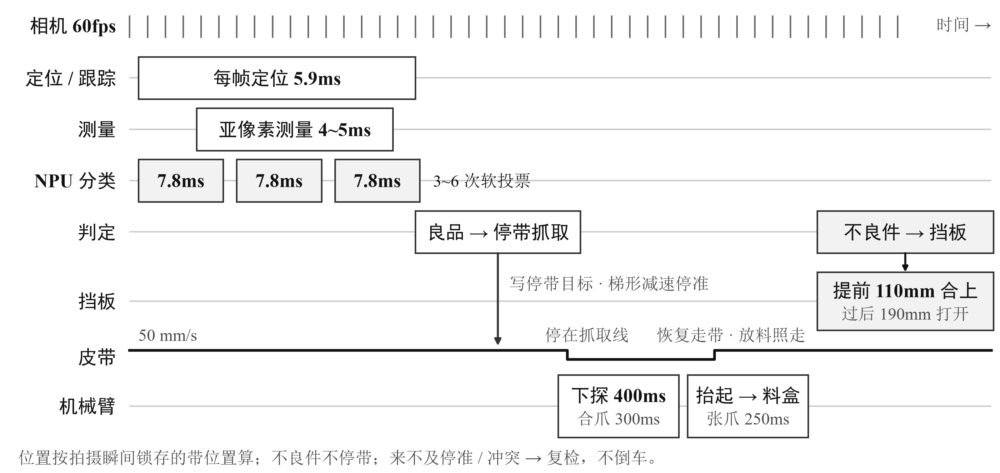
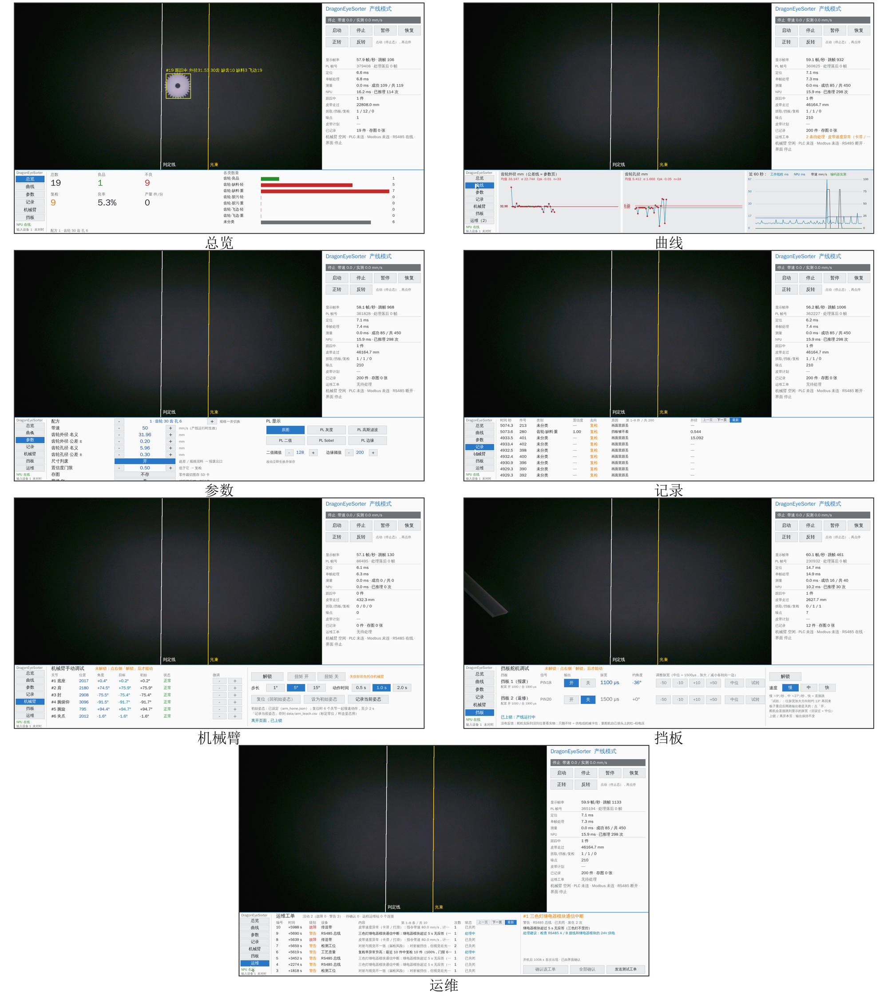

# 基于FPGA的工业智能检测系统

## 摘要

注塑塑胶齿轮目前多靠人工目检，速度慢、标准不一，检出的不良品还要人工分拣。本作品在安路飞龙 F3P 片上系统（system on chip, SoC）上实现了一套在线质检与自动分拣系统，按实时性把任务分到三处：可编程逻辑（programmable logic, PL）负责硬实时部分，包括德晟总线舵机协议主机、步进梯形加减速与精确定位、拍摄瞬间的带位置锁存、逐像素图像预处理和 RS485 收发；处理系统（processing system, PS）上的 Linux 应用负责零件定位、亚像素几何测量、按带坐标跟踪调度、六轴机械臂逆运动学和 HDMI 人机界面；神经网络处理单元（neural processing unit, NPU）运行经 ReLU 改造、8 位无符号整型（UINT8）量化的 YOLOv8n-cls，对每件零件的感兴趣区域（region of interest, ROI）做七类缺陷分类。

零件位置以拍摄瞬间锁存的带位置为基准，与取帧和推理的延迟无关。良品到达抓取线时皮带停准，由机械臂夹取后放入良品料盒；不良品不停带，由侧边导流挡板拦入报废盒或返修盒；几何测量与分类互相核对，只有两者都判为良品的零件才会被夹取，判不准的零件流到带尾复检箱。系统经 CAN、Modbus-TCP 与 RS485 接入产线，对皮带卡滞、光源异常、总线断线等设备故障生成运维工单，推送到 PC 端远程运维站。

板端实测结果：采集与显示 60.02 fps（20 s 零丢帧）；NPU 单次推理约 8.0 ms，实物七类缺陷分类准确率 92.54%，良品 / 不良二分准确率 96.74%；外径测量精度约 ±0.1 mm；硬件在环停带定位三档最坏误差 0.080 mm，节拍 22.7~48.8 件/min；实物过线跟踪误差 −0.57±0.29 mm；CAN 板上回环往返平均 359 µs，RS485 读线圈 1000 次全部成功，Modbus-TCP 实物启停全部正确；空载连续运行 2 h 无崩溃。自研 PL 模块已完成综合与布局布线，随 v16 比特流上板验证。

## 第一部分　作品概述

### 1.1 功能与特性

本作品面向注塑塑胶齿轮的在线质检，在一块安路飞龙 F3P 片上系统上完成识别、测量、跟踪和分拣。零件随传送带经过相机视野时，系统逐件做缺陷分类和几何测量：分类按缺料、脏污、飞边各分轻、重两级，与良品共七类；测量给出外径、孔径、齿数、偏心与颜色，不依赖分类网络。零件有三个去向：良品到达抓取线时皮带自动停准，六轴总线舵机机械臂夹取后放入良品料盒（规格与颜色由测量判定并随记录保存，不作分筐依据）；不良品不停带，由侧边导流挡板分别拦入报废盒与返修盒；判不准的零件流到带尾复检箱。

零件位置以拍摄瞬间的带位置为基准，皮带停止、变速或反转都不影响跟踪。只有测量与分类都判为良品的零件才会被夹取；只有良品需要停带，带速还会随机械臂的作业状态自动升降。HDMI 1080p60 界面实时显示画面、测量曲线和参数；每件零件的记录和不良品图像存入 SD 卡；系统经 CAN、Modbus-TCP 与 RS485 接入产线，设备故障会自动生成运维工单，推送到远程运维站。

### 1.2 应用领域

注塑成型是塑胶传动件的主要成形工艺，多规格、多颜色的聚甲醛（polyoxymethylene, POM）齿轮在家电、电动工具与汽车零部件中大量使用。成形中常见缺料（齿不满）、脏污（料中黑点）和飞边（毛刺填齿槽）等外观缺陷，还会出现尺寸超差与规格混料。这类零件产量大、单价低，人工目检慢且一致性差；只检测不分拣的视觉检测站，仍需人工搬运和分类。本作品把检测、测量、跟踪与分拣放进同一套在线系统，可用于注塑件出厂检验、装配前分选和返修筛选。

系统的分工方式也适用于一般的流水线视觉检测：PL 侧的逐像素预处理、步进与总线舵机控制、拍摄锁存等模块可以直接用于传送带上的其他小件；PS 侧的定位、测量与跟踪调度由标定参数驱动，换型只需更换配方与训练数据；NPU 分类模型用新的缺陷样本重训即可迁移。系统提供 CAN、Modbus-TCP 与 RS485 三种工业总线接口，可并入既有产线，由 PLC 统一调度。

### 1.3 主要技术特点

系统按 PL 硬实时、PS 调度、NPU 推理三级组织，覆盖赛题的六项硬性要求[1]：PL 用硬件实现总线舵机协议主机、步进梯形加减速、拍摄锁存与逐像素图像预处理；PS 运行嵌入式 Linux，提供 HDMI 人机界面与本地存储；PL 与 PS 经 AXI 寄存器窗口和帧 DMA 双向交互；NPU 部署轻量化分类模型；CAN、Modbus-TCP 与 RS485 负责外设通信；量化测试结果见第三部分。

自研 PL 外设挂在一条加宽地址译码引出的寄存器总线上，帧时序、脉冲和总线协议都在固定时钟节拍下完成，微秒级动作不依赖 Linux 调度；七类自研模块共 912 项仿真全部通过。PS 按实时性划分线程：取帧与显示独占核 0 并以实时优先级运行，定位、测量、跟踪与调度集中在核 1，NPU 推理和存储各有一个异步队列，工作线程既不等推理，也不等写卡。安全上，急停按钮同时切断动力电并由 PL 锁存，漏检、跟丢和挡板故障的零件都会落到带尾复检箱。

### 1.4 主要性能指标

主要实测指标见表 1，全部数值来自板端输出与测试脚本记录，条件随表给出；未实测的项目在第三部分以 ⚠ 标注，不做外推。

**表 1**　主要性能指标（板端实测）

| 指标 | 实测值 | 条件 |
|:--------|:----------------|:------------------|
| 采集与显示帧率 | 60.02 fps，20 s 零丢帧 | IMX415 1080p |
| NPU 单次推理 | 约 8.0 ms | 224×224，UINT8 |
| 七类缺陷分类准确率 | 92.54%（良品 / 不良二分 96.74%） | 737 张测试图，样件未参与训练 |
| 外径测量精度 | 约 ±0.1 mm（重复性 σ ≤0.011 mm） | 对卡尺，20 / 28 / 30 齿四件 |
| 停带定位误差 | 三档最坏 0.080 mm | 50 / 100 / 150 mm/s，硬件在环 |
| 节拍 | 22.7~48.8 件/min | 随带速三档，硬件在环 |
| 跟踪误差 | −0.57±0.29 mm | 实物 10 件过线，对射光电核对 |
| 步进命令至首脉冲 | 10.6 µs | PL 硬件计时，100 次 |
| CAN 命令往返 | 平均 359 µs，1000/1000 | 板上回环 |
| RS485 读线圈 | 1000/1000，0 错误 | 4 路继电器模块，9600 bit/s |
| Modbus-TCP 写入至执行 | 14~24 ms | 皮带实走启停 |
| 连续运行 | 2 h 无崩溃，跳帧 0.003% | 空载，60.02 fps |

### 1.5 主要创新点

（1）位置基准取拍摄瞬间：PL 写帧时锁存带位置，零件坐标不受取帧与推理延迟影响。

（2）只为良品停带：不良品由侧边挡板在皮带运行中分流，节拍只受机械臂动作限制。

（3）测量与分类双判定：亚像素几何测量独立于 NPU 分类，两者都判良品才夹取。

（4）按零件 ROI 分类：1 mm 缺陷由整帧检测时的约 1 像素放大到约 4 像素，算力约为整帧的 1/7。

（5）面向 NPU 改造模型：SiLU 改 ReLU，量化后加 logit 偏置校正，量化精度与浮点基本一致。

### 1.6 设计流程

设计按图 1 的流程展开：由赛题六项硬性要求确定三级架构与资源预算；先做 PL 模块与寄存器分段，逐模块仿真通过后上板；再实现 PS 应用的定位、测量、跟踪与调度；相机、皮带与编码器三组标定建立毫米基准；随后采集实物缺陷样件、改造并量化模型、经 ArmNN 部署到 NPU；最后按硬件在环、总线联调与长时间运行三组实测验收，未测项如实标注。各阶段以实测数据为准迭代，设计文档与测试台账同步更新。

**图 1**　设计流程：自需求分析到联调实测的八个阶段。

## 第二部分　系统组成及功能说明

### 2.1 整体介绍

本系统由一块 MLK-F3P-DR1M90G 开发板、一套 VID005 相机子卡、一台 800×300 mm 皮带传送机、一台六轴总线舵机机械臂和一块侧边导流挡板组成，外围有 M18 激光对射光电、RS485 继电器模块与 24 V 三色灯，以及一台充当产线 PLC 的 PC。除 PC 外，全部部件沿同一条传送带布置：相机架在检测工位的带面上方，抓取线、导流挡板与带尾复检箱依次位于下游。硬件组成见表 2。

**表 2**　系统硬件组成

| 部件 | 型号与说明 |
|:------|:--------------------------------|
| 主控 | MLK-F3P-DR1M90G 开发板（DR1M90GEG400：双核 Cortex-A35 + FPGA + 0.4 TOPS NPU） |
| 视觉 | VID005 子卡 + IMX415（MIPI CSI-2，4.2 mm 镜头）；两侧条形光，手动调光，不接 PL |
| 传送带 | 800×300 mm 皮带机，57 步进电机 + TB6600 类驱动器（16 细分，3200 步/圈，共阴直驱） |
| 机械臂 | 六轴：德晟 15 kg 总线舵机 ×5 + 6 kg 夹爪舵机[2]，115200 bit/s 半双工单线总线，经 BSS138 由 PL 直驱 |
| 导流挡板 | MG996R 舵机驱动的平摆摆杆 ×1，装在带尾、机械臂对侧，报废与返修共用 |
| 对射光电 | M18 激光对射，接收端 NPN 集电极开路，直接接 PIN9（FPGA 内部上拉），用于核对跟踪 |
| 带速测量 | 计米轮编码器 E6B2-CWZ6C（1000 线），独立于步进测量皮带运动，经 BSS138 接 3.3 V IO |
| 通信 | 板载 CAN 收发器 ↔ PC USB-CAN（智嵌 ZQWL-UCAN-101E）；网口 Modbus-TCP；RS485 ↔ 4 路继电器模块 + 24 V 三色灯 |
| 电源 | 24 V 主电源（LRS-350-24）+ 300 W 恒压恒流降压（舵机 6.8 V，限流 + 保险丝）；急停常闭触点切断受控 24 V |

三级的分工由数据路径决定：时序关键、逐像素和逐比特的工作放在 PL，需要灵活修改和反复迭代的算法放在 PS，卷积运算放在 NPU。相机经移动产业处理器接口（mobile industry processor interface, MIPI）CSI-2 进入 PL，经图像信号处理器（image signal processor, ISP）和自研视觉预处理后，由帧写 DMA 送入 PS 内存；PS 取帧后合成显示画面，再由 VDMA 送 HDMI 输出，界面上看到的就是 PL 预处理后的图像。PL 自研的舵机总线、步进控制、拍摄锁存、视觉预处理、挡板 PWM、现场输入与 RS485 收发等模块，经寄存器窗口与 PS 交换控制命令和状态。系统架构与三级分工见图 2。

**图 2**　系统架构：外设、PL 与 PS 的数据通路及三级分工。

图像数据不经过寄存器通道，只由帧 DMA 批量搬运；帧号、带位置与视觉统计等少量状态走寄存器，两者以帧号对齐。PS 侧运行嵌入式 Linux，零件定位、亚像素测量、跟踪调度、机械臂控制、界面与本地存储都在应用层；NPU 只做逐件 ROI 分类，由 PS 加载和调用模型。CAN 与 Modbus-TCP 由 PS 驱动，RS485 的帧收发由 PL 的 `des_485` 模块完成。外设时序留在 PL 内部，协议栈和业务逻辑在 PS 上修改，两侧只通过寄存器和 DMA 交换数据。

视觉链路的分工见表 3。PL 剩余资源只够容纳逐像素、低延迟的处理，连通域、形态学等需要全局信息的图像算法放在 PS。分类用的 ROI 由定位结果裁出；分类置信度不足时，PL 的尺寸粗测结果作为复检的补充判据。

**表 3**　PL / PS / NPU 视觉分工

| 承担者 | 主要内容 | 分工依据 |
|:---|:-----------|:------|
| PL | 逐像素灰度、滤波、边缘与二值运算，ROI 面积与外接框粗测 | 固定运算，零延迟，不占用 CPU |
| PS | 零件定位、亚像素几何测量、视差与卷帘补偿、跟踪 | 算法复杂，需要迭代与全局信息 |
| NPU | 缺陷分类 | 卷积计算由专用加速器承担 |

全系统只有一个时间与位置基准：PL 内 75 MHz 自由计数器 `FREE_CNT` 与步进位置 `POS`。零件位置按拍摄瞬间的带位置换算，采集和推理再慢也不构成位置误差，见图 3。

**图 3**　时间基准：拍摄瞬间锁存带位置，零件坐标与处理延迟无关。

PL 在开始写帧和写帧完成两个时刻各锁存一次 `FREE_CNT` 与带位置 `POS`（电路实现见 2.2.3 节）。卷帘快门逐行曝光，PS 按零件所在的图像行在两次锁存值之间线性插值，得到该零件拍摄时的带位置 B。零件带坐标定义为 `s = x − B`（x 为台面坐标），零件在带上不滑动，s 就不变，因此皮带停止、变速与反转都无需特殊处理。任一时刻的台面位置等于 `s + 当前 B`，调度器据此计算停带时刻与挡板合上时刻。实测中锁存带位置差与「带速 × 读出时间」一致，帧号差全为 1，20 s 内保持 60.02 fps、0 丢帧。

PL 与 PS 之间只有一条寄存器总线：官方相机 DMA 控制器 `fvdma_ctrl` 在 GP0 上占有 64 KB 地址窗口，本作品加宽该窗口的地址译码，把偏移 `0x1000~0x1FFF` 引出到 PL 顶层，形成 75 MHz、单周期写脉冲、读数据多路选择的寄存器总线，PL 基址为 `0x8030_1000`，官方驱动使用的 `0x0000~0x0FFF` 不受影响。各模块按 `addr[11:8]` 分段（表 4），PS 经 `/dev/mem` 映射后直接读写，单次读 PL 寄存器 188 ns（20 万次统计）。控制命令与阈值由 PS 下行写入，帧号、带位置、舵机应答与视觉统计由 PL 上行提供。

**表 4**　PL-PS 寄存器窗口分段

| 段 | 模块 | 主要内容 |
|:---|:-------|:------------------|
| `0x000` | `des_regs` | ID 与版本、`FREE_CNT`、帧号与帧周期、拍摄锁存（带位置、时间戳、编码器计数） |
| `0x100` | `servo_bus` | 舵机帧收发缓冲、状态、时间戳、错误计数 |
| `0x200` | `stepper_ctrl` | 模式、目标、速度与加速度（Q0.32）、位置、刹车距离 |
| `0x300` | `des_vision` | 处理模式、阈值、ROI；面积、外接框、质心、边缘数 |
| `0x400` | `des_pwm` | 导流挡板舵机脉宽（2 路 50 Hz，下周期生效） |
| `0x500` | `des_io` | 急停锁存、对射与限位输入捕获、编码器计数 |
| `0x600` | `des_485` | RS485 Modbus-RTU：配置、收发缓冲、状态与时间戳、计数 |

### 2.2 硬件系统介绍

#### 2.2.1 硬件整体介绍

主控为 MLK-F3P-DR1M90G 开发板，片上 DR1M90GEG400 集成双核 Cortex-A35、FPGA 与 NPU，三级划分因此可以落在同一颗芯片上。视觉链路由 VID005 子卡与 IMX415 传感器组成，镜头焦距 4.2 mm；带速另由计米轮编码器独立测量，用于标定和步进指令的交叉核对。执行机构统一由 PL 驱动：步进脉冲、舵机总线帧与挡板 PWM 都在 PL 内产生，PS 只下发目标值与时序参数。

供电分动力电与常电两路，都由 24 V 主电源引出（连接关系见 2.2.3 节图 6）。动力电经急停常闭触点形成受控 24 V 母排，只供步进驱动器和 300 W 恒压恒流降压模块，后者输出 6.8 V，经限流与保险丝送入舵机链的两处进电点和挡板舵机；常电 24 V 不经急停，供对射光电、RS485 继电器模块与三色灯，并经 5 V 降压模块供计米轮编码器和电平转换的高压侧。开发板与光源各用一只 12 V 适配器供电。

6 个舵机的峰值电流较大，舵机链在底座与臂中段两处进电。接地为单点共地：PL 地只在 24 V 地母排一点相连，6.8 V 母排的地与 24 V 地不另行外接，避免步进驱动器的大电流回流经过信号地；降压模块的输出负端与输入负端不能在外部短接，否则低边采样电阻被旁路，恒流限流失效。

急停按钮的常闭触点串在受控 24 V 母排上，按下时同时切断步进驱动器和全部舵机的电源；常开触点接 `ESTOP_IN`（低有效），经 PL 去抖 1 ms 后锁存，锁存期间步进不发脉冲、拒绝启动，复位需拔起按钮后在界面点「复位报警」。急停只断动力电，舵机断电后机械臂会因自重落下，调试时机械臂下方不放手、不放易碎物；常电 24 V 不在切断范围内，动端子前必须先关总电源。

#### 2.2.2 机械设计介绍

整机以一条 800×300 mm 皮带机为主干，零件从右往左依次经过上料端、相机视野、抓取线和带尾复检箱，布局见图 4。相机装在皮带中段上方，两侧沿带方向各有一条条形光；抓取线位于相机视野下游 65 mm，正对机械臂底座。机械臂侧装在皮带一侧，底座和运动范围都在相机视野之外，不会遮挡画面或产生反光。

**图 4**　工位布局：俯视、按比例，零件从右往左走。

导流挡板装在带尾、机械臂对侧的带边，是一根长 321 mm 的平摆摆杆，合上时与带边成 42.3°，斜拦在零件经过的带面上；零件中心偏向机械臂一侧超过约 27 mm 时摆杆够不着，改走复检。报废件与返修件共用这一根摆杆：零件被皮带推着碰到摆杆后，摆杆按两种曲线摆开，把零件推出机械臂对侧的带边。报废件在碰件后再走 50 mm 才开始摆，2.75 s 摆完；返修件碰件即摆，0.6 s 摆完。两类零件因此落在带边外的不同位置，各进一只料盒。转轴位置、摆杆长度与夹角都按相机实测标定（合位截图换算 42.3°，尺量 42.6°）。

这样布置把良品抓取和不良品分流分开：良品需要停带，由机械臂在抓取线竖直夹取；不良品不停带，由挡板在运动中分流，不占机械臂的时间；未被拦下或判不准的零件走到带尾，进入复检箱。

传送带由 57 步进电机经 TB6600 类驱动器驱动，16 细分、3200 步/圈，共阴接法，PL 的 3.3 V 输出直接接驱动器的 PUL+、DIR+ 与 ENA+。步进由 PL 发脉冲并计数，是停带定位的执行基准；计米轮编码器独立测量皮带运动，用于带速显示和步进位置的交叉核对。

机械臂由 5 个德晟 15 kg 总线舵机（底座、大臂、小臂、腕俯仰、腕旋）和 1 个 6 kg 夹爪舵机组成，共 6 轴，挂在同一根 115200 bit/s 半双工单线总线上，经 BSS138 双向电平转换由 PL 直接驱动。夹爪为两指结构，夹取方向与底座方向相切，闭合后读取 #6 轴位置判断是否夹住。挡板由一只 MG996R 舵机驱动，PWM 取自 PL `des_pwm` 两路 50 Hz 输出中的第 1 路（开位 1500 µs、合位 1100 µs），电源取自与机械臂共用的 6.8 V 母排。

#### 2.2.3 电路各模块介绍

PL 承担全部硬实时工作：舵机总线帧收发、步进脉冲产生、拍摄瞬间的位置锁存、逐像素图像预处理、挡板脉宽调制和现场输入的去抖锁存。这些操作的时间粒度在微秒量级，交给运行 Linux 的 PS 会受调度抖动影响，因此由 PL 在固定时钟节拍下完成。七类自研模块按 `addr[11:8]` 分段挂在 2.1 节的寄存器总线上，模块、寄存器窗口与引脚的对应关系见图 5；图像数据仍沿 ISP 到帧写 DMA 的 128 位通路流动，视觉预处理模块串接在这条通路上。

**图 5**　PL 自研模块、寄存器窗口与引脚。分段译码按地址位 addr[11:8] 划分，引脚取自工程约束文件 io.adc。

**舵机总线主机。**机械臂的六个舵机挂在同一根半双工单线上，采用德晟总线舵机协议 v4.01[3]。多轴协同依赖 SYNC WRITE：一帧广播同时下发六个轴的目标位置与运动时间，各轴在帧结束时同时起跑，同步误差不随轴数累积。发送采用开漏方式，PL 只主动拉低总线，高电平由 BSS138 一侧的上拉给出；帧头与校验由硬件生成，PS 只把帧主体写入发送缓冲。接收方向识别 `FF F5` 应答头，完成校验与长度检查后提取舵机的过载、过温与电压状态字节；发送期间关闭接收，每帧之后留出 1 字节时间的总线换向间隔。应答超时可配置（默认 3 ms），首个起始位、最后一个停止位和应答接收完成三个时刻分别锁存 `FREE_CNT`，帧时长与命令延迟由硬件时间戳相减得到。仿真覆盖 PING、READ、SYNC WRITE、无应答超时、错误校验与非法 LEN 等 23 项；上板实测六轴 SYNC WRITE 一帧 3298.9 µs（理论 3298.6 µs）。

**步进控制。**脉冲由相位累加器产生，速度以 Q0.32 定点数表示每个时钟的步进增量，速度分辨率 0.017 步/s，长时间运行没有累积误差。速度模式下改速度指令会自动平滑过渡；位置模式按梯形加减速运行（升降速节拍 10 kHz），运动中改写 `TARGET` 即可停在新的目标步数，减速点由硬件按当前速度与加速度实时重算。`BRAKE` 寄存器实时给出刹车距离，调度器据此判断能否停准。急停输入或 `HALT` 命令立即停脉冲并锁存；脉宽 5 µs、换向后等待 10 µs，满足驱动器对脉宽与方向建立时间的要求。上板执行 `move 3200` 后，`POS` 与累计步数都精确等于 3200。

**拍摄锁存。**官方帧写模块在开始写帧和写帧完成中断时各翻转一次信号，两路信号经两级同步进入 75 MHz 时钟域。开始写帧时，帧号、`FREE_CNT`、步进位置 `POS` 与编码器计数被锁进暂存寄存器；写帧完成时再锁存一组，两组值一起更新到 `CAP_*` 寄存器。PS 的取帧调用返回后还有整整一帧的时间读取 `CAP_*`，不会与下一帧的锁存冲突。图像、步进与编码器三路数据在同一时钟沿锁存，一帧的带位置、时间戳与编码器读数可以一并取出。

**图像预处理。**PL 在 ISP 输出与帧写 DMA 之间做逐像素预处理，数据为 128 位 AXI-Stream，每拍 4 个 BGRA 像素，不反压上游、不改变帧时序。预处理有六种模式：原图直通、BT.601 灰度、3×3 高斯平滑、阈值二值化、Sobel 梯度与边缘二值化；3×3 窗口由两块行缓冲（ERAM）和列寄存器构成，窗口运算拆成三级流水、共 6 拍延迟，以满足 125 MHz 的时序约束。模块同时统计 ROI 内的面积、外接框、质心与边缘像素数，PS 把这些量换算成毫米，得到 PL 尺寸粗测。新设置由 `APPLY` 在下一帧起始生效，切换模式时画面不撕裂。仿真覆盖 6 种模式共 790 项，逐像素比对行为模型；另保留 `LANES=2` 降级配置（每拍 2 像素、滤波逻辑约减半），同样 790 项通过。

**挡板 PWM。**PWM 模块提供两路 50 Hz 舵机脉宽输出，新脉宽在下一周期起始生效，切换时不产生毛刺脉冲；两路错开动作并平滑起停，避免两个摆杆同时启动造成电源冲击（现装一块挡板，用第 1 路）。挡板的合上时刻与放行曲线由 PS 调度器按挡板几何和带位置计算，摆开期间 PS 每个控制周期按曲线改写脉宽（见 2.3.2 节）。仿真 11 项通过，上板已验证读回值与 50 Hz 输出。

**现场输入。**现场输入都先锁存再处理。急停按下并保持 1 ms 才被确认，确认后立即锁存并直接停住步进脉冲，只有复位报警才能清除；对射光电与限位输入去抖 20 µs，对射每次挡光的边沿锁存 `FREE_CNT`、带位置与编码器计数，作为跟踪误差的原始依据。计米轮编码器按四倍频计数，输入经两级同步与约 107 ns 滤波，Z 相单独锁存，A、B 两相同时跳变记为错误。仿真 28 项通过；上板已验证 PL 级急停，编码器实测两次 Z 脉冲之间正好 4000 计数、错误计数为 0。

**RS485 收发。**`des_485` 在 PL 内完成 Modbus-RTU 帧收发：逐位移位、CRC 校验、DE 方向与帧间隔时序由硬件完成，超时、校验错误与超长帧在硬件内判定并计数，PS 只经寄存器下发请求、读取应答。仿真 60 项通过（行为级从站逐位核对线上字节，另用 6 处人为植入的错误验证测试能发现问题）；上板接 4 路继电器模块读 8 路线圈 1000/1000 成功（见 3.3 节）。

整机电气连接见图 6：左栏为供电与急停，中栏为开发板引脚，右栏为外设，中栏与右栏逐行对应，箭头表示信号方向。急停按钮的常闭触点只切断受控 24 V 一支（步进驱动器、6.8 V 降压模块与舵机母排），常开触点报 PL；常电 24 V 不受急停影响，急停期间 PL 仍能读到急停、对射与编码器信号，电平转换也不断电。

**图 6**　系统电气连接：左为供电与急停，中为开发板引脚，右为外设，箭头为信号方向。

关键输入输出信号及其电平处理见表 5。5 V 侧信号都要经电平转换才能进入 3.3 V IO；CEP 排针 J12 的 3.3 V 电源只供逻辑使用，传感器、继电器与编码器一律外部供电；24 V 不进任何 IO 引脚。

**表 5**　关键信号线与电平转换

| 信号 | 方向 | 引脚 | 电平与转换 |
|:-------|:-------|:---------|:-----------------------|
| 舵机总线 | 双向半双工 | J12 PIN19 | 3.3 V 开漏，经 BSS138 转到 5 V 上拉侧（舵机侧空闲 3.7 V） |
| 步进 PUL / DIR / ENA | PL → 驱动器 | J12 PIN3 / 4 / 5 | 3.3 V 直驱，共阴接法，高有效 |
| 挡板 PWM | PL → 舵机 | J12 PIN18 | 50 Hz；MG996R 由 6.8 V 母排供电 |
| 急停 | 按钮 → PL | J12 PIN15 | 常开触点，低有效，PL 去抖 1 ms 锁存；常闭触点串受控 24 V |
| 对射光电 | 接收端 → PL | J12 PIN9 | NPN 集电极开路，FPGA 内部上拉；电源取常电 24 V |
| 编码器 A / B / Z | 编码器 → PL | J12 PIN6 / 7 / 8 | 5 V 输出经 BSS138 转 3.3 V，四倍频计数 |
| RS485 A / B | 双向 | J11 第 5 / 6 位 | 板载收发器，`des_485` 控制 DE；从站为 4 路继电器模块（地址 1，9600 bit/s、8N1） |
| CAN H / L | 双向 | J11 第 3 / 2 位 | 板载收发器经 F20 / F19 接 PS CAN0，500 kbit/s |

自动方向的电平转换芯片在带强上拉的总线上会误判方向并锁死，纯电阻分压的发送方向余量不足，因此都未采用；该批编码器的输出被上拉到其自身的 5 V 电源，并非纯开集电极，直接接 3.3 V IO 会向 IO 灌电流，所以也经 BSS138 接入。

资源是 PL 设计的硬约束。官方 NPU 演示工程已占用查找表（look-up table, LUT）的 79% 与嵌入式块 RAM（embedded block RAM, ERAM）的 92.5%，剩余空间只够放逐像素、低延迟的处理逻辑，单个自研模块控制在数百 LUT 量级，逐模块综合资源见表 6。板端当前比特流为 v16，在 v15 基础上新增 `des_485` 与帧锁存的编码器计数，`pl_check.sh` 板端自检 0 失败；资源占用为 slice 84.22%、LUT 80.15%、ERAM 261/280（93.21%）、DSP 156/240（65%）。时序上，自研的 75 MHz、像素时钟、150 MHz 与 PS AXI 四个时钟域均无违例，剩余违例都在厂家加密 IP 内部，其中 TMDS 输出域的波形尚未用示波器复核 ⚠。

**表 6**　自研模块综合资源（TD 6.2.1 Optimize-Gate 综合口径，非布局布线结果）

| 模块 | LUT | FF | ERAM | DSP |
|:-------|:---:|:---:|:---:|:---:|
| `des_regs` | 9 | 457 | 0 | 0 |
| `des_io` | 77 | 478 | 0 | 0 |
| `des_pwm` | 58 | 123 | 0 | 0 |
| `servo_bus` | 246 | 351 | 0 | 0 |
| `stepper_ctrl` | 270 | 331 | 0 | 0 |
| `des_vision` | 977 | 1556 | 2 | 13 |
| `awb_seq_div`（2 实例） | 146 | 232 | 0 | 0 |
| **小计（不含 `des_485`）** | **1783** | **3528** | **2** | **13** |

表 6 统计于加入 `des_485` 之前；按 v16 构建报告，该模块约占 640 个 slice、1135 个寄存器。表中 `awb_seq_div` 是自研的逐位除法器，替换了厂家 ISP 自动白平衡中的两个流水线除法器。开发中对自研与厂家明文 RTL 做过多轮不改变行为的重构，每轮都以整顶层逐拍等价回归和综合资源对比作为验收条件，端口、参数与寄存器接口保持不变，PS 软件无需随之修改。

### 2.3 软件系统介绍

#### 2.3.1 软件整体介绍

PS 上运行嵌入式 Linux，产品运行时的可执行程序为 `des_app`，只保留 `run` 与 `live` 两个模式。为了让 60 fps 视频链路与视觉处理互不干扰，系统按实时性划分线程（表 7）：取帧与显示独占核 0 并以实时优先级运行，定位、测量、跟踪与调度集中在核 1，NPU 推理、机械臂执行与本地存储各有独立线程。NPU 与存储各持有一个异步队列，工作线程只投递任务、读取最近一次结果，既不等推理，也不等写 SD 卡，因此定位与调度的节拍由相机帧率决定。

**表 7**　PS 进程与线程模型

| 线程 | 核 | 职责 |
|:------|:----|:-------------------------|
| 取帧与显示 | 0（实时优先级） | 等待 DMA 帧完成并立即重新提交缓冲（平均 0.3 µs）；BGRA→BGR 写显示缓冲，叠加跟踪框、判定线与状态，贴操作界面并翻页 |
| 工作 | 1 | 定位、测量、跟踪表、调度、存储与界面状态更新 |
| NPU | 1 | 零件分类，经异步队列解耦，工作线程不等待 NPU |
| 机械臂 | 独立 | 执行抓取航点，完成后回报 |
| 存储 | 独立 | 后台写 CSV 与图片，工作线程不等待 SD 卡 |

实测符合设计目标：`run` 模式下显示保持 60 fps、每帧 13.0~13.9 ms，工作线程处理了 99.9% 的帧（2 h 统计），单帧定位平均 5.9 ms。像素搬运全程由 DMA 完成：相机帧由帧写模块（米联客开源 `uiFDMA` 与 `uidbuf_write`，150 MHz，经 HP0 口）写入 DDR，写完以中断通知 PS；HDMI 一侧由 VDMA 从显示缓冲读出扫描。CPU 每帧只做一次画面合成（NEON 按 3/4 缩放并转 BGR、贴叠加信息与界面，VDMA 读指针在帧边界切换），固定在核 0 上执行。

单件零件在软件中的处理流程与关键输入输出变量见图 7：定位、测量与调度在核 1 上按带坐标 s 串联；NPU 分类与本地存储经异步队列解耦，不阻塞工作线程。

**图 7**　PS 软件单件处理流程与关键输入输出变量（异步环节以队列传接）。

PC 端有三个程序：产线 PLC 模拟器（Python / tkinter）提供按钮、计数、逐件结果、报警与收发统计，在接入真实 PLC 前复现产线交互；统计脚本 `part_stats.py` 直接读取板上的逐件 CSV 记录生成统计表，现场记录与报告数据同源；远程运维站接收板端推送的运维工单、逐件记录与不良品图片，提供网页看板、远程确认与运维报表（见 2.3.2 节（9））。板端另有调试工具 `des_tool`，提供标定、采集、测量与机械臂调试等模式。

#### 2.3.2 软件各模块介绍

**（1）零件定位与相机标定。**零件定位在 1/4 降采样灰度图上完成，依次经过白电平相对阈值分割、开运算、外轮廓提取与最小外接矩形拟合，再由单应矩阵[4]换算为台面毫米坐标 (x, y, θ, 长, 宽)。触碰图像边缘的零件只登记存在、不使用几何量，面积超过上限的判为粘连件。

台面坐标系由三组标定建立。`calib-cam` 用平放在皮带上的棋盘格拍一次，得到皮带平面的单应矩阵；`calib-belt` 让白纸随皮带走过已知步数，得到毫米每步与方向；`calib-enc` 在空带往返中每 10 ms 采样一次编码器，得到毫米每计数。相机定版后的实测结果为：棋盘格残差 rms 0.240 mm，比例尺 0.1945 mm/像素，视野 373×214 mm；皮带 0.020921 mm/步，234 mm 往返误差 −0.08 mm；编码器 0.049227 mm/计数（3 轮标准差 0.019%）。

位置视差是定位误差的主要来源。零件顶面高出皮带 h，按皮带平面标定读出的位置会以相机正下方点为中心向外放大 k 倍，把绕该点按 1/k 缩放的变换并入单应矩阵，就得到面向零件顶面的 `px_to_part`。k 由实测确定：三个 10 mm 厚的齿轮随皮带走过 7 个站点，质心位移是皮带位移的 1.020 倍；现行灯位（光源高位朝下、侧壁变暗）改用侧壁暗模型，k = H/(H − h) ≈ 1.035，定位直接按顶面计算。

**（2）亚像素几何测量。**每件零件只在离光轴最近的一帧上测量一次，此时视差最小，单核耗时 4~5 ms。测量结果既直接决定尺寸超差件的处置，也作为独立于 NPU 的第二意见参与复检判定。流程分五步：ROI 内二值化，找出外轮廓与内孔；沿每个轮廓点的法线搜索灰度穿过 50% 电平的亚像素位置；经单应变换映射到毫米，并做视差校正与卷帘快门逐行补偿；拟合齿顶圆、孔径与偏心，由齿距推算齿数（齿距取中位数 ±25% 范围内的平均值，使 30 齿缺 2 齿与 28 齿可以区分），同时判定缺料齿、缺齿与三种形态的飞边；最后按色调与饱和度把裁切图亮区归为白、黄、橙、蓝、红五种颜色；颜色分类取裁切图中心圆盘内亮区（V 高于 Otsu 阈值）的饱和度加权平均色调，结果与色调、饱和度一起写入逐件记录。现有样件均为白色，彩色样件的颜色分类准确率尚未实测 ⚠。

裁切图先做平场校正。广角镜头渐晕与条形光不均匀使视野四角只有中心亮度的 32~51%，系统让白纸走过视野 13 个站点得到 48×27 的白电平网格，裁切图逐点乘以 ref / white 完成校正（校正后纸面亮度 p5~p95 为 98.0~101.8%）；NPU 输入、存图与训练集使用同一套校正。边缘定位与光照带来的系统偏差用卡尺量过的标准件修正，修正形式为「增益 × 拟合值 + 偏置」（增益 1.0285、外径 +0.02 mm、孔 +0.15 mm），实测精度见表 12，判废公差取外径 ±0.2 mm。

测量的可信范围受曝光与视场限制：曝光 800 µs 时，50 mm/s 带速下的拖影为 0.04 mm；离光轴 40 mm 以内测量可信，相机上游设 V 形导向条，使零件中心落在判齿、训练数据与机械臂可达范围的交集内。超出可信范围的零件不判齿形，NPU 判良品且置信度不低于 0.8 时照常夹取，否则进入复检。

**（3）跟踪与调度。**跟踪表以带坐标 s 为键，为每件零件分配 ID，并按 s 关联多帧观测（关联门限 12 mm），状态依次为新建、跟踪、已判定、抓取中与完成。调度负责良品停带抓取、不良品导流和带速调节，抓取与导流的时间关系见图 8。

**图 8**　良品停带抓取与不良品导流时序：示意，时长取默认配置。

停带抓取发生在待抓良品接近抓取线时：调度器先查 `BRAKE` 刹车距离，再检查夹爪两指张开区域与邻件是否冲突（θ 与 θ + 90° 两种候选姿态都需通过），全部通过后才改写步进目标，使该件恰好停在抓取线；来不及停准或有冲突的零件转复检，皮带不倒车追件。

挡板分流针对不停带的不良品：调度器按挡板几何算出每件零件碰到摆杆的位置和摆杆扫过的区段，按带位置在碰件前合上，碰件后按该件去向的放行曲线摆开（见 2.2.2 节）。摆杆合上或摆开期间如果还会碰到别的零件，后一件不拦、改走复检；是否碰到按零件横向位置与摆杆末端伸出量逐时刻判断，中线附近的后一件相距约 18 cm 以上即不受影响。漏检、跟丢与挡板故障最多让零件进入复检箱，不会混入良品盒。

带速随作业状态自动调节：机械臂作业期间，调度器按下一件良品离抓取线的距离和机械臂空闲的时刻降低带速（不低于 15 mm/s），让零件在机械臂空闲时刚好到达，减少整停整起；判定线下游没有零件待处理且机械臂空闲时，带速升到 80 mm/s 快档，有零件越过判定线即恢复设定带速。PLC 或操作员改带速后，自适应从新带速重新计算。该功能已上板，调度单元测试全部通过，实物节拍提升待统计 ⚠。

硬件在环测试让模拟零件以真实 PL 步进计数为位移基准运动，50、100、150 mm/s 三档 6/6 全部通过：8 件良品全部停准抓取，4 件不良品全部到达带尾，停带误差与节拍见表 10。

**（4）机械臂控制。**控制程序对台面目标点求解逆运动学，6 轴指令在一帧 SYNC WRITE 中同时下发。齿轮是圆对称件，夹取方向取与底座方向相切。夹爪装配有偏差需要补偿：#4 轴到指尖 190 mm、指尖中心偏离腕旋轴 9 mm，运动学把这一偏置作为工具坐标系中的固定向量，按 #5 转角反解底座角，定点迭代求解。夹爪始终竖直下探，抓取范围以标定的横向可达带为准，超出可达带的零件进入复检。是否夹住按 #6 轴位置判断：闭合后与闭合指令相差大于 0.8 mm 判为夹住，否则判为空抓（挤压量 4 mm 时，夹住齿轮约 2.6 mm、空抓约 0.21 mm）。手眼标定已完成，整线真抓已跑通：单件慢速 4/4 成功，正常速度一次抓取 4.26 s；50 mm/s、件距 27~28 cm 时 3/3 抓取并放入料盒。件距小于一次抓取占用的 186 mm 带长时只能抓到部分良品，这是单臂串行的上限。重复定位精度待测 ⚠。

**（5）人机界面。**赛题要求提供 HDMI 曲线与参数配置界面，板上 Qt 只有独立镜像，为了不影响 60 fps 视频链路，系统用 OpenCV 自绘界面、以 FreeType 渲染中文，共七页：总览页显示运行状态、计数与良率、节拍、带速与最近零件；曲线页给出外径与孔径趋势线、规格线和工序能力指数（process capability index, Cpk），带速同时显示命令值与编码器实测值；参数页集中管理配方、带速、公差、置信度门限、存图策略与 PL 显示模式；记录页列出最近零件的裁切图、类别、测量值与去向；机械臂页可在软限位内手动调试 6 个舵机；挡板页用于手动调试挡板舵机、查找开合脉宽；运维页列出设备运维工单（见（9））。画面左侧 1440×780 为主画面，右侧为状态栏，底部为操作条，支持 USB 鼠标键盘热插拔；界面在显示线程内贴入显示缓冲，另保留脚本输入通道，用于自动化测试与截图。

**（6）本地存储与运行记录。**每件零件判定后写入一行 44 列的 CSV 记录，不良品与复检件另存 ROI 裁切图，按日期分目录存放。CSV 包括时间、件号、帧号、类别与置信度、处置与去向及原因、全部测量值、带坐标与姿态、PL 粗测、NPU 投票次数、推理耗时与延迟、图片名与配方号。板上没有实时时钟，记录时间取本机时钟加 PLC 经 CAN 下发的时间偏移。

**（7）视觉与缺陷分类。**分类模型选用为板上 NPU 改造过的 YOLOv8n-cls[5]，输入 224×224，以 ImageNet 预训练权重做迁移学习，训练只做翻转与亮度两类温和增强。类别按缺陷类型与轻重两级展开，共 7 类：良品、缺料轻、缺料重、脏污轻、脏污重、飞边轻、飞边重；规格由几何测量判定，颜色由色调判定，分类网络只负责缺陷类型与轻重。分类结果直接决定去向：良品送机械臂抓取，缺料两级与重脏污报废，轻脏污与飞边两级返修。

按零件 ROI 分类是由缺陷尺度决定的：缺料、脏污与飞边多在 1 mm 量级，整幅图像约 0.19 mm/像素，缩到 416 输入后 1 mm 缺陷只剩约 1 个像素；先定位，再按零件方向转正、裁出 56×56 mm 的 ROI 并缩放到 224×224，每像素约 0.25 mm，1 mm 缺陷约占 4 个像素，计算量约为整帧检测的 1/7（图 9）。整帧检测还要网络同时完成定位与分类，检测框回归误差会叠加到缺陷判别上；拆开以后，定位与测量由几何流程独立完成，分类器只判断缺陷类别。

**图 9**　整幅采集图与单件 ROI 裁切图对比（同一零件同一帧；右侧为送入分类网络的 224×224 视图）。

模型改造围绕板端 NPU 的算子特性展开。NPU 对 SiLU 只做近似计算，训练与导出改用 ReLU（同一批合成数据上 ReLU 版板上 96.25%、SiLU 版 94.0%，推理时间相同）。per-tensor 量化[6]会压缩良品与缺料轻之间的分界，导出时用训练图统计 fp32 与 UINT8 输出之差的均值，写入模型 JSON 的 `logit_offset` 字段，由 PS 在 softmax 前加上，再配合全部实物数据重训：测试集上量化模型的准确率为 92.8%，与浮点模型的 92.9% 基本一致，板端 NPU 输出与 PC 端量化模型在 33 张参考图上逐张同类。部署链为 ArmNN[7] 与厂家 Alnpu 后端，输入在 PS 端预先查表量化为 UINT8，单次推理约 8.0 ms，输入准备 1.43 ms。每件零件经过视野时分类 3~6 次，概率累加后取最大类，置信度不足的进入复检。训练与推理必须使用同一裁切函数和同一归一化，否则板端精度会下降。

数据按缺陷类型与轻重两级组织，样件形貌见图 10。缺陷样件由冷加工制作，每个等级 8 件，其中 6 件用于采集训练图、2 件只用于测试；按零件而不是按图片划分，测得的准确率反映对未见样件的泛化能力。飞边分级以缺陷处数为准：轻飞边 1 处（一个齿槽或孔里填充不到一半），重飞边 2 处及以上或孔里填充超过一半。采集时皮带以 30 mm/s 自走，每件存 10 张；剔除照到对射光电激光红点的 205 张后，各类样本数见表 8，训练在 RTX 4060 上完成。

**图 10**　零件与七类缺陷样件。良品齿轮与缺料、脏污、飞边三类缺陷的轻、重两级样件对照。

**表 8**　数据集规模与划分

| 类别 | 训练集（张） | 测试集（张） |
|:-------|:---------:|:---------:|
| 良品 | 1469 | 250 |
| 缺料轻 | 660 | 80 |
| 缺料重 | 290 | 80 |
| 脏污轻 | 300 | 80 |
| 脏污重 | 320 | 92 |
| 飞边轻 | 274 | 80 |
| 飞边重 | 259 | 75 |

良品训练集由 30 齿 833 张、20 齿 287 张、28 齿 219 张与 30 齿孔 8 的 130 张组成。训练集最初漏掉 30 齿孔 8 规格，该规格 130 张良品中有 49 张被浮点模型判成飞边，所以良品类必须包含全部规格；只用合成数据训练的模型对 833 张实物良品只判对 38.8%，实物重训不能省。在 737 张测试图（样件均未参与训练）上，板端逐图准确率 92.54%，良品 / 不良二分 96.74%，按零件投票 73/78，逐类结果见图 15；缺料两级与重脏污全部判对，轻脏污有 17/80 张被判成重脏污（仍为不良），最弱的轻飞边 80 张中判对 45 张，整线由几何测量做第二道拦截。分类对颜色不敏感：测试图转灰度后板端准确率 88.87%；训练不做灰度增强，因为随机转灰度会使 UINT8 量化掉 10~20 个点。开启对射激光后的影响和轻飞边的整线检出率待实测 ⚠。

**（8）工业总线通信。**总线通信有三条链路：与产线 PLC 交互的 CAN、面向工厂 PLC 的 Modbus-TCP 从站，以及驱动塔灯与继电器的 RS485 主站；前两条共用同一套命令与状态语义。

板载 CAN 收发器只支持经典 CAN，系统采用 CAN 2.0A（11 位标识符）[8]、500 kbit/s 的自定义产线协议，报文见表 9。命令侧覆盖产线生命周期（启动、停止、联锁暂停、恢复、复位报警，附命令序号），带速、配方、心跳、对时与塔灯接管各有独立标识符；状态侧以 10 Hz 上报状态、1 Hz 上报计数，每件零件单独上报件号、类别、去向、置信度与主尺寸（0.01 mm）。本机状态机分为空闲、运行、暂停、急停与故障五态，PLC 命令与界面按钮走同一套规则；切换配方会同时改变良品判据与混料判据。

**表 9**　CAN 产线协议报文

| 方向 | 标识符 | 内容 |
|:-----|:------|:-----------------------|
| PLC → 本机 | 0x100 CMD | 启动 / 停止 / 联锁暂停 / 恢复 / 复位报警，附命令序号 |
| PLC → 本机 | 0x101 SPEED | 带速（0.1 mm/s） |
| PLC → 本机 | 0x102 RECIPE | 配方号（换型：切换规格齿数 / 外径 / 孔径；运行中拒绝） |
| PLC → 本机 | 0x103 PLC_HB | PLC 心跳（≥2 Hz；1 s 收不到清除「PLC 在线」） |
| PLC → 本机 | 0x104 TIME | 对时（unix 秒 + 毫秒） |
| PLC → 本机 | 0x105 LAMP | 塔灯接管（v1.2）：经 RS485 写继电器模块；RS485 不在跑时拒绝 |
| 本机 → PLC | 0x180 ACK | 命令 ID、序号、结果（成功 / 状态不允许 / 数值不对 / 未知） |
| 本机 → PLC | 0x181 STATUS | 状态、标志（b5 = RS485 在线，b6 = 有运维工单）、带速、报警码、心跳、运行时间，10 Hz |
| 本机 → PLC | 0x182 COUNTS | 总数 / 良品 / NG / 复检，1 Hz |
| 本机 → PLC | 0x183 PART | 每件：件号、类别、去向、料盒 / 出口、置信度、主尺寸（0.01 mm） |
| 本机 → PLC | 0x184 ALARM | 报警码、级别、细节；运维工单为故障代码、级别（提示 / 警告 / 故障）与工单号 |

官方演示工程的块设计没有启用 PS CAN0，现版比特流把 PS CAN0 硬核的收发信号经块设计引到顶层，并约束到 F20 / F19。协议先在板上回环验收，再由 PC 端 USB-CAN 充当 PLC 做双节点实测，结果见表 13。调试中发现，「应答立即发」与同周期排队帧背靠背发送会丢帧（3%），改为应答单独排队、每周期仍只发 1 帧后消除。

Modbus-TCP 从站在 PS 网口的 502 端口上自行实现[9]（单线程 poll 完成 MBAP 分帧，处理半帧与粘包，不依赖第三方库），命令与状态沿用 CAN 的语义：保持寄存器 HR0 命令、HR1 带速、HR2 配方、HR5~6 对时、HR7 塔灯、HR8 运维工单确认可写，HR3 结果与 HR4 执行序号只读，输入寄存器提供状态、计数、最近一件的明细与运维工单摘要。CAN、Modbus-TCP 与界面按钮三路命令并发时，服务线程只负责排队，由控制循环按同一套规则执行；PLC 写入后等待「执行序号」变化再读结果码。

RS485 由 PL 的 `des_485` 作 Modbus-RTU 主机，从站为 4 路继电器模块，继电器驱动 24 V 三色警示灯。灯态与产线状态绑定（空闲不亮、运行绿、暂停黄、急停红），CAN 的 0x105 LAMP 与 Modbus-TCP 的 HR7 可以接管灯态，警示灯既能跟随本机状态，也能由外部 PLC 统一控制。

**（9）设备运维与远程运维。**设备运维由板端健康监测、运维工单与 PC 端远程运维站三部分组成。健康监测不增加传感器，只复用产线已有的测量：步进指令带速与计米轮实测带速对比，判断皮带卡滞或打滑；画面平均亮度与开机时学到的基准对比，判断光源熄灭或镜头被遮挡；此外还监测视觉处理帧率、对射光电与视觉跟踪是否一致（漏检风险）、机械臂连续抓取失败与舵机指令未确认、RS485 继电器模块与 PLC 链路、NPU 运行状态、SD 卡空间与写入错误，以及最近 20 件的不良率、复检率和最近 10 件良品的外径均值漂移，共 15 种故障代码。每条判据都设有持续时间门限与恢复条件，单个慢窗口、切换显示模式或白纸路过都不会误报。

同一种故障在工单关闭前只对应一张工单，重复发生只累加次数；工单按「待处理、已恢复待确认、已关闭」流转，故障消失且有人确认后才关闭，每次变化都追加写入 SD 卡上的工单日志。皮带卡滞属于停机故障：线体转入故障态、皮带停住，塔灯红灯加蜂鸣，须复位报警后才能重新启动；其余故障为警告，线体继续运行，未确认期间塔灯亮黄灯。同一张工单同时送到五个出口：HDMI 运维页列出工单、详情与处理建议，可现场确认；网口上传通道推送工单，新连接的客户端先收到当前工单列表；Modbus-TCP 输入寄存器给出工单摘要，HR8 用于远程确认；CAN 以 0x184 ALARM 帧上报故障代码、级别与工单号；RS485 塔灯提供现场声光提示。

远程运维站运行在 PC 上，只用 Python 标准库实现：经网口接收工单、逐件记录与不良品图片，存入本地 SQLite 数据库；网页看板展示设备状态、工单与处理建议，支持远程确认工单、启停与调速，可导出运维报表；连接建立时为板端对时（板端没有实时时钟），板端 5 s 无响应时自动生成「设备离线」工单。板上验证中，运维页发出的测试工单经网口推送到远程运维站，在看板上确认后，板端工单同步关闭；判据单元测试 72 项、运维站自检 23 项全部通过。

## 第三部分　完成情况及性能参数

### 3.1 整体介绍

整机实物见图 11：相机龙门与条形光、抓取线与机械臂、导流挡板与带尾复检箱沿同一条 800×300 mm 传送带布置，全部功能运行在一块安路飞龙 F3P 开发板上，HDMI 显示器上是运行中的操作界面。系统已完成单机联调，相机、传送带与机械臂标定，七类实物模型训练上板，对射光电整线过件、机械臂整线真抓与单挡板分流；板端比特流为 v16，`pl_check.sh` 0 失败，空载连续运行 2 h 无崩溃，接实物持续上料连续运行 2 h 已完成。赛题前五项硬性要求的功能都已在板端实现，第六项要求的量化测试结果见 3.3 节。

图 11（a）从操作位拍摄：前方是电控盘，相机龙门横跨皮带中段，右侧是三色灯，后方显示器上是运行中的 HDMI 操作界面。（b）从带尾斜 45° 拍摄，可以看清工位顺序：零件从画面右后方上料，经过相机视野到达机械臂前的抓取线，良品由机械臂放入近侧的蓝色料盒；不良品在带尾由导流挡板拨出远侧带边，其余零件从带尾落入黄色复检箱。

**图 11**　整机实物：（a）正面，（b）斜 45°。图中编号：1 相机与条形光；2 六轴机械臂；3 传送带；4 导流挡板；5 复检箱；6 料盒；7 三色灯；8 急停按钮；9 电控盘；10 HDMI 显示器。

### 3.2 工程成果

#### 3.2.1 机械成果

机械部分已完成皮带机安装与张紧、相机龙门与两侧条形光安装、机械臂底座固定与手眼标定、对射光电支架与光束标定（光束位置 x 139.69 mm，3 轮标准差 0.05 mm）。六轴总线舵机机械臂见图 12：5 个 15 kg 舵机构成底座、大臂、小臂、腕俯仰与腕旋五轴，末端为 6 kg 舵机驱动的两指夹爪。抓取航点与取放流程先在 `des_tool arm` 上验证（运动命令默认只打印，加 `--go` 才执行），整线已能把良品停带夹起、放入料盒；带尾导流挡板已按相机实测几何标定，报废与返修两类不良经两种放行曲线分别落入两只料盒。

**图 12**　六轴总线舵机机械臂与两指夹爪。

#### 3.2.2 电路成果

电路以 MLK-F3P-DR1M90G 开发板为核心，电控盘布置见图 13。板外电路全部为接线级实现：24 V 主电源与 300 W 恒压恒流降压（舵机 6.8 V）、急停双触点（常闭断受控 24 V、常开报 PL）、TB6600 类驱动器共阴直驱、BSS138 电平转换（舵机总线与编码器）、4 路 RS485 继电器模块与三色灯、USB-CAN 适配器。自研 PL 模块（舵机总线主机、步进控制、拍摄锁存、图像预处理、挡板 PWM、现场输入、RS485 收发）已随 v16 比特流上板，`pl_check.sh` 0 失败。

**图 13**　电控盘接线实况。图中编号：1 开发板；2 步进驱动器；3 急停按钮；4 RS485 继电器模块；5 舵机 6.8 V 恒压恒流降压模块；6 5 V 降压模块；7 USB-CAN 适配器。

#### 3.2.3 软件成果

软件成果以 HDMI 操作界面为直接证据，见图 14。`des_app` 产品模式有总览、曲线、参数、记录、机械臂、挡板与运维七个页面，支持配方换型、PL 显示模式点选、参数即时生效并保存，设备故障生成运维工单；`des_tool` 提供相机 / 皮带 / 编码器 / 手眼标定、数据采集与机械臂调试；PC 端 PLC 模拟器、`part_stats.py` 统计脚本与远程运维站构成产线对接、测试与运维工具链。训练与导出脚本覆盖数据采集、ReLU 改造、去 Softmax 导出与 UINT8 QDQ 量化全流程。

**图 14**　HDMI 操作界面七页（总览 / 曲线 / 参数 / 记录 / 机械臂 / 挡板 / 运维）。

### 3.3 特性成果

本节按赛题硬性要求中的四类量化指标[1]给出板端实测结果：控制同步精度（表 10）、采集延迟（表 11）、AI 推理耗时与识别精度（表 12）、总线通信稳定性与连续运行（表 13），最后对照选题方向的等级要求做小结（表 14）。全部数值来自板端输出、PL 硬件时间戳与测试脚本记录，条件随数值给出；尚未实测的项目标「待测 ⚠」，不做外推。

测试在安路飞龙 F3P 开发板上完成，比特流 v16，PS 运行 `des_app` 产品模式。时延与同步类指标一律取 PL 硬件时间戳与寄存器计数：`FREE_CNT` 提供 75 MHz 时间基准，命令到总线、命令到步进脉冲的间隔由 PL 直接记录，不经过 Linux 用户态。硬件在环测试由 `test_belt_hil` 完成：模拟零件以真实 PL 步进计数为位移基准，经模拟相机、跟踪表与调度器回到 PL 步进，覆盖 50、100、150 mm/s 三档带速。尺寸测量以卡尺读数为真值，其余各项的测法列在各表最后一列。

控制同步精度见表 10。六轴 SYNC WRITE 与 PING 帧的线上时长与理论值之差都在 1 µs 以内；步进命令至第一个脉冲的延迟 100 次波动小于 0.2 µs；停带定位用硬件在环在三档带速下全部停准，误差已包含停稳 300 ms 后释放步进驱动器、起步前使能 50 ms 的抗噪开销；实物过线的跟踪误差由对射光电逐件核对。指令到执行在 10 µs 量级，与毫米级的停带精度和机械臂动作时间相比可以忽略。多舵机动作起点差与机械臂重复定位尚未实测 ⚠。

**表 10**　控制同步精度实测

| 指标 | 数值 | 条件 | 测法 |
|:--------|:----------------|:-----------|:--------|
| 六轴 SYNC WRITE 帧时长 | 3298.9 µs（理论 3298.6 µs） | 115200 bit/s、8N1，未接舵机 | PL 硬件时间戳 |
| PING 帧时长 | 520.9 µs（理论 520.8 µs） | 同上 | PL 硬件时间戳 |
| 命令至总线第一位 | 空闲总线 1.1 µs；连续发帧平均 25.5 µs、最大 85.4 µs | 含写发送缓冲；连续发帧时等待 1 字节换向间隔 | `desreg cmdlat` 计时 |
| 步进命令至第一个脉冲 | 10.6 µs（100 次最小 10.61 µs、最大 10.77 µs） | 共阴直驱 TB6600 与 57 步进，含 10 µs 换向建立 | `desreg steplat` 计时 |
| 停带定位误差 | 最坏 0.080 mm（三档 0.040 / 0.050 / 0.080 mm） | 50 / 100 / 150 mm/s，每档 6/6；含停稳 300 ms 与起步使能 50 ms | 硬件在环 `test_belt_hil` |
| 节拍 | 22.7 / 39.1 / 48.8 件/min | 同上 | 硬件在环 `test_belt_hil` |
| 跟踪误差（对射前沿与预测前沿之差） | −0.57±0.29 mm（最大 0.96 mm），10 件全部匹配 | 30 齿件连续过线，PL 同一时钟锁存对射边沿 | `part_stats.py` 逐件统计 |
| 整线良品抓取 | 3/3 抓取并放入料盒；一次抓取 4.26 s | 50 mm/s、件距 27~28 cm，30 齿 POM 齿轮 | 服务日志与逐件记录 |
| 夹取判据 | 夹住约 2.6 mm、空抓 0.21 mm（门限 0.8 mm） | 挤压量 4 mm | 合爪位置与指令之差 |
| 挡板分流 | 两类不良分别落入对应料盒；逐件成功率待统计 ⚠ | 单挡板，合位 1100 µs、夹角 42.3° | 台前放件 |
| 多舵机动作起点差、机械臂重复定位 | 待测 ⚠ | 逻辑分析仪；30 次重复定位 | — |

采集与处理延迟见表 11。相机帧率由 PL 帧计数测得；PL 视觉预处理只增加 1~6 个像素时钟的延迟；PS 取帧后单帧定位平均 5.9 ms、测量 4~5 ms，HDMI 每帧合成 13.0~13.9 ms，都在一个帧周期（16.7 ms）以内。拍摄到 NPU 结果可用的端到端延迟已逐件写入记录的 `lat_ms` 字段，统计待回填 ⚠。

**表 11**　采集与处理延迟实测

| 指标 | 数值 | 条件 | 测法 |
|:--------|:----------------|:-----------|:--------|
| 采集帧率 | 60.02 fps，20 s 0 丢帧 | IMX415 1080p | PL 帧计数 |
| PL 视觉预处理延迟 | 直通 1 拍、滤波模式 6 拍（9 ns / 54 ns） | 像素时钟 111.1 MHz，不反压 | 仿真与上板 |
| 取帧重新提交 | 平均 0.3 µs | 取帧线程，实时优先级 | 线程内计时 |
| PS 读 PL 寄存器 | 188 ns | 20 万次 | 循环计时 |
| 零件定位（PS） | 平均 5.9 ms/帧（4.9~11.2 ms） | 1/4 降采样，2 h 统计 | 线程内计时 |
| 几何测量（PS） | 4~5 ms/件 | 单核 | 板上 `test_measure` |
| HDMI 显示 | 60 fps，每帧 13.0~13.9 ms | `run` 模式，1080p | 帧耗时统计 |
| 端到端（拍摄至 NPU 结果） | 统计待回填 ⚠ | 逐件记录 `lat_ms` 字段 | `part_stats.py` |

AI 推理耗时与识别精度见表 12 与图 15。七类模型在 v16 板上 50 次推理的中位数为 8.01 ms、p95 为 8.05 ms，加上 1.43 ms 的输入准备，一次分类不到 10 ms，每件 3~6 次分类可在零件穿过视野的时间内完成。逐类准确率见图 15：缺料两级与重脏污全部判对，良品与重飞边各错 1 张，短板在轻脏污与轻飞边（轻脏污误判为重脏污 17 张，仍为不良；轻飞边误判为良品 23 张，由几何测量补第二道拦截）。外径重复性 σ 0.004~0.011 mm，对卡尺误差约 ±0.1 mm。

**表 12**　AI 推理耗时与识别精度实测

| 指标 | 数值 | 条件 | 测法 |
|:--------|:----------------|:-----------|:--------|
| NPU 单次推理 | 中位 8.01 ms、p95 8.05 ms | 七类模型，224×224 UINT8，v16 板 50 次 | `test_npu` 分阶段计时 |
| 输入准备 / 模型加载 | 1.43 ms / 0.11 s | PS 查表量化为 UINT8 | `test_npu` |
| 七类分类准确率 | 92.54%（682/737） | 实物测试集，样件未参与训练 | 板端逐图评测 |
| 良品 / 不良二分 | 96.74% | 同上 | 板端逐图评测 |
| 按零件投票 | 73/78（二分 76/78） | 78 件测试件 | 板端逐图评测 |
| 灰度复测 | 88.87% | 测试图转灰度 | 板端逐图评测 |
| 量化一致性 | 量化 92.8%、浮点 92.9%；NPU 与 PC 量化模型 33/33 张同类 | 测试集；33 张参考图 | PC 与板端对比 |
| 外径测量 | 重复性 σ 0.004~0.011 mm；对卡尺 20 / 28 齿 ±0.01 mm、30 齿 −0.08 / +0.07 mm，精度约 ±0.1 mm | 实物四件居画面中心，曝光 800 µs，0.1945 mm/像素 | 与卡尺比对 |
| 孔径测量 | 30 齿 +0.01 / +0.02 mm；20 / 28 齿 +0.13 / −0.22 mm（小孔卡尺读数本身不准） | 同上，孔径 6 / 8 mm 两种 | 与卡尺比对 |
| 测量算法精度 | 外径 ≤0.003 mm、齿距 ≤0.001 mm（合成图，非实测） | 0.15 mm/像素合成渲染 | `test_measure` 83 项 |

**图 15**　七类逐类准确率（板端 NPU，737 张测试图均未参训；柱内标注判对数 / 总数）。

总线通信稳定性与连续运行见表 13。CAN 板上回环 1000/1000，200~2000 帧/s 零丢失、零错序；双节点实测 240 条命令全部应答，状态帧 0 丢；Modbus-TCP 实物启停各步全部正确，4 种非法写均被拒绝；RS485 读线圈 1000/1000，三色灯 5 min 切换 1773 次 0 失败；空载连续运行 2 h 无崩溃，内存 88.5→99.9 MB 后持平。CAN 回环与 Modbus-TCP 启停两项测于 v12，v16 只新增 `des_485` 与锁存编码器计数，寄存器接口不变，结论仍然适用。CAN 2 h 回环中 PLC 侧状态帧丢失 0.13%，集中在逐件上报突发的那几秒，已改为每周期最多发 1 帧，复测中 ⚠。

**表 13**　总线通信稳定性与连续运行实测

| 指标 | 数值 | 条件 | 测法 |
|:--------|:----------------|:-----------|:--------|
| CAN 往返与吞吐 | 往返平均 359 µs（最小 341 µs、最大 825 µs），1000/1000；200~2000 帧/s 零丢失、零错序 | 板上 can0 回环，v12 | 板上回环实测 |
| CAN 双节点收发 | 命令 240 / 应答 240；应答往返中位 44.5 ms（含 USB）；状态帧 1063 帧 0 丢 | PC USB-CAN 作 PLC，2 min，500 kbit/s | `can_soak.py` |
| CAN 长时间 | 2 h 回环：PLC 侧状态帧 63928 帧丢 82（0.13%）；复测中 ⚠ | 回环 + PLC 模拟 | `soak.sh 7200` |
| Modbus-TCP 读状态 | 平均 1.04 ms；39 项测试通过 | 读 24 个输入寄存器 500 次 | `mb_client.py bench` |
| Modbus-TCP 实物启停 | 启停 / 调速 / 暂停 / 恢复全部正确，4 种非法写被拒；写入至执行 14~24 ms；带速 50 / 30 / 80 mm/s 实测 50.5 / 30.0 / 79~81 mm/s | 皮带实走，v12 | `mb_run_test.py` |
| RS485 读线圈 | 1000/1000；应答 9.99 / 10.30 / 11.07 ms（最小 / 平均 / 最大）；超时、CRC、帧错误均为 0 | 4 路继电器模块，地址 1，9600 bit/s、8N1 | `desreg 485 soak 1000` |
| RS485 三色灯 | 5 min 切换 1773 次，0 失败 | `des_app` 驱动 | 服务日志 |
| RS485 帧时序 | 8 字节请求线上 8.334 ms（9600 bit/s、8N1）/ 0.764 ms（115200 bit/s、8E1） | 同一模块两种速率 | 总线时间戳 |
| 软件连续运行（空载） | 2 h 无崩溃；432122 帧跳 13 帧（0.003%）；工作线程处理 99.9% 帧；内存 88.5→99.9 MB 后持平 | `des_app run` + CAN 回环 | `soak.sh 7200` 每分钟采样 |
| 接实物连续运行 | 2 h 已完成，逐件统计待回填 ⚠ | 持续上料 | 逐件 CSV 记录 |
| 运维工单推送与远程确认 | 测试工单推到远程运维站，看板确认后板端同步关闭；单元测试 72 项、自检 23 项通过 | v16 板 + PC 远程运维站（网线） | 板上核对 |
| 舵机总线长时间 | 待测 ⚠ | — | — |

本作品属于选题方向「流水线工业视觉检测」，表 14 按该方向中级与高级的展示细则和落地效果要求逐项对照[1]。

**表 14**　对照选题方向等级要求

| 等级要求 | 本作品实现与实测 | 出处 |
|:-----------|:------------------|:-----|
| 60 fps 稳定（中级、高级） | 60.02 fps，20 s 零丢帧；空载 2 h 跳帧 0.003% | 表 11、表 13 |
| PL 硬件边缘检测、尺寸粗测量（中级） | Sobel 边缘与 ROI 面积、外接框统计在 PL 完成 | 2.2.3 节 |
| 多类产品分类（中级） | 七类缺陷分类，规格与颜色由几何测量判定 | 2.3.2 节（7） |
| 尺寸测量误差小于 0.3 mm（中级） | 外径约 ±0.1 mm | 表 12 |
| NG 输出 IO 控制、不良品实时分拣（中级） | PL 输出挡板 PWM，不良品不停带分流 | 表 10 |
| 本地存储不良图像（中级） | 不良与复检件存 ROI 图和 44 列记录 | 2.3.2 节（6） |
| 亚像素尺寸测量（高级） | 沿法线取 50% 电平亚像素边缘，重复性 σ ≤0.011 mm | 表 12 |
| 缺陷分级 AI 判定，准确率不低于 92%（高级） | 三类缺陷各分轻重，七类 92.54% | 表 12 |
| 流水线速度自适应调节（高级） | 机械臂忙时降速、下游空闲时升至快档；实物效果待统计 ⚠ | 2.3.2 节（3） |
| 工业网口对接产线 PLC，联动联锁（高级） | Modbus-TCP 从站与 CAN 产线协议，支持联锁暂停 | 2.3.2 节（8） |
| 高速流水线无漏检（高级） | 实物 10 件过线全部匹配，视觉漏检 0/10；样本量小 ⚠ | 表 10 |

尚未完成的实测包括：多舵机动作起点差、机械臂重复定位、端到端延迟统计、挡板与机械臂逐件成功率、接实物 2 h 的逐件统计、CAN 2 h 复测，以及舵机总线与 RS485 总线的长时间稳定性；彩色样件下的颜色分类（代码已实现，现有样件全为白色，无准确率实测）；界面「复位报警」与 PL 锁存的联动流程、运维判据的实物故障触发（挡光、断线、皮带卡滞）也待验证。已完成的项目也有口径限制：停带定位误差来自硬件在环，未覆盖真实零件的滑动与打滑；整线真抓与挡板分流目前是小样本验证；轻飞边只判对 45/80；尺寸测量只覆盖少数标定件。

## 第四部分　总结

### 4.1 可扩展之处

系统可以从四个方面扩展。检测能力上，按零件 ROI 的分类框架与 PL 预处理管线可扩展到更多规格与更多缺陷类型，配方机制已支持 20 / 28 / 30 齿与孔 6 / 8 等规格切换。通信上，CAN 与 Modbus-TCP 共用同一套命令语义，可直接并入多工位产线由 PLC 统一编排，RS485 也可以接更多现场从站。运维上，工单已能经网口推送到 PC，增加 4G 或云端中转即可实现异地监控。部署上，定位、测量与跟踪由标定参数驱动，更换相机、带速或零件只需重做标定与训练。下一步先补实测：整线连续运行，统计挡板和机械臂的逐件成功率，并把缺陷检出率与误判率的统计口径固定到逐件记录中，便于产线追溯。

### 4.2 心得体会

这个作品的主要难点，是让 PL、PS 和 NPU 三部分共用同一个时间基准。最省事的做法是把视觉流程全部放在 PS 上、外设直接用现成例程，但赛题明确「全部功能仅 PS 实现扣分」；而且停带定位、舵机总线帧和挡板脉宽的时间粒度都在微秒量级，受调度影响的 Linux 应用达不到。我们最终把位置基准、脉冲和协议帧都放进 PL，这是整个设计中影响最大的决定。拍摄瞬间锁存带位置的做法也由此而来：零件位置只取决于拍摄的那一刻，取帧和推理再慢也不会产生位置误差，很多补偿代码就不需要写了。

调试中体会最深的是数字必须带条件。停带定位 0.080 mm 的误差里包含停稳 300 ms 后释放步进驱动器的开销，不看条件直接引用就会高估精度。CAN 测试中，应答帧与同周期排队帧背靠背发送会丢帧（3%），改为应答单独排队后才消除。此后组内汇报都按数值、条件、测法三项来写，缺一项就不采用。

模型方面的教训最多。第一版 per-tensor 量化把 PC 端良品准确率压到 53%，原因是量化压缩了良品与缺料轻之间的分界；我们统计浮点与整型输出之差写入 logit 偏置，再用全部实物数据重训，才把准确率恢复过来。训练集最初漏掉了 30 齿孔 8 规格，该规格 130 张良品有 49 张被判成飞边，可见没参与训练的规格必须放进良品类，漏掉一种规格的代价远高于多采一类样本。SiLU 改 ReLU 是先查清 NPU 对该算子的近似实现再动手的：同一批数据上 ReLU 版比 SiLU 版高 2 个点，推理时间相同。

实物调试也出过险情。一次六角扳手同时碰到 6.8 V 模块的两个端子，打出电弧，好在恒流限流和保险丝起了作用，6 个舵机的状态位全为 0。此后我们定下接线原则：先关电再动端子，先量电平再接线；急停切断舵机电源后机械臂会因自重落下，所以机械臂下方不清场就不通电。

整个过程中我们坚持以实测为准：每个数字标明条件和出处，没测的标 ⚠、不外推，重构前先写能失败的测试。912 项仿真、三组标定和七类实物训练因此每一步都能追溯，报告中的数字也都有出处可查。

## 第五部分　参考文献

1. 安路科技. 2026 全国大学生嵌入式芯片与系统设计竞赛 · FPGA 创新设计赛道选题指南[Z]. 2026.
2. 德晟. DS-SY15A 数字舵机规格书[Z]. 2017.
3. 德晟. 串口总线舵机通信协议：v4.01[Z]. 舵机厂家资料.
4. HARTLEY R, ZISSERMAN A. Multiple view geometry in computer vision[M]. 2nd ed. Cambridge: Cambridge University Press, 2004.
5. JOCHER G, CHAURASIA A, QIU J. Ultralytics YOLO: version 8.0[CP/OL]. (2023)[2026-10-29]. https://github.com/ultralytics/ultralytics.
6. JACOB B, KLIGYS S, CHEN B, et al. Quantization and training of neural networks for efficient integer-arithmetic-only inference[C]//Proceedings of the IEEE Conference on Computer Vision and Pattern Recognition. Salt Lake City: IEEE, 2018: 2704-2713.
7. ARM LIMITED. Arm NN: a framework for enabling machine learning on Arm platforms[CP/OL]. [2026-10-29]. https://github.com/arm/armnn.
8. ROBERT BOSCH GMBH. CAN specification: version 2.0[S]. Stuttgart: Robert Bosch GmbH, 1991.
9. MODBUS ORGANIZATION. MODBUS application protocol specification: V1.1b3[S]. 2012.
